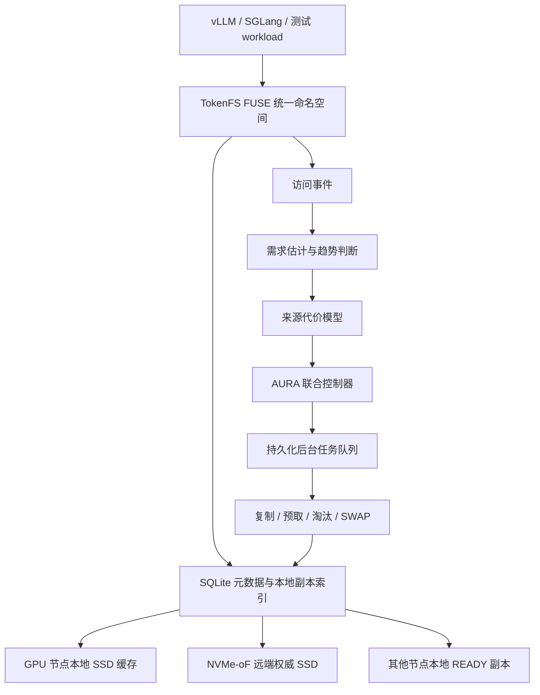

# AURA-KV / TokenFS

> 最新缺口优化：[18组实测速率、p99与逐种子边界](reports/latest/paper-experiments/22_adaptive_control/README.md)。热点场景对共享SIEVE-2hit/1hit分别 **+5.50%/+0.81%**，随机场景 **+2.53%/+2.73%**；但部分种子仍略慢，尾延迟未全面通过，三个严格闭合目标仍未达成。源码、负结果、分段计量和完整证据一并保留。

> 最新SIEVE对照：[18次真实测速与完整证据](reports/latest/paper-experiments/21_burst_reuse_sieve/README.md)。热点变化场景中新版相对原共享SIEVE-2hit **+5.12%（3/3更快）**，相对同期旧完整版+5.44%；对SIEVE-1hit仍−0.28%，随机访问对两种SIEVE仍约−4.8%。新增短期复用预测、7组内容校验与完整审计；仅原SIEVE-2hit先导门槛通过，未证明全面优于SIEVE。

> 最新收尾实测：[热点、亲和、联合与整体速度四表](reports/latest/paper-experiments/20_compact_planning_closeout/README.md)。固定18次测速＋6组内容检查：热点 +8.35%、亲和 +14.65%、联合控制 +5.88%，三个组件比较均3/3提速；完整版本相对基础共享 +19.68%，相对同容量共享SIEVE仍 −1.96%。联合通过本轮先导筛选；强基线、尾延迟及完整版本中热点≥5%的目标仍未闭合。数据完整不等于全部论文主张成立。

> 上一轮小规模优化：[热点、共享亲和和联合控制18次实测](reports/latest/paper-experiments/19_causal_reuse_pilot/README.md)。同版本配对结果：热点 +5.59%、亲和 +7.34%、联合控制 +4.15%，均为3/3种子提速；完整版本相对基础共享 +14.31%，相对同容量共享SIEVE仍 −1.84%。这是开发先导，未证明三个独立创新或真实GPU推理收益；旧轮次正负结果均保留。

> 上一轮大样本补实验：[同版本整体速度、H/J 消融与论文边界](reports/latest/paper-experiments/16_minimal_closeout/README.md)。完成 336 次正式测速、56 项内容检查、28 次开发测速和 12 次描述性边界测速；16 项整体缓存比较中，确认提速 10 项、确认变慢 3 项、未确定 3 项。五个实验亲和开关关闭，共享旧元数据统计仍保留。下方历次结果按各自版本解释，不混算；GPU 亲和和真实推理收益仍未证实。

> 旧亲和版本确认结果：第二轮 288 次正式实测与 48 项内容检查完成。热点跨域交接平均吞吐 +3.36%，但多重比较检验未通过；未证明稳定独立提速，新机制仍为实验性显式选项。见 [创新点二最终实测速率表](reports/latest/paper-experiments/15_affinity_handover/README.md)。前一轮失败确认与所有开发负结果完整保留。

> 亲和修正首轮确认：288 次冻结实测与 48 项内容检查完成。旧版退化得到修复，但新亲和相对关闭亲和尚无确认的独立提速；保留所有负结果，见 [亲和修正与独立验证](reports/latest/paper-experiments/14_affinity_refinement/README.md)。

> 上一轮综合四表：本轮完成 **576 次正式实测、132 项内容验证**，按热点、访问亲和、联合净收益和整体速度给出四张表。组件采用完整策略逐项关闭的对照，实际 MiB/s 与配对统计决定结论；未确定、未触发和退化结果全部保留。范围为三个私有逻辑缓存域与真实 NVMe/TCP 远端，不是物理 GPU 推理，也不代表完整 Python RobustBenefit 已接入。见 [三项机制与整体速度](reports/latest/paper-experiments/13_affinity_joint/README.md)。

> 上一轮 B3 收口：已从原始归档重新审计 756 次性能与 169 项内容验证记录，统计复算一致。当前可支撑的性能贡献是**热点变化下的缓存准入与历史自适应**；GPU 亲和放置仍未获得新版的独立性能验证，measured 路径绕过旧亲和状态门槛。见 [最终结果、可写结论与剩余缺口](reports/latest/paper-experiments/12_paper_closeout/README.md)。预定实验完成不等于两个原始创新点均成立。

> 实验证据修订：历史模拟结果存在首次缺失计账问题，旧真实 `wall_time_s` 是分段耗时和，且基线能力、缓存控制与淘汰触发存在缺口。旧报告保留为历史记录，不能作为当前已验证性能结论。新分类、真实速率口径和验收状态见 [证据驱动实验](docs/evidence-experiments.md)。

> 当前评估使用 **cn7 → cn13** 的独立 NVMe/TCP namespace，cn8 承担独立正确性校验，cn14 停用。配置见 [迁移记录](docs/client-migration-cn7.md)，实验分类与未闭合主张见 [证据对应表](docs/claim-evidence-ledger.md)。旧 cn14 表格及失效批次不能用作新结论。

> 第二轮已完成 **756/756** 次预先固定的速度实验。当前可执行策略是显式启用的 **AURA-adaptive / measured_policy**，默认旧 AURA-core 保留；它是近期需求与实测成本的 C++ 启发式，不等于完整 Python RobustBenefit，也未验证真实多 GPU 推理收益。读 [第二轮完整报告](reports/latest/paper-experiments/11_measured_admission/README.md) 和 [第一轮 400 次结果](reports/latest/paper-experiments/10_real_cn7_evidence/README.md) 时请分开解释，不能跨批次直接比较速度。

```text
面向多 GPU 大模型 KV Cache 的本地 SSD 与 NVMe-oF 远端 SSD 自适应分层缓存系统
```

AURA-KV 是研究控制层，TokenFS 是可挂载的 FUSE 文件系统原型。项目面向大模型推理中的 Prompt Token、Token Shard 和 KV Cache 数据，把 GPU 计算节点本地 SSD 作为低延迟缓存层，把 NVMe-oF 远端 SSD 作为大容量权威层，通过访问价值、缓存保留收益和共享副本放置来减少远端读取和长尾访问代价。

当前仓库按三个板块组织：

| 板块 | 入口 | 用途 |
|---|---|---|
| 代码 | `src/`、`aura_kv/`、`scripts/`、`tests/` | FUSE 原型、AURA-KV 控制器、实验脚本和测试 |
| 说明文档 | [docs/README.md](docs/README.md) | 项目设计、模型公式、实验方法和部署说明 |
| 数据结果 | [三项机制与整体速度四表](reports/latest/paper-experiments/13_affinity_joint/README.md) | 576 次新拓扑冻结速度实验、完整负结果与写作边界 |

## 1. 当前项目定位

大模型推理时，长 Prompt、公共前缀、多轮对话和 Agent 任务会产生大量 KV Cache。GPU 显存最快但容量最紧，本地 SSD 比远端快但空间有限，远端 NVMe-oF SSD 容量大且可共享但存在网络开销。AURA-KV 要回答的问题是：

```text
哪些 KV Cache 值得留在本地？
本地空间满了应该删谁？
共享缓存要不要复制到某些 GPU 节点本地？
复制、预取和淘汰如何不阻塞前台请求？
```

原始设计的两个研究重点，以及本轮单独评估的联合决策，必须区分设计新颖性与实测收益：

1. **价值感知本地缓存管理**：不只按 LRU/LFU 删除缓存，而是估计删除某个本地副本后未来会多付出的访问代价。
2. **多 GPU 共享副本放置**：远端保存权威副本，本地保存热点副本；系统根据访问分布、节点亲和和复制收益决定副本复制到哪里。
3. **联合净收益控制**：同时考虑新副本收益、复制成本与所选旧副本的淘汰损失。本轮仅验证实际 C++ 净收益准入及独立决策对照，不能据此声称完整鲁棒控制器或超加性协同成立。

多 GPU QoS、公共前缀去重和 P99 驱动迁移不再作为当前主要创新点。跨层迁移一致性作为文件系统必要工程能力保留。

## 2. 系统结构



上图是目标结构；C++ FUSE 与 Python 完整控制器的接入边界见下表。当前 C++ 在打开文件时记录访问并判断准入/亲和，再将复制交给后台。异步模式不等待整份复制完成，但前台仍承担元数据、布局锁和共享 I/O 的开销，需以完整任务时间验证净收益。

## 3. 当前完成度

| 模块 | 状态 | 说明 |
|---|---|---|
| TokenFS FUSE 文件系统 | 已实现 | 支持目录、创建、读写、删除、truncate、fsync 等基础文件操作 |
| 本地优先与远端溢写 | 已实现 | 本地配额不足时写入远端后端 |
| SQLite 元数据 | 已实现 | 记录逻辑路径、物理路径、GPU、tier、大小、状态和指标 |
| 价值感知替换 | 分层实现 | Python 有需求估计/来源代价/EvictionLoss；C++ 是独立的 value_aware 启发式，不能共用已验证性能标签 |
| 共享副本放置 | 已实现/部分真实 | 模拟层支持跨 GPU/节点副本放置；真实跨机器实验仍需要更多内网计算节点 |
| 后台任务队列 | 分层实现 | Python 有 SQLite 队列；C++ 为有界内存队列与退出 join；满容量强 SWAP 和复制中断恢复尚未完整验证 |
| 动态监控 | 已实现 | 支持事件流、指标快照、布局快照和本地 Dashboard |
| 真实 TokenFS 速度实验 | 已补充 | 使用实际 FUSE workload 的 wall-clock 时间、吞吐和平均读写延迟验证策略是否真的变快 |
| 双 VM NVMe-oF | 已验证 | 两台 Ubuntu VM 跑通过 Linux NVMe/TCP Host/Target |
| 实验室 NVMe-oF 实验 | cn7 重新评估 | 当前独立远端挂载 `/srv/tokenfs/remote-cn7`；正式批次使用优化构建、独立种子和整批审计，历史 cn14 结果仅保留追溯 |
| 真实 vLLM/SGLang 集成 | 未完成 | 当前结果还不是真实模型 TTFT 结果 |

## 4. 环境边界

当前已经形成三类环境：

| 环境 | 是否真实 NVMe-oF | 用途 | 边界 |
|---|---|---|---|
| 目录模拟环境 | 否 | 开发 FUSE、策略、元数据和测试 | 不能代表真实远端性能 |
| 双 VM NVMe-oF | 是，真实 Linux NVMe/TCP 协议 | 验证 Host/Target、远端挂载和 TokenFS 端到端路径 | 底层是虚拟网络和虚拟磁盘 |
| 单客户端 NVMe-oF | 是，真实 Linux NVMe/TCP 链路 | 测量本地目录与远端 NVMe-oF 挂载目录的差距，并运行 TokenFS 真实速度消融 | 当前结果来自 `cn7 -> cn13`，三个逻辑 GPU 共享客户端磁盘；底层为既有文件系统/loop，非独占裸 NVMe |

论文表述时要区分：策略实验是模拟/代理结果，NVMe-oF baseline 是真实协议链路结果，真实 GPU 推理收益还需要后续接入模型 workload。

### 4.1 当前真实实验形态

```text
cn7 客户端
  ├── Release TokenFS / FUSE
  ├── gpu0 / gpu1 / gpu2：同一客户端磁盘上的三个逻辑缓存域
  └── /srv/tokenfs/remote-cn7 → /dev/nvme1n1 → NVMe/TCP
cn13 远端
  └── 独立 namespace → loop backing file → 既有文件系统
cn8：独立目录后端正确性校验
```

cn14 保持停用。程序与数据使用本次专用目录，不替换原项目或业务盘。前台本地/远端读取均启用 O_DIRECT；后台复制仍为 buffered I/O，目标端缓存和其他任务争用不受控。逻辑 GPU 放置不能证明真实 PCIe/NVLink 或多物理 GPU 收益。

实验分类、对照语义和完整复现命令见 [证据实验方案](docs/evidence-experiments.md)，主张与未闭合部分见 [证据对应表](docs/claim-evidence-ledger.md)。

## 5. 快速开始

推荐 Ubuntu 24.04 LTS：

```bash
sudo apt update
sudo apt install -y build-essential cmake ninja-build pkg-config \
  fuse3 libfuse3-dev sqlite3 libsqlite3-dev libyaml-cpp-dev \
  python3 fio nvme-cli
```

构建：

```bash
cmake -S . -B build -G Ninja -DCMAKE_BUILD_TYPE=Release
cmake --build build
```

初始化开发目录并启动：

```bash
./scripts/reset_dev_state.sh /mnt/tokenfs
./scripts/start_tokenfs.sh config/tokenfs.dev.yaml /mnt/tokenfs
./scripts/tokenfsctl.py status
```

最小读写：

```bash
mkdir -p /mnt/tokenfs/gpu0/demo
printf "hello tokenfs\n" > /mnt/tokenfs/gpu0/demo/a.tokens
cat /mnt/tokenfs/gpu0/demo/a.tokens
./scripts/tokenfsctl.py files
./scripts/stop_tokenfs.sh /mnt/tokenfs
```

## 6. 论文实验入口

当前实际速度先读 [三项机制与整体速度四表](reports/latest/paper-experiments/13_affinity_joint/README.md)，方案见 [本轮冻结确认方案](docs/affinity-joint-confirmation-plan.md)。上一轮 B3 与本轮访问拓扑不同，结果不合并。

第一轮 [cn7 正式实测报告](reports/latest/paper-experiments/10_real_cn7_evidence/README.md) 的冻结矩阵按实际 C++ 实现划分：整体对照、价值淘汰、亲和放置、价值×亲和交互、趋势、收益准入、预取、异步执行。每项都用相同 trace/字节/配额下的外层任务耗时和 MiB/s 判定；内部命中率和复制量只作解释。

```bash
# Linux/FUSE；先按 docs/evidence-experiments.md 建立独立数据目录并运行完整批次
python3 scripts/evidence_audit.py /path/to/formal-batch
python3 scripts/evidence_report.py /path/to/formal-batch
python3 scripts/evidence_figures.py /path/to/formal-batch /path/to/figures
```

正式程序使用 Release 构建，运行前完成独立全内容正确性验证。报告保留每次 trace、配置、请求、动作、结果、哈希与失败记录；缺组、数据不一致或失效标记会阻止统计。置信区间与检验按预先固定的配对方案计算，退化与无明确收益的组件同样报告。

`paper_experiments.py` 仍可生成 Python 模拟/代理研究结果；`lab_single_client_multigpu_experiment.sh` 和 cn14 三轮报告为历史入口。修复前模拟计账、弱基线及分段求和计时影响旧结论，不能作为新论文速度证据。历史数据保留在 `01_trace_replay/` 至 `09_real_cn14_nvmeof/`，不与 cn7 正式批次合并。

当前 C++ 的 AURA-core 是启发式原型，不能用它的速度表替代完整 Python RobustBenefit 模型的实测。真实推理 TTFT、生产 trace、多物理 GPU、满容量强 SWAP 和复制中断恢复尚未完成对应验证。若一个消融只改善命中率而没有净速度收益，就不作为已验证性能贡献。

## 7. 常用测试

```bash
# Python 与实验证据回归
python3 -m unittest tests.aura_kv_unit_test tests.evidence_test

# Release C++ 回归（包含 GetAttr 竞态）
ctest --test-dir build --output-on-failure

# 历史模拟/代理实验，不代表真实加速
python3 scripts/paper_experiments.py

# 历史 TokenFS 速度入口；正式评估使用 evidence_benchmark.py
TOKENFS_CONFIG=config/tokenfs.nvmeof.yaml ./scripts/real_speed_benchmark.sh

# 历史三轮入口，不能替代新配对检验
TOKENFS_CONFIG=config/tokenfs.nvmeof.yaml ./scripts/real_speed_repeat_benchmark.sh

# 检查当前环境本地/远端是否存在足够性能差距
TOKENFS_CONFIG=config/tokenfs.nvmeof.yaml ./scripts/nvmeof_gap_diagnostic.sh

# 只读检查老师物理 NVMe-oF Target 是否能从当前客户端直连
./scripts/lab_network_probe.sh --target-ip 28.10.10.13 --port 4420

# TokenFS 基础功能，需 Linux/FUSE
./scripts/smoke_test.sh
./scripts/integration_test.sh

# 双 VM NVMe-oF，需两台 Linux VM
./scripts/nvmeof_two_vm_test.sh <TARGET_IP>
./scripts/nvmeof_perf_test.sh <TARGET_IP>
```

macOS 主机上主要运行 Python 策略测试；FUSE 和 NVMe-oF 脚本应在 Ubuntu VM 或实验室服务器上运行。

## 8. 真实 NVMe-oF 接入

远端接入脚本已经配置化：

```bash
cp config/tokenfs.nvmeof.example.yaml config/tokenfs.nvmeof.yaml
./scripts/lab_network_probe.sh --config config/tokenfs.nvmeof.yaml --target-ip 28.10.10.13 --port 4420
./scripts/connect_nvme.sh --config config/tokenfs.nvmeof.yaml --dry-run
sudo ./scripts/connect_nvme.sh --config config/tokenfs.nvmeof.yaml --backend remote0 --chown-current
```

真实环境需要在 `config/tokenfs.nvmeof.yaml` 中填写：

```yaml
type: nvmeof
nvme_target_ip: "<SSD Target IP>"
nvme_subnqn: "<Subsystem NQN>"
nvme_device: "/dev/nvmeXnY"
nvme_mount: /srv/tokenfs/remote0
```

如果只是复测已有远端设备，可运行：

```bash
AURA_REMOTE_DEVICE=/dev/nvmeXnY \
AURA_LOCAL_READ_DEVICE=/dev/nvme0n1 \
./scripts/real_nvmeof_baseline.sh
```

只对专用测试 Namespace 或 backing file 做写测试，不要对已有业务盘写 fio。

## 9. 文档与结果

从这里读：

- [docs/README.md](docs/README.md)：最终文档导航。
- [docs/system-design.md](docs/system-design.md)：系统架构、数据生命周期和一致性。
- [docs/model-and-controller.md](docs/model-and-controller.md)：需求估计、来源代价、EvictionLoss、ReplicaGain、RobustBenefit 和控制器。
- [docs/experiments.md](docs/experiments.md)：实验设计、指标、结果解释和论文边界。
- [docs/deployment.md](docs/deployment.md)：配置、脚本和 NVMe-oF 部署。
- [cn7 正式实测报告](reports/latest/paper-experiments/10_real_cn7_evidence/README.md)：第一轮历史结果报告。

旧的零散编号文档已经合并到上述文档中。以后新增内容优先更新这些最终入口，避免文档再次发散。
