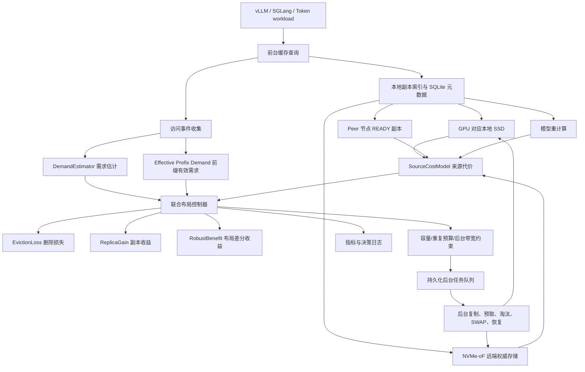

# AURA-KV / TokenFS

```text
面向多 GPU 大模型 KV Cache 的本地 SSD 与 NVMe-oF 远端 SSD 自适应分层缓存系统
```

AURA-KV 是研究控制层，TokenFS 是可挂载的 FUSE 文件系统原型。项目面向大模型推理中的 Prompt Token、Token Shard 和 KV Cache 数据，把计算节点本地 SSD 作为低延迟缓存层，把 NVMe-oF 远端 SSD 作为大容量权威层，在容量、延迟、共享和可靠性之间做在线取舍。

当前仓库已经形成两类可复现实验环境：

- 目录模拟环境：用于开发 FUSE、SQLite 元数据、本地配额、远端溢写、缓存替换和副本放置策略。
- 双 VM NVMe-oF 环境：使用两台 Ubuntu VM 跑通真实 Linux NVMe/TCP Host/Target 协议链路，TokenFS 的远端层挂载到真实 NVMe-oF Namespace 上。
- 实验室远端准备环境：已在 `cn13` 上创建 64GiB backing file，作为后续真实 NVMe/TCP Target 的文件后端；尚未开放 4420，等待内网客户端直连。

需要明确的是，双 VM 环境验证的是 NVMe-oF 协议接入和 TokenFS 端到端路径，底层仍是虚拟机网络和 loop/虚拟磁盘；它可以作为论文前期系统验证和方法论实验，不应直接宣称为真实物理 SSD/GPU 集群性能。

当前真实环境边界：

```text
本地 VM:
  tokenfs-dev / tokenfs-target
  用于开发、双 VM NVMe/TCP 功能验证和策略模拟

实验室服务器:
  cn13
  Ubuntu 24.04 LTS, x86_64
  远端 IP: 28.10.10.13
  backing file: /home/wjxt/aura-kv-nvmeof/aura-remote0.img
  size: 64 GiB

尚未完成:
  本地 VM 目前不能直连 cn13:4420
  cn13 尚未导出 NVMe/TCP Target
  真实性能测试需要放到能访问 cn13:4420 的内网客户端
```

## 1. 项目解决的问题

大模型推理通常包含两个阶段：

- Prefill：处理输入 Prompt，生成整段上下文的 Key/Value 中间状态。
- Decode：逐 token 生成答案，并复用已有 Key/Value。

这些 Key/Value 中间状态就是 KV Cache。长上下文、公共系统提示词、多轮对话和 Agent 任务会让 KV Cache 变大。GPU 显存最快但容量最紧，本地 SSD 比远端快但容量有限，远端 NVMe-oF SSD 容量大且可共享但有网络长尾。AURA-KV 要解决的是：

```text
哪些缓存应该留在本地？
哪些缓存可以只放远端？
哪些共享缓存值得复制到某些 GPU 节点本地？
当本地空间满了，删谁才最不亏？
```

## 2. 总体架构



前台数据路径负责当前请求，发现本地未命中时立即选择本地、Peer、远端或重计算来源，不等待后台控制器。后台控制路径根据访问统计和代价模型决定后续布局，例如创建本地副本、删除低价值副本或预取连续 shard。布局动作不会直接修改数据，而是先进入持久化后台任务队列，再由执行器复制、校验、提交或取消。

## 3. 核心设计概览

### 3.1 代价驱动型本地缓存替换

本地 SSD 满了不能只按 LRU 或 LFU 删除。AURA-KV 会估计删除某个本地副本之后，未来访问会多付出多少代价：

```text
EvictionLoss = 未来需求上界 * 删除后最优来源变慢的幅度
```

删除使用需求上界，原因是删除是危险动作：如果低估未来需求，就会误删热点缓存。无远端权威副本、无 peer 副本且不可重算的数据不能删除。

### 3.2 共享感知的副本放置

共享缓存不一定复制，复制也不是越多越好。AURA-KV 会估计一个新副本 READY 之后，在剩余窗口里能节省多少访问代价：

```text
ReplicaGain = 副本 READY 后的未来需求下界 * 新副本带来的来源代价下降
```

新增副本使用需求下界，原因是复制是消耗本地空间和后台带宽的动作，只有保守估计仍然划算才执行。同一物理节点上的多个 GPU 共用一份物理本地副本，避免无意义重复。

### 3.3 前台访问与后台执行解耦

一次前台访问只做两件事：

```text
1. 尽快返回当前请求需要的数据；
2. 记录访问事件，供后台控制器判断后续布局。
```

后台控制器会把动作写成任务：

| 任务 | 作用 |
|---|---|
| PROMOTE | 当前 GPU 节点频繁访问远端缓存时，把副本提升到本地 |
| PREFETCH | 根据连续访问或预测提前拉取下一批缓存 |
| REPLICATE | 在指定节点创建本地副本 |
| EVICT | 删除低价值本地副本 |
| SWAP | 先复制高价值副本，再删除低价值副本 |

任务状态是：

```text
PENDING -> RUNNING -> VERIFYING -> COMMITTED
                 \-> FAILED / CANCELED
```

SWAP 使用依赖任务保证安全：新副本没有复制并校验成功之前，旧副本不会删除。任务还带有 `layout_version`，如果执行时布局已经变化，就取消旧任务，避免用过期判断修改当前布局。

## 4. 当前实现状态

| 模块 | 状态 | 说明 |
|---|---|---|
| TokenFS FUSE 文件系统 | Implemented | `src/main.cpp`，支持常见文件操作和目录后端 |
| SQLite 元数据 | Implemented | `files`、`metrics`、`gpu_access`、`local_replicas` 等表 |
| 本地优先与远端溢写 | Implemented | 本地配额不足时写入 remote 后端目录 |
| 远端主副本 + 本地热缓存 | Implemented / Partial | 目录后端和双 VM NVMe-oF 均已跑通；真实物理 SSD/GPU 集群尚未验证 |
| GPU 访问统计与跨 GPU 本地副本 | Implemented | `TOKENFS_GPU_ID`、访问窗口、亲和状态、本地副本表 |
| 需求估计 | Implemented | `GammaPoissonDemandEstimator`、`EWMADemandEstimator`、`DualWindowDemandEstimator`、模拟用 `OracleDemandEstimator` |
| 来源代价模型 | Implemented | 本地、Peer、远端、重计算代价分解 |
| EvictionLoss / ReplicaGain | Implemented | `aura_kv/layout.py` |
| RobustBenefit | Implemented / Partial | ADD/REMOVE 已实现；SWAP 已有任务依赖安全原型，真实多进程恢复待硬件验证 |
| 容量与重复预算约束 | Implemented | `LayoutConstraints` |
| 后台带宽和 SLO 门控 | Partial | 字段和检查存在，真实 metrics 尚未接入 |
| 持久化后台任务队列 | Implemented | `aura_kv/tasks.py`，SQLite 记录任务、状态、依赖、重试、校验和布局版本 |
| 后台执行器 | Implemented / Partial | `aura_kv/executor.py`，目录后端可执行复制、校验、淘汰和 SWAP 依赖；真实远端由 NVMe-oF 挂载目录替换 |
| 联合控制器 | Implemented / Partial | `aura_kv/controller.py`，前台访问可生成 PROMOTE/PREFETCH/REPLICATE/EVICT/SWAP 任务计划 |
| 迁移执行和崩溃恢复 | Implemented / Partial | TokenFS 有临时文件/状态恢复；AURA-KV Python 层有持久化任务队列和目录执行器 |
| NVMe-oF 接入 | Implemented / Partial | 脚本支持 connect/dry-run/two-VM；双 VM Linux NVMe/TCP 已验证，真实物理 SSD Target 尚未验证 |
| 统一指标与动态监控 | Implemented / Partial | `aura_kv/monitoring.py`、`aura_kv/dashboard.py`、`scripts/aura_kv_monitor.py`，支持 JSONL 事件、指标快照、布局快照和本地 Dashboard |
| Trace simulator | Implemented | 8 个场景、16 个策略或 baseline，支持论文友好策略命名和旧名兼容 |
| 真实 GPU/vLLM/SGLang 集成 | Planned | 需要真实集群环境 |

更细的模块清单见 [docs/14_implementation_status.md](docs/14_implementation_status.md)。

## 5. 仓库结构

```text
tokenfs/
├── src/main.cpp                 # TokenFS FUSE 主程序
├── aura_kv/                     # AURA-KV 策略、代价模型和模拟器
├── config/                      # 开发配置与 AURA-KV 配置模板
├── scripts/                     # 启停、测试、NVMe-oF、实验脚本
├── tests/                       # AURA-KV 单元性质测试
├── docs/                        # 编号式设计文档
└── reports/latest/              # 最新模拟或开发实验结果
```

## 6. 快速开始

### 6.1 环境要求

推荐 Ubuntu 24.04 LTS。TokenFS 构建需要：

```bash
sudo apt update
sudo apt install -y build-essential cmake ninja-build pkg-config \
  fuse3 libfuse3-dev sqlite3 libsqlite3-dev libyaml-cpp-dev \
  python3 fio nvme-cli
```

### 6.2 构建 TokenFS

```bash
cmake -S . -B build -G Ninja
cmake --build build
```

### 6.3 初始化开发目录

```bash
./scripts/reset_dev_state.sh /mnt/tokenfs
```

该命令会创建 `/var/lib/tokenfs/local`、`/var/lib/tokenfs/remote-sim` 和 SQLite 元数据目录。

### 6.4 启动与停止

```bash
./scripts/start_tokenfs.sh config/tokenfs.dev.yaml /mnt/tokenfs
./scripts/tokenfsctl.py status
./scripts/stop_tokenfs.sh /mnt/tokenfs
```

### 6.5 最小可运行示例

```bash
mkdir -p /mnt/tokenfs/gpu0/demo
printf "hello tokenfs\n" > /mnt/tokenfs/gpu0/demo/a.tokens
cat /mnt/tokenfs/gpu0/demo/a.tokens
./scripts/tokenfsctl.py files
./scripts/tokenfsctl.py metrics
```

## 7. 配置入口

- `config/tokenfs.dev.yaml`：TokenFS 开发配置，包含 FUSE 挂载点、SQLite 路径、GPU 本地目录、远端后端和 NVMe-oF 占位字段。
- `config/aura_kv.example.yaml`：AURA-KV 需求估计、代价模型、预算和模拟器配置模板。

真实 NVMe-oF 接入时主要修改 `config/tokenfs.dev.yaml` 中 `backends.remote0` 的：

```yaml
type: nvmeof
nvme_target_ip: "<SSD Target IP>"
nvme_subnqn: "<Subsystem NQN>"
nvme_device: "/dev/nvmeXnY"
nvme_mount: /srv/tokenfs/remote0
```

详细说明见 [docs/10_storage_and_nvmeof.md](docs/10_storage_and_nvmeof.md)。

## 8. 测试命令

```bash
# AURA-KV 单元测试和模拟器冒烟测试
./scripts/aura_kv_test.sh

# TokenFS 基础功能
./scripts/smoke_test.sh
./scripts/integration_test.sh
./scripts/v2_integration_test.sh

# 策略、淘汰、预取、迁移和一致性
./scripts/advanced_policy_test.sh
./scripts/eviction_test.sh
./scripts/promote_test.sh
./scripts/prefetch_test.sh
./scripts/consistency_test.sh
```

部分 FUSE/NVMe-oF 脚本需要 Linux、sudo、FUSE 或 nvme-cli；在 macOS 主机上只建议跑 Python 模拟和文档检查。

## 9. 模拟实验

```bash
python3 scripts/aura_kv_sim.py --output reports/latest/aura-kv-sim
```

输出：

```text
reports/latest/aura-kv-sim/aura_sim_report.md
reports/latest/aura-kv-sim/aura_sim_results.csv
reports/latest/aura-kv-sim/aura_sim_results.json
```

所有模拟结果都标记为：

```text
SIMULATED RESULT
```

它们只能证明策略逻辑和趋势，不代表真实 NVMe-oF 或真实 GPU 集群性能。真实协议链路结果请看 `reports/latest/final-report.md` 和 `reports/latest/report.md`。

## 10. 动态监控与统一指标

除了离线模拟报告，AURA-KV 现在也可以在 workload 运行时持续输出结构化事件和轻量级 Dashboard。它的作用不是制造一个固定演示，而是让正常 workload 的每一步都可观察：

```text
前台请求到达
  -> 缓存查询
  -> 控制器候选动作
  -> 后台任务状态变化
  -> 布局版本变化
  -> 指标快照更新
```

### 10.1 启动 workload 并打开 Dashboard

```bash
python3 scripts/aura_kv_monitor.py run \
  --workload hotspot-migration \
  --policy AURA-Joint \
  --dashboard
```

启动后终端会打印：

```text
AURA-KV is running
Mode: SIMULATED
Dashboard: http://127.0.0.1:8765
Logs: reports/latest/aura-kv-live/<run-id>
Latency: PROXY / SIMULATED, not real TTFT
```

在浏览器打开 Dashboard 地址，可以看到：

- 当前运行状态、事件数、运行目录和最新更新时间。
- 本地命中、Peer 命中、远端读取、重计算、迁移字节数、重复副本字节数。
- 前台请求流：每个请求命中了本地、Peer、远端还是重计算。
- 控制器周期：每轮候选动作、接受或拒绝原因、估计收益和损失。
- 后台任务队列：复制、预取、淘汰、SWAP 的状态变化。
- Node x Cache 布局矩阵：每个缓存在哪些节点有本地副本。
- 时间序列：请求量、本地命中率、远端流量和后台迁移变化。
- Trace 搜索：按 request、cache、task、action 或 error 过滤事件。

### 10.2 不打开 Dashboard，只生成结果

```bash
python3 scripts/aura_kv_monitor.py run \
  --workload shared-prefix \
  --policy AURA-Joint \
  --no-wait
```

每次运行会生成一个独立目录：

```text
reports/latest/aura-kv-live/<run-id>/
├── manifest.json              # 本次运行的配置、模式和状态
├── events.jsonl               # 统一事件流，每行一个事件
├── metrics.jsonl              # 每个事件后的累计指标快照
├── layout_snapshots.jsonl     # 布局矩阵快照
├── results.json               # 本次 workload 汇总结果
├── results.csv                # 表格版结果
└── state.json                 # Dashboard 可直接读取的聚合状态
```

### 10.3 查看历史运行

如果 workload 已经结束，也可以单独打开历史 Dashboard：

```bash
python3 scripts/aura_kv_monitor.py dashboard \
  --run-dir reports/latest/aura-kv-live/<run-id> \
  --port 8765
```

也可以只导出聚合状态：

```bash
python3 scripts/aura_kv_monitor.py export \
  --run-dir reports/latest/aura-kv-live/<run-id>
```

### 10.4 当前支持的 workload

| workload 名称 | 用途 |
|---|---|
| `shared-prefix` | 多请求共享公共前缀，观察共享缓存是否值得放本地 |
| `hotspot-migration` | 热点从一个节点迁移到另一个节点，观察副本布局调整 |
| `local-capacity-pressure` | 本地容量紧张，观察淘汰和远端回退 |
| `remote-congestion-change` | 远端访问代价升高，观察本地副本收益变化 |
| `mixed-object-size` | 大小混合缓存，观察收益密度和容量利用 |

注意：当前 Dashboard 中的延迟、P99 和 TTFT 仍是模拟器代理指标。它们可以用来检查策略链路是否闭环、候选动作是否合理、结果是否可解释，但不能直接写成真实 GPU 推理收益。双 VM NVMe-oF 性能结果属于真实协议链路结果，但底层不是物理 SSD 集群。

## 11. 文档入口

从 [docs/README.md](docs/README.md) 开始阅读。常用入口：

- 项目背景：[docs/02_background_and_problem.md](docs/02_background_and_problem.md)
- 系统架构：[docs/03_system_architecture.md](docs/03_system_architecture.md)
- 数据生命周期：[docs/04_data_model_and_lifecycle.md](docs/04_data_model_and_lifecycle.md)
- 正式代价模型：[docs/06_cost_model.md](docs/06_cost_model.md)
- 替换策略：[docs/07_replacement_policy.md](docs/07_replacement_policy.md)
- 副本放置：[docs/08_replica_placement.md](docs/08_replica_placement.md)
- 联合控制器：[docs/09_joint_controller.md](docs/09_joint_controller.md)
- 实现状态：[docs/14_implementation_status.md](docs/14_implementation_status.md)

## 12. 当前限制

- 双 VM NVMe/TCP Host/Target 已经接入并完成性能基线；真实物理 NVMe-oF SSD、真实 GPU、vLLM/SGLang 尚未接入当前测试结果。
- AURA-KV 的 Python 控制器、任务队列和目录执行器已经闭环，但还没有直接嵌入 TokenFS C++ 主进程。
- 动态 Dashboard 已能展示 AURA-KV Python 模拟和控制事件，TokenFS C++ 主进程尚未直接输出同一套 `AuraEvent` JSONL。
- `RobustBenefit` 已有 ADD/REMOVE 与 SWAP 任务依赖原型；真实 NVMe-oF、多进程崩溃和硬件断电仍需要真实环境验证。
- TokenFS 使用 FUSE 和目录后端，适合作为原型和实验入口，不代表最终生产数据路径。
- 当前报告分为两类：双 VM NVMe-oF 的 FIO/TokenFS 指标是真实协议链路测量；AURA-KV 策略对比、Dashboard TTFT 和命中率仍为模拟或代理结果。

## 13. 双 VM NVMe-oF 复现实验

当前已验证的本地双 VM 拓扑：

```text
tokenfs-dev     192.168.64.2  TokenFS / NVMe-oF Host
tokenfs-target  192.168.64.3  Linux nvmet / NVMe-oF Target
```

Target 端：

```bash
cd ~/projects/tokenfs
sudo ./scripts/setup_nvme_target.sh --target-ip 0.0.0.0 --size 20G
```

Client 端：

```bash
cd ~/projects/tokenfs
./scripts/nvmeof_two_vm_test.sh 192.168.64.3
./scripts/nvmeof_perf_test.sh 192.168.64.3
```

最新统一结果入口：

```text
reports/latest/final-report.md
reports/latest/report.md
reports/latest/summary.csv
reports/latest/strategy-matrix/strategy_summary.csv
```

## 14. 真实物理集群接入路线

1. 获得 SSD Target IP、端口、Subsystem NQN、Host NQN/ACL、Namespace 是否独占、设备路径和挂载点。
2. 在配置文件中填写真实值。
3. 先运行 dry-run：

```bash
./scripts/connect_nvme.sh --config config/tokenfs.dev.yaml --dry-run
```

4. 真实连接并挂载：

```bash
./scripts/connect_nvme.sh --config config/tokenfs.dev.yaml
```

5. 使用 `fio`、Token workload 和 TokenFS 指标重新采集本地/远端延迟、带宽、P95/P99 和后台迁移干扰。
