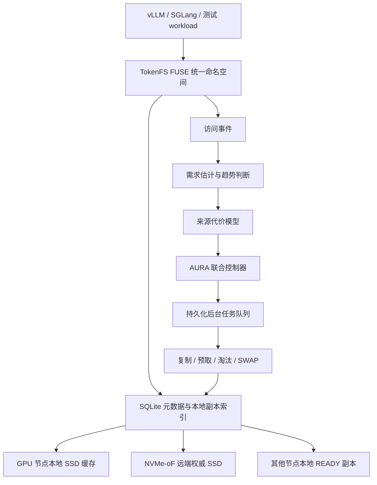

# AURA-KV / TokenFS

```text
面向多 GPU 大模型 KV Cache 的本地 SSD 与 NVMe-oF 远端 SSD 自适应分层缓存系统
```

AURA-KV 是研究控制层，TokenFS 是可挂载的 FUSE 文件系统原型。项目面向大模型推理中的 Prompt Token、Token Shard 和 KV Cache 数据，把 GPU 计算节点本地 SSD 作为低延迟缓存层，把 NVMe-oF 远端 SSD 作为大容量权威层，通过访问价值、缓存保留收益和共享副本放置来减少远端读取和长尾访问代价。

当前仓库按三个板块组织：

| 板块 | 入口 | 用途 |
|---|---|---|
| 代码 | `src/`、`aura_kv/`、`scripts/`、`tests/` | FUSE 原型、AURA-KV 控制器、实验脚本和测试 |
| 说明文档 | [docs/README.md](docs/README.md) | 项目设计、模型公式、实验方法和部署说明 |
| 数据结果 | [reports/latest/final-report.md](reports/latest/final-report.md) | 最新统一结果报告和论文实验结果 |

## 1. 当前项目定位

大模型推理时，长 Prompt、公共前缀、多轮对话和 Agent 任务会产生大量 KV Cache。GPU 显存最快但容量最紧，本地 SSD 比远端快但空间有限，远端 NVMe-oF SSD 容量大且可共享但存在网络开销。AURA-KV 要回答的问题是：

```text
哪些 KV Cache 值得留在本地？
本地空间满了应该删谁？
共享缓存要不要复制到某些 GPU 节点本地？
复制、预取和淘汰如何不阻塞前台请求？
```

当前保留两个研究重点：

1. **价值感知本地缓存管理**：不只按 LRU/LFU 删除缓存，而是估计删除某个本地副本后未来会多付出的访问代价。
2. **多 GPU 共享副本放置**：远端保存权威副本，本地保存热点副本；系统根据访问分布、节点亲和和复制收益决定副本复制到哪里。

多 GPU QoS、公共前缀去重和 P99 驱动迁移不再作为当前主要创新点。跨层迁移一致性作为文件系统必要工程能力保留。

## 2. 系统结构



前台路径只负责尽快返回当前请求：本地命中就读本地，本地没有就从 Peer 或远端读取。后台控制器根据访问事件决定后续是否复制、预取或淘汰。这样前台请求不会被大文件迁移直接拖慢。

## 3. 当前完成度

| 模块 | 状态 | 说明 |
|---|---|---|
| TokenFS FUSE 文件系统 | 已实现 | 支持目录、创建、读写、删除、truncate、fsync 等基础文件操作 |
| 本地优先与远端溢写 | 已实现 | 本地配额不足时写入远端后端 |
| SQLite 元数据 | 已实现 | 记录逻辑路径、物理路径、GPU、tier、大小、状态和指标 |
| 价值感知替换 | 已实现 | 支持需求估计、来源代价、EvictionLoss、收益密度和多 baseline 对比 |
| 共享副本放置 | 已实现/部分真实 | 模拟层支持跨 GPU/节点副本放置；真实跨机器实验仍需要更多内网计算节点 |
| 后台任务队列 | 已实现 | SQLite 持久化任务，支持复制、预取、淘汰、SWAP、重试和布局版本检查 |
| 动态监控 | 已实现 | 支持事件流、指标快照、布局快照和本地 Dashboard |
| 真实 TokenFS 速度实验 | 已补充 | 使用实际 FUSE workload 的 wall-clock 时间、吞吐和平均读写延迟验证策略是否真的变快 |
| 双 VM NVMe-oF | 已验证 | 两台 Ubuntu VM 跑通过 Linux NVMe/TCP Host/Target |
| 实验室 NVMe-oF 实验 | 已完成单客户端复测 | 已在 `cn14` 客户端直连 `cn13:4420`，远端 `/dev/nvme3n1` 通过 NVMe/TCP 挂载到 `/srv/tokenfs/remote0`，并完成环境差距、单轮消融和三轮重复实验 |
| 真实 vLLM/SGLang 集成 | 未完成 | 当前结果还不是真实模型 TTFT 结果 |

## 4. 环境边界

当前已经形成三类环境：

| 环境 | 是否真实 NVMe-oF | 用途 | 边界 |
|---|---|---|---|
| 目录模拟环境 | 否 | 开发 FUSE、策略、元数据和测试 | 不能代表真实远端性能 |
| 双 VM NVMe-oF | 是，真实 Linux NVMe/TCP 协议 | 验证 Host/Target、远端挂载和 TokenFS 端到端路径 | 底层是虚拟网络和虚拟磁盘 |
| 单客户端 NVMe-oF | 是，真实 Linux NVMe/TCP 链路 | 测量本地目录与远端 NVMe-oF 挂载目录的差距，并运行 TokenFS 真实速度消融 | 最新主结果来自实验室 `cn14 -> cn13`，多 GPU 仍为同一客户端内的逻辑 GPU |

论文表述时要区分：策略实验是模拟/代理结果，NVMe-oF baseline 是真实协议链路结果，真实 GPU 推理收益还需要后续接入模型 workload。

### 4.1 当前推荐真实实验形态

在老师只提供一台远端 NVMe-oF 存储服务器、暂时没有多台真实 GPU 计算节点时，当前已经采用的论文前实验形态是：

```text
cn14 内网客户端
  ├── TokenFS / AURA-KV / FUSE
  ├── /gpu0 -> 本地缓存目录 /var/lib/tokenfs/local/gpu0
  ├── /gpu1 -> 本地缓存目录 /var/lib/tokenfs/local/gpu1
  ├── /gpu2 -> 本地缓存目录 /var/lib/tokenfs/local/gpu2
  └── /srv/tokenfs/remote0 -> 真实远端 NVMe-oF 挂载目录 /dev/nvme3n1

cn13 远端 NVMe/TCP Target / Storage
  └── Linux NVMe/TCP Target -> 远端 SSD 或安全测试后端
```

这不是“纯模拟”：远端容量层和 NVMe-oF 协议链路必须是真实的。它也不是“完整多物理 GPU 集群”：`gpu0/gpu1/gpu2` 是同一客户端里的逻辑 GPU 节点，用来验证访问分布、亲和副本、价值感知淘汰和后台迁移机制。

当前网络排查结论是：本地两台 UTM VM 已从 `Shared` NAT 改为 `Bridged` 桥接模式，并获得校园网地址：

```text
tokenfs-dev     172.26.3.29/17
tokenfs-target  172.26.23.154/17
```

桥接后，两台本地 VM 到老师存储网仍然不能直连 `28.10.10.13:4420`，因此它们不再作为主实验客户端。主实验已切换到老师提供的 `cn14`，该机器位于存储网内，可以直连 `cn13:4420` 并完成 NVMe/TCP 连接。

最新真实 NVMe-oF 证据：

```text
客户端：cn14
远端 Target：28.10.10.13:4420
Subsystem NQN：nqn.2026-09.local.aura-kv:remote0
远端块设备：/dev/nvme3n1
远端挂载点：/srv/tokenfs/remote0
文件系统：ext4, noatime
```

SSH 跳板只用于登录管理，不参与本次数据面。真实结果中的 TokenFS 远端后端是 `cn14` 通过 Linux NVMe/TCP 直接连接 `cn13:4420` 后挂载得到的目录，不是 SSH tunnel。

该形态能支撑的结论：

| 能支撑 | 不能直接支撑 |
|---|---|
| FUSE + TokenFS 真实可运行 | 真实 vLLM/SGLang TTFT 已降低 |
| 远端层通过实验室 NVMe-oF 真实接入 | 多台物理 GPU 服务器并发结果 |
| AURA / LRU / LFU / LocalFirst 在同一 workload 下的真实 wall-clock 对比 | 生产级多客户端一致性 |
| 多逻辑 GPU 的亲和副本和缓存淘汰机制是否生效 | NUMA、真实 GPU PCIe 拓扑收益 |

统一实验入口：

```bash
./scripts/lab_network_probe.sh --config config/tokenfs.nvmeof.yaml --target-ip 28.10.10.13 --port 4420
cp config/tokenfs.cn14.example.yaml config/tokenfs.cn14.yaml
TOKENFS_CONFIG=config/tokenfs.cn14.yaml ./scripts/lab_single_client_multigpu_experiment.sh /home/wjxt/aura-kv/reports/real-nvmeof-cn14
```

脚本会按顺序完成：

```text
网络和环境检查
-> 确认 /srv/tokenfs/remote0 必须来自 /dev/nvme* 挂载
-> 记录 nvme list、findmnt、df、lsblk 证据
-> 运行本地/远端差距诊断
-> 运行单轮真实速度消融
-> 运行三轮重复真实速度消融
-> 生成统一汇总报告
```

输出位置：

```text
reports/latest/paper-experiments/09_real_cn14_nvmeof/
├── lab_single_client_multigpu_report.md
├── environment_evidence.txt
├── 01_environment_gap/
├── 02_single_run_speed/
├── 03_repeat_speed/          # 优化前重复实验，保留作历史对照
└── 06_optimized_repeat/      # 当前论文主引用重复实验
```

论文里可以把它写成“单客户端多逻辑 GPU + 实验室真实远端 NVMe-oF 容量层实验”。这个表述准确，也足够让老师看懂当前实验边界。

## 5. 快速开始

推荐 Ubuntu 24.04 LTS：

```bash
sudo apt update
sudo apt install -y build-essential cmake ninja-build pkg-config \
  fuse3 libfuse3-dev sqlite3 libsqlite3-dev libyaml-cpp-dev \
  python3 fio nvme-cli
```

构建：

```bash
cmake -S . -B build -G Ninja
cmake --build build
```

初始化开发目录并启动：

```bash
./scripts/reset_dev_state.sh /mnt/tokenfs
./scripts/start_tokenfs.sh config/tokenfs.dev.yaml /mnt/tokenfs
./scripts/tokenfsctl.py status
```

最小读写：

```bash
mkdir -p /mnt/tokenfs/gpu0/demo
printf "hello tokenfs\n" > /mnt/tokenfs/gpu0/demo/a.tokens
cat /mnt/tokenfs/gpu0/demo/a.tokens
./scripts/tokenfsctl.py files
./scripts/stop_tokenfs.sh /mnt/tokenfs
```

## 6. 论文实验入口

当前最重要的统一实验入口：

```bash
python3 scripts/paper_experiments.py
```

它一次生成四类结果：

| 实验 | 输出目录 | 作用 | 结果性质 |
|---|---|---|---|
| Trace 回放 | `reports/latest/paper-experiments/01_trace_replay/` | 比较 AURA-Joint 与 RemoteOnly、LocalFirst、LRU/LFU 等策略 | 模拟结果 |
| 端到端延迟代理 | `reports/latest/paper-experiments/02_e2e_latency/` | 比较本地、Peer、远端和后台动作共同造成的请求代价 | 代理结果 |
| 参数敏感性 | `reports/latest/paper-experiments/03_sensitivity/` | 扫描本地容量、远端 P99、副本预算，验证策略稳定性 | 模拟结果 |
| NVMe-oF baseline | `reports/latest/paper-experiments/04_nvmeof_baseline/` | 汇总已有真实 NVMe/TCP 基线 | 真实链路摘要 |
| 单客户端多逻辑 GPU + 真实 NVMe-oF | `reports/latest/paper-experiments/09_real_cn14_nvmeof/` | 当前主实验结果，串联环境证据、差距诊断、单轮速度和三轮重复速度 | 最新真实系统结果 |

统一报告：

```text
reports/latest/paper-experiments/paper_experiments_report.md
```

当前关键结果：

| 策略 | 本地命中率 | 远端读取 | P99 代理延迟 | 综合代价/请求 |
|---|---:|---:|---:|---:|
| RemoteOnly | 0.0000 | 2244.77 MiB | 9.0188 ms | 3.1889 |
| LRU-Local | 0.7362 | 400.62 MiB | 3.0247 ms | 1.7085 |
| LFU-Local | 0.7586 | 380.31 MiB | 3.0594 ms | 1.5691 |
| DualWindowReplacement | 0.8907 | 146.15 MiB | 1.4685 ms | 0.7717 |
| AURA-Joint | 0.8822 | 228.31 MiB | 1.4749 ms | 0.5376 |

`AURA-Joint` 不追求单项指标永远第一，而是降低综合服务代价：前台访问延迟、远端读取、Peer 读取、后台迁移、重复副本空间和副本创建/删除抖动。真实速度实验中，如果 AURA 已经显著减少远端读取但总耗时没有提升，不能通过构造极端 workload 来证明策略，而要回到两个根因：

1. **实现开销是否过大**：前台读写是否被 SQLite 指标写入、同步提升、同步副本复制或后台淘汰拖慢。
2. **环境差距是否真实**：当前本地 SSD 与 NVMe-oF 远端 SSD 的读写差距是否足够大，是否被页缓存、虚拟化或同宿主机路径抹平。

因此当前代码采用更保守的在线决策：远端对象不会因为“读过两次”就立刻搬到本地，而是同时满足复用次数、价值分数和迁移收益比之后才触发后台提升或复制。本地命中率不是唯一目标，最终仍以真实 `wall_time_s`、`effective_mib_s`、`read_mib_s` 和复用阶段吞吐判断策略是否真的变快。

后台动作也被分成两类：热点提升是确认复用后的强动作，必要时可以通过价值感知淘汰腾空间；顺序预取和跨 GPU 副本是推测动作，默认只在本地有余量时执行，不为了预测性复制挤掉已有缓存。这样可以降低后台迁移造成的写放大和抖动。

成本模型的结果不能单独证明系统更快，所以当前仓库还提供真实速度入口。当前推荐直接运行统一编排脚本；它默认只接受 NVMe-oF 直连挂载目录，并使用和论文消融一致的策略分类：

| 真实速度对照 | 含义 |
|---|---|
| `RemoteOnly` | 不使用本地缓存，全部从远端容量层读取 |
| `LocalFirst` | 本地够用优先，本地不足溢写远端，不主动淘汰 |
| `LRU-Local` | 本地不足时淘汰最久未访问数据 |
| `LFU-Local` | 本地不足时淘汰访问次数最少数据 |
| `AURA-Joint` | 价值感知、GPU 亲和、容量约束和后台动作联合决策 |

```bash
TOKENFS_CONFIG=config/tokenfs.nvmeof.yaml ./scripts/lab_single_client_multigpu_experiment.sh
```

它实际启动 TokenFS，确认远端目录来自 `/dev/nvme*`，运行同一组 token shard workload，再输出：

```text
reports/latest/paper-experiments/09_real_cn14_nvmeof/
├── lab_single_client_multigpu_report.md
├── environment_evidence.txt
├── 01_environment_gap/storage_gap_summary.csv
├── 03_repeat_speed/repeat_summary.csv        # 优化前重复实验，保留作历史对照
├── 05_fast_local_hit_single/strategy_summary.csv
└── 06_optimized_repeat/repeat_summary.csv    # 当前论文主引用结果
```

其中 `06_optimized_repeat/repeat_summary.csv` 是论文真实速度实验优先引用的多轮汇总表。`03_repeat_speed` 是优化前结果，用来说明“只提高命中率还不够，必须降低前台和后台实现开销”。

如果只想单独跑某个阶段，也可以分别运行：

```bash
TOKENFS_CONFIG=config/tokenfs.nvmeof.yaml ./scripts/nvmeof_gap_diagnostic.sh
TOKENFS_CONFIG=config/tokenfs.nvmeof.yaml ./scripts/real_speed_benchmark.sh
TOKENFS_CONFIG=config/tokenfs.nvmeof.yaml ./scripts/real_speed_repeat_benchmark.sh
```

当前真实重复实验设置为 `64 MiB` shard、`512 MiB` 本地配额、重复 `3` 轮。每个策略每轮总读写约 `16904 MiB`，比快速验证版本更适合观察稳定性能；脚本会让 shard 大小和本地配额按比例放大，并保留替换缓冲，避免“只放大文件、不放大缓存”或“把缓存压到完全无余量”改变实验含义。它不改变访问形状，只放大数据规模并重复采样。`repeat_summary.csv` 给出每个策略的平均总耗时、平均吞吐、平均加速比、标准差和最小/最大范围。论文里优先使用这张表，而不是只引用某一次单轮结果。

最新真实 NVMe-oF 三轮平均结果如下：

| 策略 | 平均总耗时 s | 耗时范围 s | 平均有效吞吐 MiB/s | 相对 RemoteOnly | 本地读命中率 | 远端打开读取 |
|---|---:|---:|---:|---:|---:|---:|
| `RemoteOnly` | 63.896 | 62.476-65.310 | 264.64 | 1.000x | 0.00% | 260 |
| `LocalFirst` | 61.293 | 59.474-62.481 | 275.92 | 1.043x | 0.38% | 259 |
| `LRU-Local` | 61.229 | 60.039-62.136 | 276.14 | 1.044x | 0.38% | 259 |
| `LFU-Local` | 62.038 | 60.357-63.736 | 272.61 | 1.030x | 0.38% | 259 |
| `AURA-Joint` | **58.372** | **57.274-59.251** | **289.65** | **1.095x** | **95.38%** | **12** |

这组结果说明，优化后的 AURA-Joint 不只是减少远端访问次数，也已经在真实 wall-clock 总耗时上领先。相比 RemoteOnly 平均快约 `8.65%`，相比 LRU-Local 平均快约 `4.67%`。这里的提升来自两个工程修正：

1. **远端权威、本地可重建缓存语义**：远端 NVMe-oF 层保存 canonical 数据，本地副本作为可重建缓存。`durable_local_cache=false` 时，热点提升和跨 GPU 本地副本不再对每个本地缓存副本执行前台强 `fsync`，避免把缓存创建写成持久化事务。
2. **本地命中快路径**：`fast_local_cache_hit=true` 时，已经存在的本地 READY 副本优先服务前台读，请求不会被同步指标写库、亲和判断和预取判断阻塞；远端 miss 仍会走完整 AURA 决策链路。

这两个改动没有改变 workload，也没有人为制造更适合 AURA 的访问序列，而是把系统实现和项目语义对齐：远端是权威容量层，本地是高速缓存层。论文中可以把旧 `03_repeat_speed` 与新 `06_optimized_repeat` 作为一组实现优化前后的对照。

主速度实验默认不人为限制后台复制带宽，因为这里要回答的是“策略是否让端到端 workload 更快”。如果要单独研究后台复制对前台 I/O 的干扰，可以设置 `TOKENFS_ABLATION_BACKGROUND_MIB_PER_SEC=256` 之类的限速参数另跑专项实验，不和主速度表混在一起。

这部分直接看 `wall_time_s`、`effective_mib_s`、`read_mib_s`、`avg_read_us` 和 `speedup_vs_baseline`。其中 `speedup_vs_baseline` 的 baseline 是 `RemoteOnly`，表示完整 workload 总耗时是否真的变快；`read_mib_s` 只看读路径吞吐，更接近 KV Cache 获取速度。同时还要看 `steady_reuse_mib_s` 和 `steady_reuse_vs_baseline`，它们只统计热点提升、顺序预取和跨 GPU 副本生效之后的复用读取阶段，用来判断后台策略完成后是否真的减少后续读取代价。`promote_count`、`prefetch_count`、`evict_count`、`cross_gpu_local_replica_hit` 是内部动作统计，用来解释 AURA-Joint 做了什么，不再作为论文主对照组名称。

真实速度是否能明显提高，取决于两个条件同时成立：

1. AURA 确实把后续读请求从远端转到本地，并且后台迁移不阻塞前台请求；
2. 当前机器里“本地 SSD”和“NVMe-oF 远端 SSD”存在足够明显的物理访问差距。

因此仓库同时提供环境差距诊断：

```bash
TOKENFS_CONFIG=config/tokenfs.nvmeof.yaml ./scripts/nvmeof_gap_diagnostic.sh
```

输出：

```text
reports/latest/paper-experiments/09_real_cn14_nvmeof/01_environment_gap/storage_gap_report.md
reports/latest/paper-experiments/09_real_cn14_nvmeof/01_environment_gap/storage_gap_summary.csv
```

如果诊断结果显示本地/远端读吞吐比接近 `1.0x`，说明当前双 VM 或共享宿主机环境过于理想化，策略虽然能减少远端访问，但不容易在总耗时上拉开差距。另一个常见干扰是 Linux page cache：当实验数据集小于内存时，RemoteOnly 的重复读取可能不再访问 NVMe-oF，而是直接命中内存，从而把远端路径伪装得接近本地路径。此时不能通过修改 workload 去“制造胜利”，而应当优先做下面两件事：

- 优化 TokenFS 自身：减少前台路径指标写库、避免同步搬迁、限制后台复制对前台 I/O 的干扰，并用迁移收益门槛减少无效复制；
- 校准实验环境：用真实 NVMe-oF 直连、真实网络 RTT/带宽、`fio` 基线和环境差距诊断证明远端代价确实存在。

当前真实速度脚本会保留 workload 不变，只改变策略实现和配置门槛。这样得到的结果才是在改系统，而不是改题目。

最新一次实验室真实运行中，远端层挂载证据为 `/dev/nvme3n1 -> /srv/tokenfs/remote0`，Target IP 为老师物理服务器 `28.10.10.13:4420`。这组结果能证明 Linux NVMe/TCP、FUSE、TokenFS 和 AURA 控制链路已经在实验室 NVMe-oF 环境中打通；它仍不能写成多台真实 GPU 物理服务器并发结果，因为 `gpu0/gpu1/gpu2` 目前是同一客户端里的逻辑 GPU。

当前真实 workload 会使用每轮独立的实验命名空间，避免旧的远端文件影响结果，也不会清理已有远端数据。它显式构造：

- 远端 canonical KV Cache：模拟远端容量层已有可共享缓存；
- 本地冷缓存填满：让后续策略必须面对本地容量约束；
- 扩展已有本地文件：触发 LRU/LFU/AURA 的淘汰路径；
- 热点重复读取：触发 AURA 的热点提升；
- 连续 shard 读取：触发顺序预取；
- 跨 GPU 共享读取：触发 GPU 亲和本地副本。

为了避免短流程把策略收益淹没，真实速度脚本默认把热点、连续 shard 和跨 GPU 共享读改成同一 loader 进程中的批量重复读取；同时在关键阶段和每次逻辑读计时前请求清理 Linux page cache，并把这些动作记录为 `cache_control` 行。清缓存动作不计入策略读写耗时，它的目的不是改变 workload，而是避免 RemoteOnly 被 DRAM 页缓存免费加速，确保比较对象仍是本地 SSD 路径和远端 NVMe-oF 路径。AURA-Joint 的热点提升和跨 GPU 副本创建默认使用后台异步执行：当前请求仍按现有路径完成，复制动作服务于后续请求，避免把迁移开销直接压到前台读延迟上。

为避免误用，`real_speed_benchmark.sh` 现在默认强制检查 NVMe-oF：

```bash
cp config/tokenfs.nvmeof.example.yaml config/tokenfs.nvmeof.yaml
# 填入真实 target_ip、subnqn、device 后连接并挂载
sudo ./scripts/connect_nvme.sh --config config/tokenfs.nvmeof.yaml --backend remote0 --chown-current
TOKENFS_CONFIG=config/tokenfs.nvmeof.yaml ./scripts/real_speed_benchmark.sh
```

如果远端仍是 `/var/lib/tokenfs/remote-sim`，脚本会直接停止，不生成论文级真实速度报告。如果 `nvme_target_ip` 是 `127.0.0.1` 或 `localhost`，脚本也会停止，因为这代表数据路径经过 SSH tunnel 或端口转发。开发时可显式设置 `TOKENFS_REQUIRE_NVMEOF=0` 绕过挂载检查，或设置 `TOKENFS_NVMEOF_PATH_MODE=tunnel` 做功能验证；这两类结果只能用于排查软件逻辑，不能写成直连 NVMe-oF 性能。

## 7. 常用测试

```bash
# AURA-KV 单元测试和模拟器冒烟测试
./scripts/aura_kv_test.sh

# 论文前四项实验
python3 scripts/paper_experiments.py

# 真实 TokenFS workload 速度实验，需 Linux/FUSE
TOKENFS_CONFIG=config/tokenfs.nvmeof.yaml ./scripts/real_speed_benchmark.sh

# 更大数据量下重复 3 轮，汇总均值和波动范围
TOKENFS_CONFIG=config/tokenfs.nvmeof.yaml ./scripts/real_speed_repeat_benchmark.sh

# 检查当前环境本地/远端是否存在足够性能差距
TOKENFS_CONFIG=config/tokenfs.nvmeof.yaml ./scripts/nvmeof_gap_diagnostic.sh

# 只读检查老师物理 NVMe-oF Target 是否能从当前客户端直连
./scripts/lab_network_probe.sh --target-ip 28.10.10.13 --port 4420

# TokenFS 基础功能，需 Linux/FUSE
./scripts/smoke_test.sh
./scripts/integration_test.sh

# 双 VM NVMe-oF，需两台 Linux VM
./scripts/nvmeof_two_vm_test.sh <TARGET_IP>
./scripts/nvmeof_perf_test.sh <TARGET_IP>
```

macOS 主机上主要运行 Python 策略测试；FUSE 和 NVMe-oF 脚本应在 Ubuntu VM 或实验室服务器上运行。

## 8. 真实 NVMe-oF 接入

远端接入脚本已经配置化：

```bash
cp config/tokenfs.nvmeof.example.yaml config/tokenfs.nvmeof.yaml
./scripts/lab_network_probe.sh --config config/tokenfs.nvmeof.yaml --target-ip 28.10.10.13 --port 4420
./scripts/connect_nvme.sh --config config/tokenfs.nvmeof.yaml --dry-run
sudo ./scripts/connect_nvme.sh --config config/tokenfs.nvmeof.yaml --backend remote0 --chown-current
```

真实环境需要在 `config/tokenfs.nvmeof.yaml` 中填写：

```yaml
type: nvmeof
nvme_target_ip: "<SSD Target IP>"
nvme_subnqn: "<Subsystem NQN>"
nvme_device: "/dev/nvmeXnY"
nvme_mount: /srv/tokenfs/remote0
```

如果只是复测已有远端设备，可运行：

```bash
AURA_REMOTE_DEVICE=/dev/nvmeXnY \
AURA_LOCAL_READ_DEVICE=/dev/nvme0n1 \
./scripts/real_nvmeof_baseline.sh
```

只对专用测试 Namespace 或 backing file 做写测试，不要对已有业务盘写 fio。

## 9. 文档与结果

从这里读：

- [docs/README.md](docs/README.md)：最终文档导航。
- [docs/system-design.md](docs/system-design.md)：系统架构、数据生命周期和一致性。
- [docs/model-and-controller.md](docs/model-and-controller.md)：需求估计、来源代价、EvictionLoss、ReplicaGain、RobustBenefit 和控制器。
- [docs/experiments.md](docs/experiments.md)：实验设计、指标、结果解释和论文边界。
- [docs/deployment.md](docs/deployment.md)：配置、脚本和 NVMe-oF 部署。
- [reports/latest/final-report.md](reports/latest/final-report.md)：最新统一结果报告。

旧的零散编号文档已经合并到上述文档中。以后新增内容优先更新这些最终入口，避免文档再次发散。
