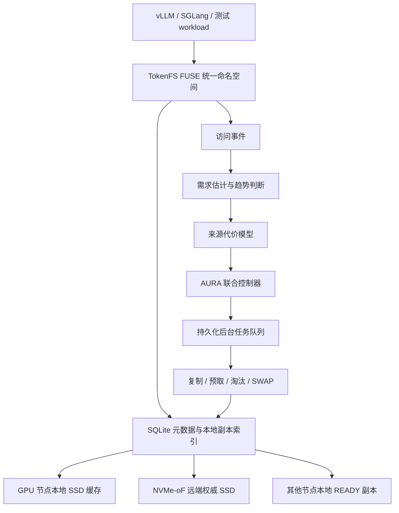

# AURA-KV / TokenFS

```text
面向多 GPU 大模型 KV Cache 的本地 SSD 与 NVMe-oF 远端 SSD 自适应分层缓存系统
```

AURA-KV 是研究控制层，TokenFS 是可挂载的 FUSE 文件系统原型。项目面向大模型推理中的 Prompt Token、Token Shard 和 KV Cache 数据，把 GPU 计算节点本地 SSD 作为低延迟缓存层，把 NVMe-oF 远端 SSD 作为大容量权威层，通过访问价值、缓存保留收益和共享副本放置来减少远端读取和长尾访问代价。

当前仓库按三个板块组织：

| 板块 | 入口 | 用途 |
|---|---|---|
| 代码 | `src/`、`aura_kv/`、`scripts/`、`tests/` | FUSE 原型、AURA-KV 控制器、实验脚本和测试 |
| 说明文档 | [docs/README.md](docs/README.md) | 项目设计、模型公式、实验方法和部署说明 |
| 数据结果 | [reports/latest/final-report.md](reports/latest/final-report.md) | 最新统一结果报告和论文实验结果 |

## 1. 当前项目定位

大模型推理时，长 Prompt、公共前缀、多轮对话和 Agent 任务会产生大量 KV Cache。GPU 显存最快但容量最紧，本地 SSD 比远端快但空间有限，远端 NVMe-oF SSD 容量大且可共享但存在网络开销。AURA-KV 要回答的问题是：

```text
哪些 KV Cache 值得留在本地？
本地空间满了应该删谁？
共享缓存要不要复制到某些 GPU 节点本地？
复制、预取和淘汰如何不阻塞前台请求？
```

当前保留两个研究重点：

1. **价值感知本地缓存管理**：不只按 LRU/LFU 删除缓存，而是估计删除某个本地副本后未来会多付出的访问代价。
2. **多 GPU 共享副本放置**：远端保存权威副本，本地保存热点副本；系统根据访问分布、节点亲和和复制收益决定副本复制到哪里。

多 GPU QoS、公共前缀去重和 P99 驱动迁移不再作为当前主要创新点。跨层迁移一致性作为文件系统必要工程能力保留。

## 2. 系统结构



前台路径只负责尽快返回当前请求：本地命中就读本地，本地没有就从 Peer 或远端读取。后台控制器根据访问事件决定后续是否复制、预取或淘汰。这样前台请求不会被大文件迁移直接拖慢。

## 3. 当前完成度

| 模块 | 状态 | 说明 |
|---|---|---|
| TokenFS FUSE 文件系统 | 已实现 | 支持目录、创建、读写、删除、truncate、fsync 等基础文件操作 |
| 本地优先与远端溢写 | 已实现 | 本地配额不足时写入远端后端 |
| SQLite 元数据 | 已实现 | 记录逻辑路径、物理路径、GPU、tier、大小、状态和指标 |
| 价值感知替换 | 已实现 | 支持需求估计、来源代价、EvictionLoss、收益密度和多 baseline 对比 |
| 共享副本放置 | 已实现/部分真实 | 模拟层支持跨 GPU/节点副本放置；真实跨机器实验仍需要更多内网计算节点 |
| 后台任务队列 | 已实现 | SQLite 持久化任务，支持复制、预取、淘汰、SWAP、重试和布局版本检查 |
| 动态监控 | 已实现 | 支持事件流、指标快照、布局快照和本地 Dashboard |
| 双 VM NVMe-oF | 已验证 | 两台 Ubuntu VM 跑通过 Linux NVMe/TCP Host/Target |
| 实验室 NVMe-oF 基线 | 已验证 | 一台内网计算节点已连接实验室远端 NVMe/TCP Target 并完成 fio 基线 |
| 真实 vLLM/SGLang 集成 | 未完成 | 当前结果还不是真实模型 TTFT 结果 |

## 4. 环境边界

当前已经形成三类环境：

| 环境 | 是否真实 NVMe-oF | 用途 | 边界 |
|---|---|---|---|
| 目录模拟环境 | 否 | 开发 FUSE、策略、元数据和测试 | 不能代表真实远端性能 |
| 双 VM NVMe-oF | 是，真实 Linux NVMe/TCP 协议 | 验证 Host/Target、远端挂载和 TokenFS 端到端路径 | 底层是虚拟网络和虚拟磁盘 |
| 实验室单客户端 NVMe-oF | 是，真实内网 NVMe/TCP 链路 | 测量本地 NVMe 与远端 NVMe-oF 差距 | 当前只有单客户端，不能完整验证跨机器 GPU 亲和 |

论文表述时要区分：策略实验是模拟/代理结果，NVMe-oF baseline 是真实协议链路结果，真实 GPU 推理收益还需要后续接入模型 workload。

## 5. 快速开始

推荐 Ubuntu 24.04 LTS：

```bash
sudo apt update
sudo apt install -y build-essential cmake ninja-build pkg-config \
  fuse3 libfuse3-dev sqlite3 libsqlite3-dev libyaml-cpp-dev \
  python3 fio nvme-cli
```

构建：

```bash
cmake -S . -B build -G Ninja
cmake --build build
```

初始化开发目录并启动：

```bash
./scripts/reset_dev_state.sh /mnt/tokenfs
./scripts/start_tokenfs.sh config/tokenfs.dev.yaml /mnt/tokenfs
./scripts/tokenfsctl.py status
```

最小读写：

```bash
mkdir -p /mnt/tokenfs/gpu0/demo
printf "hello tokenfs\n" > /mnt/tokenfs/gpu0/demo/a.tokens
cat /mnt/tokenfs/gpu0/demo/a.tokens
./scripts/tokenfsctl.py files
./scripts/stop_tokenfs.sh /mnt/tokenfs
```

## 6. 论文实验入口

当前最重要的统一实验入口：

```bash
python3 scripts/paper_experiments.py
```

它一次生成四类结果：

| 实验 | 输出目录 | 作用 | 结果性质 |
|---|---|---|---|
| Trace 回放 | `reports/latest/paper-experiments/01_trace_replay/` | 比较 AURA-Joint 与 RemoteOnly、LocalFirst、LRU/LFU 等策略 | 模拟结果 |
| 端到端延迟代理 | `reports/latest/paper-experiments/02_e2e_latency/` | 比较本地、Peer、远端和后台动作共同造成的请求代价 | 代理结果 |
| 参数敏感性 | `reports/latest/paper-experiments/03_sensitivity/` | 扫描本地容量、远端 P99、副本预算，验证策略稳定性 | 模拟结果 |
| NVMe-oF baseline | `reports/latest/paper-experiments/04_nvmeof_baseline/` | 汇总已有真实 NVMe/TCP 基线 | 真实链路摘要 |

统一报告：

```text
reports/latest/paper-experiments/paper_experiments_report.md
```

当前关键结果：

| 策略 | 本地命中率 | 远端读取 | P99 代理延迟 | 综合代价/请求 |
|---|---:|---:|---:|---:|
| RemoteOnly | 0.0000 | 2244.77 MiB | 9.0188 ms | 3.1889 |
| LRU-Local | 0.7362 | 400.62 MiB | 3.0247 ms | 1.7085 |
| LFU-Local | 0.7586 | 380.31 MiB | 3.0594 ms | 1.5691 |
| DualWindowReplacement | 0.8907 | 146.15 MiB | 1.4685 ms | 0.7717 |
| AURA-Joint | 0.8822 | 228.31 MiB | 1.4749 ms | 0.5376 |

`AURA-Joint` 不追求单项指标永远第一，而是降低综合服务代价：前台访问延迟、远端读取、Peer 读取、后台迁移、重复副本空间和副本创建/删除抖动。

## 7. 常用测试

```bash
# AURA-KV 单元测试和模拟器冒烟测试
./scripts/aura_kv_test.sh

# 论文前四项实验
python3 scripts/paper_experiments.py

# TokenFS 基础功能，需 Linux/FUSE
./scripts/smoke_test.sh
./scripts/integration_test.sh

# 双 VM NVMe-oF，需两台 Linux VM
./scripts/nvmeof_two_vm_test.sh <TARGET_IP>
./scripts/nvmeof_perf_test.sh <TARGET_IP>
```

macOS 主机上主要运行 Python 策略测试；FUSE 和 NVMe-oF 脚本应在 Ubuntu VM 或实验室服务器上运行。

## 8. 真实 NVMe-oF 接入

远端接入脚本已经配置化：

```bash
./scripts/connect_nvme.sh --config config/tokenfs.dev.yaml --dry-run
sudo ./scripts/connect_nvme.sh --config config/tokenfs.dev.yaml --backend remote0 --chown-current
```

真实环境需要在 `config/tokenfs.dev.yaml` 中填写：

```yaml
type: nvmeof
nvme_target_ip: "<SSD Target IP>"
nvme_subnqn: "<Subsystem NQN>"
nvme_device: "/dev/nvmeXnY"
nvme_mount: /srv/tokenfs/remote0
```

如果只是复测已有远端设备，可运行：

```bash
AURA_REMOTE_DEVICE=/dev/nvmeXnY \
AURA_LOCAL_READ_DEVICE=/dev/nvme0n1 \
./scripts/real_nvmeof_baseline.sh
```

只对专用测试 Namespace 或 backing file 做写测试，不要对已有业务盘写 fio。

## 9. 文档与结果

从这里读：

- [docs/README.md](docs/README.md)：最终文档导航。
- [docs/system-design.md](docs/system-design.md)：系统架构、数据生命周期和一致性。
- [docs/model-and-controller.md](docs/model-and-controller.md)：需求估计、来源代价、EvictionLoss、ReplicaGain、RobustBenefit 和控制器。
- [docs/experiments.md](docs/experiments.md)：实验设计、指标、结果解释和论文边界。
- [docs/deployment.md](docs/deployment.md)：配置、脚本和 NVMe-oF 部署。
- [reports/latest/final-report.md](reports/latest/final-report.md)：最新统一结果报告。

旧的零散编号文档已经合并到上述文档中。以后新增内容优先更新这些最终入口，避免文档再次发散。
