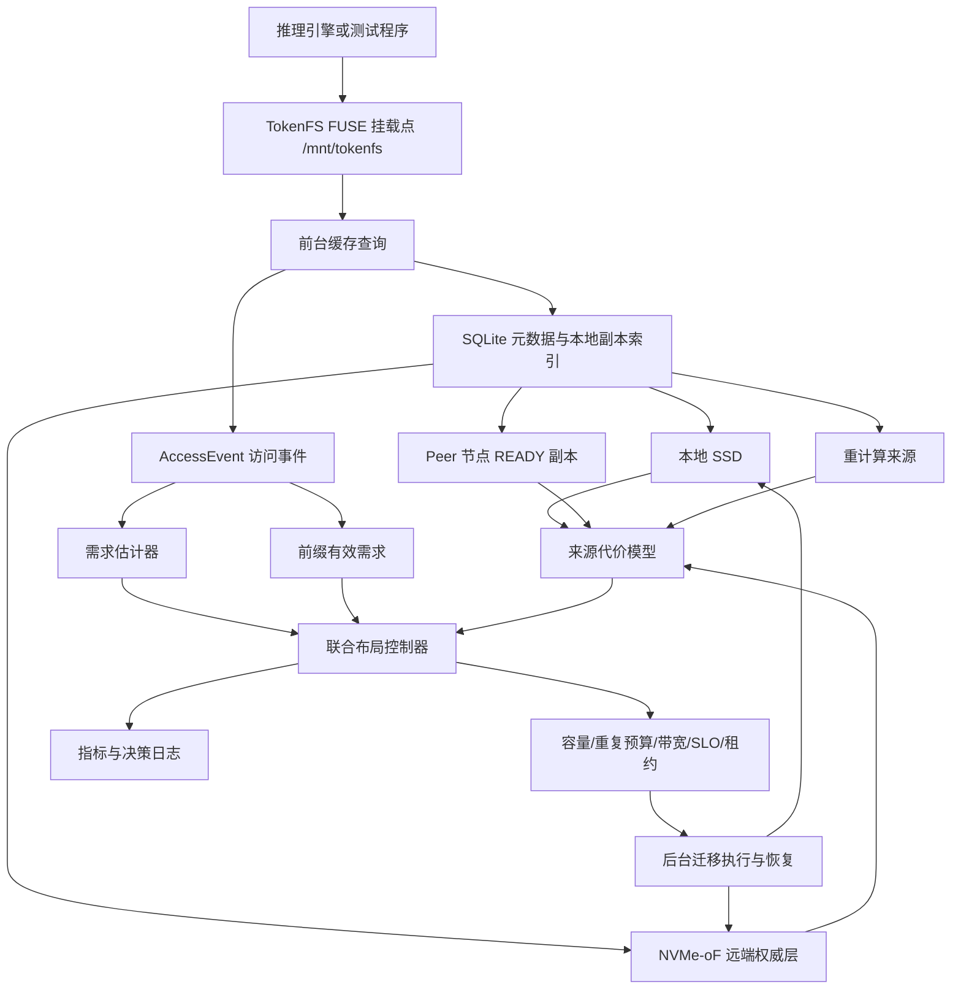

# 03. 系统架构

## 1. 总体架构



## 2. 前台数据路径

前台路径服务当前请求，不等待后台控制器：

```text
请求到达 -> 解析 cache_key -> 查本地 READY 副本
命中 -> 直接从本地读
未命中 -> 选择 Peer、远端或重计算 -> 返回当前请求
同时异步记录 AccessEvent
```

TokenFS 真实前台路径在 `src/main.cpp`，支持 `getattr`、`readdir`、`create`、`open`、`read`、`write`、`release`、`fsync`、`unlink`、`rename` 和 `truncate`。

## 3. 后台控制路径

后台控制路径影响后续请求：

```text
访问统计 -> 需求估计 -> 来源代价 -> 候选 ADD/REMOVE/SWAP
-> 计算 RobustBenefit -> 检查硬约束 -> 下发后台复制/淘汰/预取
```

当前 AURA-KV 的正式控制逻辑主要在 Python simulator 中实现：

| 模块 | 代码 |
|---|---|
| 需求估计 | `aura_kv/demand.py` |
| 来源代价 | `aura_kv/cost_model.py` |
| 删除损失、副本收益 | `aura_kv/layout.py` |
| 约束 | `aura_kv/optimization.py` |
| 策略和 baseline | `aura_kv/policies.py` |
| 模拟器 | `aura_kv/simulator.py` |

## 4. 控制面与数据面

| 平面 | 包含内容 |
|---|---|
| 数据面 | FUSE 读写、本地目录、远端挂载目录、文件复制、fsync、checksum |
| 控制面 | 需求估计、来源代价、候选动作、约束检查、指标、决策日志 |

当前 TokenFS 数据面可以真实运行；AURA-KV Python 控制面已经具备“访问事件 -> ActionPlan -> 持久化后台任务 -> 目录执行器 -> 副本状态反馈”的原型闭环。真实 TokenFS C++ 主进程仍未直接调用 Python 控制器，真实 NVMe-oF 远端需要外部挂载后再验证。

## 5. 当前请求本地未命中如何处理

本地未命中时，系统不会等复制完成。它会立即从可用来源中选择一个：

1. 同节点本地 READY 副本；
2. Peer 节点 READY 副本；
3. NVMe-oF 远端权威副本；
4. 重计算。

后台控制器可能因为这次未命中而生成复制候选，但复制完成只会改善后续请求。

## 6. 目录后端与 NVMe-oF 后端

开发模式：

```text
/var/lib/tokenfs/remote-sim
```

真实 NVMe-oF 模式：

```text
/dev/nvmeXnY -> ext4/XFS -> /srv/tokenfs/remote0
```

TokenFS 上层仍通过目录路径访问，算法层不直接发送 NVMe 命令。
