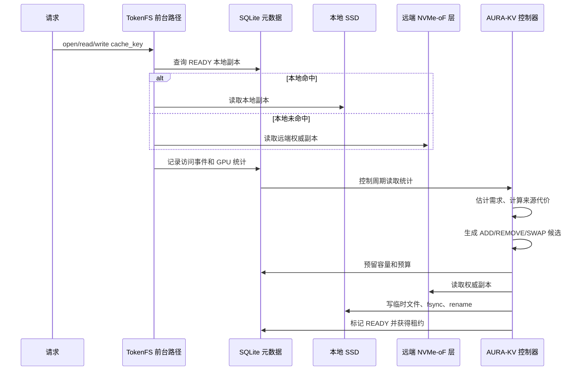

# 04. 数据模型与生命周期

## 1. 核心对象

| 概念 | 含义 | 代码位置 |
|---|---|---|
| Cache Object | 一个 KV Cache、Prompt Token 或 Token Shard 对象 | `CacheObject` |
| Cache Key | 缓存对象唯一标识 | `CacheIdentity.cache_key` |
| Prefix Path | 前缀依赖路径，表示父前缀和子缓存关系 | `parent_cache_key` |
| Request ID | 单次请求实例 ID，用于去重 | `AccessEvent.request_id` |
| Compute Node | 带 GPU 和本地 SSD 的计算节点 | `NodeState.node_id` |
| GPU | 访问来源和亲和信息，不是存储设备 | `gpu_id` |
| Local Replica | 某节点本地 SSD 上的 READY 副本 | `Replica` / `local_replicas` |
| Canonical Remote Copy | 远端权威副本 | TokenFS remote 后端 |

## 2. 共享安全身份

`CacheIdentity.share_safe_key` 包含：

```text
sharing_domain, model_id, model_version, tokenizer_version,
token_prefix_hash, lora_adapter, kv_dtype, layer_range,
position_encoding, tensor_parallel, pipeline_parallel,
cache_schema_version, tenant_id
```

只有该键完全一致的缓存才允许共享。不同 tenant 或 sharing_domain 即使 cache_key 看起来相同，也不能互相作为来源。

## 3. 副本状态

AURA-KV 研究层状态：

```text
RESERVED -> COPYING -> VERIFYING -> READY -> EXPIRED -> DELETING
FAILED
```

TokenFS 工程层状态：

```text
LOCAL_ONLY
REMOTE_ONLY
REMOTE_WITH_LOCAL_CACHE
COPYING_TO_REMOTE
REMOTE_READY
COPYING_TO_LOCAL
LOCAL_READY
DELETING_CACHE
COMMITTED
```

状态名称来自两个层次：Python 策略层用于模拟，C++ FUSE 主程序用于真实文件迁移。

## 4. 生命周期时序图



## 5. 一个具体例子

`/gpu0/prefix/a.tokens` 初次由 GPU0 写入：

1. TokenFS 解析路径，确认逻辑空间为 `/gpu0`。
2. 本地配额足够时写入 `/var/lib/tokenfs/local/gpu0/prefix/a.tokens`。
3. `release` 或 `fsync` 时计算 checksum，写入 `files` 表。
4. 后续容量紧张时，TokenFS 把它复制或移动到远端后端，状态经历 `COPYING_TO_REMOTE -> REMOTE_READY -> COMMITTED`。
5. 如果 GPU1 高频读取该文件，系统记录 `gpu_access` 和 `gpu_access_events`。
6. 若亲和状态变为共享热点，TokenFS 可在 `/var/lib/tokenfs/local/gpu1/.tokenfs-replicas/...` 创建隐藏本地副本。
7. 副本过冷或超出目标副本数时，经过最短驻留时间保护后删除本地副本。

## 6. 崩溃恢复边界

TokenFS 已实现：

- 临时文件后缀；
- fsync 后 rename；
- 启动时清理未完成状态；
- checksum 检查；
- `tokenfsctl.py check` 一致性检查。

AURA-KV Planned：

- 持久化 `decision_log`；
- 预算 reservation 恢复；
- 并发后台任务幂等重试；
- 完整 SWAP 事务恢复。

