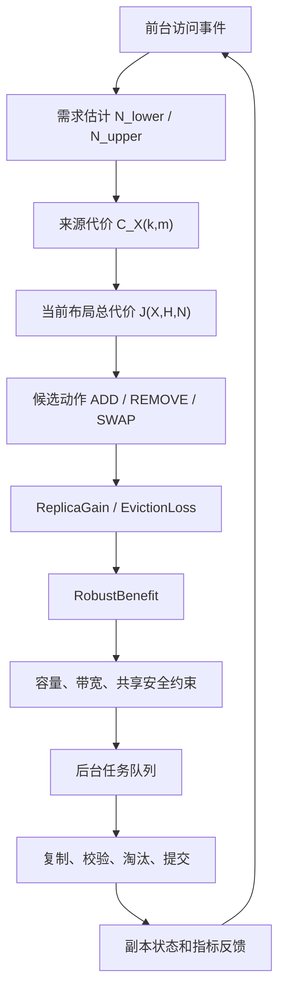

# 06 成本模型

本文集中说明 AURA-KV 的正式符号和公式。其他文档只引用这里的模型，避免同一概念在不同文件里重复解释。

## 1. 模型目标

AURA-KV 要回答三个问题：

```text
本地空间满了，删除哪个本地副本损失最小？
远端共享数据要不要复制到某个 GPU 节点本地？
多个新增、删除、交换动作同时出现时，哪个布局整体更划算？
```

模型不直接预测真实 TTFT P99。它给在线控制器一个可计算的代理目标：在未来时间窗口内，尽量减少 KV Cache 获取代价。

## 2. 公式如何协同工作

这些公式不是彼此独立使用的，而是组成一条控制流水线：



整体含义可以压缩成一句话：

```text
先估计未来谁会访问，再计算从哪里取最划算，
然后比较“新增副本能省多少”和“删除副本会亏多少”，
最后只有收益超过阈值且通过硬约束时，才把动作交给后台执行。
```

具体分工如下：

| 阶段 | 使用的公式或模块 | 输出 |
|---|---|---|
| 需求预测 | 时间衰减、Gamma-Poisson、双窗口、前缀有效需求 | 未来访问次数 `N_lower / N_upper` |
| 来源选择 | 来源代价 `C(m <- s,k)`、最佳来源 `C_X(k,m)` | 当前从本地、peer、远端或重计算获取的代价 |
| 全局评估 | 统一服务代价 `J(X,H,N)` | 当前布局在未来窗口内的总代价 |
| 删除判断 | `EvictionLoss` | 删除某个本地副本会损失多少 |
| 复制判断 | `ReplicaGain` | 新增某个本地副本会节省多少 |
| 动作门控 | `RobustBenefit` + `LayoutConstraints` | 是否生成后台任务 |
| 后台落地 | `background_tasks` 状态机 | PROMOTE/PREFETCH/REPLICATE/EVICT/SWAP 是否提交 |

因此，时间衰减需求估计只是第一步，不是最终决策。真正的动作必须继续经过来源代价、收益损失、容量预算、共享安全和任务执行状态机。

## 3. 符号表

| 符号 | 含义 | 单位 | 数据来源 | 更新频率 | 代码字段 |
|---|---|---|---|---|---|
| `k` | 一个 KV Cache 对象或 token shard | - | cache 元数据 | 创建时 | `CacheIdentity.cache_key` |
| `q` | 一类请求或一个 prompt/prefix 需求类 | - | trace 或访问事件 | 请求到达时 | `AccessEvent.request_id` / prefix tracker |
| `m` | 请求所在 GPU 节点或访问节点 | - | 调度器、路径或环境变量 | 请求到达时 | `AccessEvent.node_id`、`gpu_id` |
| `n` | 可放置副本的节点 | - | 集群拓扑 | 配置或拓扑更新时 | `NodeState.node_id` |
| `X` | 当前副本布局 | - | 副本表和远端元数据 | 副本状态变化时 | `NodeState.replicas`、`local_replicas` |
| `X_A` | 执行动作 `A` 后的候选布局 | - | 控制器构造 | 控制周期 | `LayoutCostEvaluator` |
| `H` | 未来决策窗口 | 秒 | 配置 | 配置变更时 | `demand_horizon_seconds` |
| `S(k)` | 对象 `k` 的大小 | MiB/bytes | 文件元数据 | 写入或迁移时 | `CacheObject.size_bytes`、`size_bytes` |
| `N(k,m,H)` | 窗口 `H` 内 `m` 对 `k` 的未来需求 | 次 | 需求估计器 | 控制周期 | `DemandEstimate.mean` |
| `N_lower` | 保守需求下界 | 次 | 需求估计器 | 控制周期 | `DemandEstimate.lower` |
| `N_upper` | 保守需求上界 | 次 | 需求估计器 | 控制周期 | `DemandEstimate.upper` |
| `C_X(k,m)` | 布局 `X` 下，节点 `m` 获取 `k` 的最佳来源代价 | ms | 来源代价模型 | 请求或控制周期 | `BestSourceResult.best.total_ms` |
| `D_ready` | 新副本从开始复制到 READY 的等待时间 | ms | 后台复制估计 | 控制周期 | `ReplicaGainResult.ready_delay_ms` |
| `B_bg` | 后台复制可用带宽 | MiB/s | 配置或 metrics | 控制周期 | `background_bandwidth_budget_bytes_per_cycle` |

## 4. 需求估计

### 4.1 直觉

系统不能只看过去总访问次数。一个缓存过去很热，但最近已经不用了，就不该一直霸占本地 SSD。AURA-KV 使用带时间衰减的访问窗口估计未来需求。

### 4.2 公式

对对象 `k` 和访问节点 `m`：

```text
w_j(t) = exp(-(t - t_j) / tau)

C_w(k,m) = Σ_j w_j(t) * count(k,m,j)
E_w(k,m) = Σ_j w_j(t) * duration(j)

alpha = alpha0 + C_w(k,m)
beta  = beta0  + E_w(k,m)

mu(H)      = H * alpha / beta
sigma2(H) = H * alpha / beta + H^2 * alpha / beta^2

kappa_delta = sqrt((1 - delta) / delta)

N_lower(k,m,H) = max(mu(H) - kappa_delta * sqrt(sigma2(H)), 0)
N_upper(k,m,H) = mu(H) + kappa_delta * sqrt(sigma2(H))
```

### 4.3 通俗解释

- `w_j(t)`：越新的访问权重越大，越旧的访问慢慢淡出。
- `alpha / beta`：估计单位时间访问率。
- `mu(H)`：未来 `H` 秒大概会访问多少次。
- `N_lower`：保守估计，适合判断“要不要新增副本”。
- `N_upper`：悲观估计，适合判断“删掉会不会很亏”。

新增副本用下界，是因为复制会占空间和带宽，不能太乐观。删除副本用上界，是因为误删热点代价很高，宁愿保守一点。

### 4.4 数值例子

假设最近窗口内某缓存访问率大约是每秒 `0.4` 次，窗口 `H=60s`：

```text
mu = 60 * 0.4 = 24 次
```

如果不确定性较大，系统可能得到：

```text
N_lower = 14 次
N_upper = 34 次
```

含义是：复制时按至少 14 次收益算，删除时按可能还有 34 次访问损失算。

### 4.5 计算步骤

1. 从访问事件中按 `cache_key` 和访问节点聚合历史访问次数。
2. 对每个历史桶施加时间衰减。
3. 用 `alpha` 和 `beta` 得到访问率分布。
4. 按窗口 `H` 计算均值和方差。
5. 输出 `mean/lower/upper` 三个值。

### 4.6 硬约束、假设和局限

需求估计只决定“未来可能访问多少次”，不直接决定能否复制或删除。容量、共享安全、租约、唯一可靠副本、后台带宽由约束层检查。

局限：

- 突发热点无法提前准确预测。
- 历史访问和未来访问不一定同分布。
- 当前实现没有直接接入真实 vLLM/SGLang 调度器。

### 4.7 代码位置

- `aura_kv/demand.py`
- `EWMADemandEstimator`
- `GammaPoissonDemandEstimator`
- `DualWindowDemandEstimator`
- `tests/aura_kv_unit_test.py`

## 5. 前缀有效需求

### 5.1 直觉

KV Cache 和 prompt prefix 有共享关系。一个公共前缀可能被多个请求复用。计算需求时不能只看单个文件名，而要看“哪些请求会用到这个前缀”。

### 5.2 公式

```text
N_effective(k,m,H) =
    Σ_{q: k ∈ Prefix(q)} N(q,m,H)
```

实现中会按请求 ID 去重，避免同一请求内部重复计算同一个前缀收益。

### 5.3 计算步骤

1. 为每个请求记录它依赖的 prefix path。
2. 找出所有包含对象 `k` 的请求类 `q`。
3. 对这些请求类在节点 `m` 上的未来需求求和。
4. 对同一 `request_id` 去重。

### 5.4 硬约束、假设和局限

前缀共享必须满足 `share_safe_key` 一致。模型版本、tokenizer、KV dtype、位置编码和 tenant 不一致时不能共享。

### 5.5 代码位置

- `aura_kv/demand.py`
- `EffectivePrefixDemandTracker`
- `tests/aura_kv_unit_test.py`

## 6. 来源代价

### 6.1 直觉

同一个缓存可以从不同地方拿：

```text
本 GPU 节点本地 SSD
同物理节点其他 GPU 可共享的本地副本
其他节点 peer 副本
NVMe-oF 远端 SSD
模型重计算
```

系统每次要选当前最便宜的来源。

### 6.2 公式

```text
C(m <- s, k) =
    queue_delay(s)
  + fixed_latency(s)
  + transfer_time(s, k)
  + deserialize_cost(k)
  + format_conversion_cost(k)
  + host_to_device_cost(k)

transfer_time(s,k) =
    S(k) / effective_bandwidth(s) * 1000
```

其中 `S(k)` 用 MiB 表示，带宽用 MiB/s 表示，所以传输时间乘 `1000` 变成毫秒。

### 6.3 最佳来源

```text
C_X(k,m) = min_{s ∈ AvailableSources(X,k,m)} C(m <- s, k)
```

如果本地有 READY 副本，通常本地最便宜；如果没有，就可能选择远端、peer 或重计算。

### 6.4 计算步骤

1. 枚举当前布局下所有可用来源。
2. 过滤不兼容来源，例如未 READY 副本或 sharing domain 不匹配来源。
3. 分别计算本地、peer、远端和重计算代价。
4. 按总毫秒排序，得到最优和第二优来源。

### 6.5 硬约束、假设和局限

来源代价不负责判断容量是否够，也不负责触发复制。当前真实 TokenFS 路径主要使用本地/远端目录，peer 来源主要在 AURA-KV 模拟层体现。

### 6.6 代码位置

- `aura_kv/cost_model.py`
- `SourceCostModel`
- `AlternativeSourceResolver`

## 7. 统一服务代价

### 7.1 公式

```text
J(X,H,N) =
    Σ_k Σ_m N_effective(k,m,H) * C_X(k,m)
```

### 7.2 通俗解释

这个公式是在问：如果未来窗口 `H` 内照当前布局 `X` 运行，所有 GPU 节点获取所有缓存大概要花多少毫秒。

例子：

```text
缓存 A 在 Node0 未来访问 10 次，每次最好来源 2 ms
缓存 A 在 Node1 未来访问 5 次，每次最好来源 8 ms

J_A = 10 * 2 + 5 * 8 = 60 ms
```

控制器的目标就是让这个总服务代价尽量小。

### 7.3 计算步骤

1. 对每个缓存对象和访问节点估计未来有效需求。
2. 在当前布局下求最佳来源。
3. 将“访问次数”和“每次获取代价”相乘。
4. 对所有对象和节点求和。

### 7.4 硬约束、假设和局限

`J` 是代理目标，不等同真实 TTFT P99。真实请求还会受到模型执行、GPU 排队、网络长尾和批处理调度影响。

## 8. 删除损失 EvictionLoss

### 8.1 它解决什么

本地 SSD 满了，系统必须删除一些本地副本。`EvictionLoss` 衡量“删掉这个副本之后，未来访问会变慢多少”。

### 8.2 公式

删除对象 `k` 在节点 `n` 的本地副本：

```text
EvictionLoss(k,n,X,H) =
    Σ_m N_upper(k,m,H)
        * max(C_X_without(k,n)(k,m) - C_X(k,m), 0)

EvictionLossDensity =
    EvictionLoss / S(k)
```

### 8.3 通俗解释

删除前：

```text
GPU0 本地读 A：2 ms
```

删除后：

```text
GPU0 只能远端读 A：10 ms
```

每次访问多花：

```text
10 - 2 = 8 ms
```

如果未来可能还有 20 次访问：

```text
EvictionLoss = 20 * 8 = 160 ms
```

如果另一个缓存删除后只多花 30 ms，就优先删后者。

### 8.4 为什么用需求上界

删除是不可逆或成本较高的动作。如果低估未来访问，就会误删热点缓存。因此删除时使用 `N_upper`，更保守。

### 8.5 代码和测试

- `aura_kv/layout.py`
- `LayoutCostEvaluator.eviction_loss`
- `tests/aura_kv_unit_test.py`

### 8.6 执行规则

`EvictionLossDensity` 可以用于候选筛选，但不能单独决定删除。真正执行前还必须构造候选布局并通过安全约束：

- 有远端、peer 或可重算替代来源。
- 本地副本不是刚创建的短驻留副本。
- 文件不处于复制、校验或迁移状态。
- 删除不会破坏 sharing domain 隔离。

## 9. 新增副本收益 ReplicaGain

### 9.1 它解决什么

远端有一份共享主副本时，系统要判断是否值得把它复制到某个 GPU 节点本地。

### 9.2 公式

```text
D_ready(k,n) =
    copy_queue_delay
  + source_read_time
  + S(k) / B_bg * 1000
  + verify_time
  + metadata_commit_time

H_remaining =
    max(H - D_ready(k,n) / 1000, 0)

ReplicaGain(k,n,X,H) =
    Σ_m N_lower(k,m,H_remaining)
        * max(C_X(k,m) - C_X_with(k,n)(k,m), 0)

ReplicaGainDensity =
    ReplicaGain / S(k)
```

### 9.3 通俗解释

复制不是马上生效。假设复制要 5 秒，决策窗口是 60 秒，那么真正能享受本地副本收益的只剩 55 秒。

复制前：

```text
GPU1 远端读 A：10 ms
```

复制后：

```text
GPU1 本地读 A：2 ms
```

每次节省：

```text
10 - 2 = 8 ms
```

如果保守估计复制完成后还会访问 15 次：

```text
ReplicaGain = 15 * 8 = 120 ms
```

如果复制对象很大，本地空间成本高，收益密度就会降低。

### 9.4 为什么用需求下界

新增副本会占用本地 SSD、后台带宽和元数据状态。为了避免“看到一点热度就疯狂复制”，新增副本用 `N_lower`，只有保守估计仍然有收益才复制。

### 9.5 代码和测试

- `aura_kv/layout.py`
- `LayoutCostEvaluator.replica_gain`
- `aura_kv/optimization.py`

### 9.6 执行规则

`ReplicaGainDensity` 同样只用于候选排序。复制前还必须检查：

- 本地容量。
- 全局重复副本预算。
- 单节点重复副本预算。
- 后台带宽预算。
- 复制并发数。
- 新副本 READY 前是否还有足够剩余窗口。

## 10. 布局差分收益 RobustBenefit

### 10.1 它解决什么

实际控制器不只做单个动作。比如：

```text
删除 A 的一个低价值本地副本
新增 B 的一个热点本地副本
交换两个缓存的位置
```

`RobustBenefit` 衡量“执行某个候选动作后，整个布局在未来窗口内是否更好”。

### 10.2 公式

候选动作 `A` 产生候选布局 `X_A(t)`：

```text
DeltaC_A(k,m,t) =
    C_X(k,m) - C_X_A(t)(k,m)

RobustBenefit(A;X,H) =
    Σ_k Σ_m ∫_0^H [
        lambda_lower(k,m,t) * max(DeltaC_A(k,m,t), 0)
      - lambda_upper(k,m,t) * max(-DeltaC_A(k,m,t), 0)
    ] dt
```

### 10.3 通俗解释

`DeltaC_A` 是动作带来的代价变化：

- 正数：动作让访问变快，是收益。
- 负数：动作让访问变慢，是损失。

收益部分用保守需求 `lambda_lower`，损失部分用悲观需求 `lambda_upper`。这样做的效果是：

```text
好处按少的算
坏处按多的算
仍然划算才执行
```

### 10.4 数值例子

候选动作：把缓存 A 从远端复制到 GPU0 本地，同时删除缓存 B 的本地副本腾空间。

收益：

```text
A 复制后每次访问省 8 ms
A 未来保守访问 20 次
收益 = 160 ms
```

损失：

```text
B 被删除后每次访问多花 3 ms
B 未来悲观访问 30 次
损失 = 90 ms
```

```text
RobustBenefit = 160 - 90 = 70 ms
```

如果超过 `MinimumLayoutImprovementMs`，控制器才执行。

### 10.5 当前实现状态

当前实现：

- ADD 的差分收益原型。
- REMOVE 的差分收益原型。
- 离散窗口求和，而不是连续积分。

尚未完整实现：

- 完整 SWAP 候选布局事务。
- 多动作批量求解。
- 与真实后台执行器的闭环调度。

### 10.6 代码和测试

- `aura_kv/layout.py`
- `robust_benefit_for_add`
- `robust_benefit_for_remove`
- `tests/aura_kv_unit_test.py`

### 10.7 执行规则

`RobustBenefit` 必须作用在完整候选布局上。特别是 SWAP 场景不能只算：

```text
ReplicaGain - EvictionLoss
```

原因是 ADD 和 REMOVE 可能同时改变多个请求节点的最佳来源。正确做法是构造候选布局 `X_A`，再统一比较 `C_X` 与 `C_X_A`。

## 11. 约束

动作收益为正还不够，还必须满足安全约束：

| 约束 | 含义 |
|---|---|
| 容量约束 | 本地 SSD 不能超配额 |
| 重复预算 | 同一对象不能无限复制 |
| 后台带宽 | 复制、预取、迁移不能挤占前台 |
| 并发上限 | 同时复制任务数量有限 |
| SLO 门控 | 前台延迟过高时减少后台动作 |
| 共享安全 | sharing domain 不一致不能共享 |
| 删除安全 | 无远端、无 peer、不可重算的数据不能删 |

代码位置：

- `aura_kv/optimization.py`
- `LayoutConstraints`
- `SafetyGuard`

## 12. 模型边界

当前公式是工程可运行的启发式优化框架，不声称数学最优。它的价值在于：

- 把本地淘汰、副本创建和共享访问统一到同一个代价空间。
- 能和 LRU、LFU、本地优先、固定副本数等 baseline 对比。
- 没有真实 IP 时可用 trace simulator 验证策略逻辑。

真实论文结论仍需要在 NVMe-oF SSD 和 GPU 推理环境中复测。
