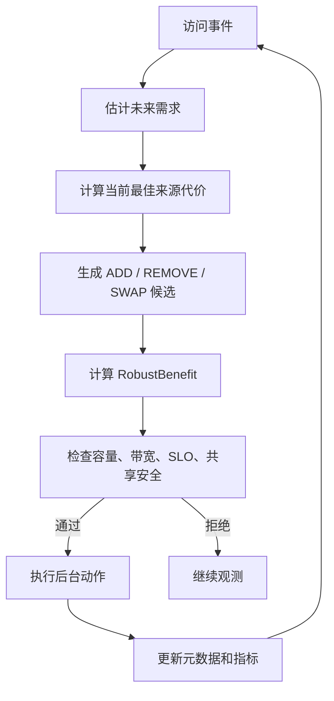

# 09 联合控制器

联合控制器把本地淘汰和副本放置放在同一个决策空间里。它不只是问“删谁”或“复制谁”，而是问“在容量、带宽和安全约束下，整个布局怎样更好”。

## 1. 控制器输入

```text
当前布局 X
KV Cache 对象和大小
本地/远端/peer 副本状态
访问统计和未来需求估计
来源代价模型
本地容量和后台带宽预算
安全约束
```

## 2. 候选动作

| 动作 | 含义 |
|---|---|
| ADD | 从远端或其他来源复制一个本地副本 |
| REMOVE | 删除一个本地缓存副本 |
| SWAP | 删除低价值副本并新增高价值副本 |
| PROMOTE | 远端主副本被热点 GPU 读后复制到本地 |
| PREFETCH | 连续 shard 的下一片提前拉到本地 |
| GC | 清理冷副本和未完成状态 |

## 3. 决策顺序



## 4. 为什么要联合

如果替换和复制分开做，会出现：

```text
复制策略发现 A 很热，想复制 A
淘汰策略独立发现空间不够，删了 B
但删 B 的损失可能比复制 A 的收益还大
```

联合控制器会先构造完整候选布局，再比较整体收益：

```text
新增 A 的收益 - 删除 B 的损失 - 后台复制成本
```

只有整体收益超过阈值才执行。

## 5. 安全门控

即使收益为正，也必须满足：

- 不超过本地容量。
- 不超过重复副本预算。
- 后台复制带宽没有超限。
- 前台 SLO 没有明显恶化。
- sharing domain 允许共享。
- 删除后仍有远端、peer 或可重算来源。
- 目标文件没有处于未完成迁移状态。

## 6. 当前状态

Implemented：

- Python AURA-KV 层的 ADD/REMOVE 收益计算。
- 容量、重复预算、后台带宽、并发、SLO 和共享安全约束。
- 多个 baseline 与 `AuraKVPolicy` 模拟。
- TokenFS 主路径具备 promote、prefetch、evict、cache-gc 工程动作。

Partial：

- 完整 SWAP 候选布局尚未实现为一个事务化动作。
- Python 控制器还没有直接驱动 TokenFS 后台任务队列。
- 真实 metrics 尚未回灌到 AURA-KV 策略层。

Planned：

- 统一后台执行器。
- 将 TokenFS metrics 转换为 AURA-KV trace。
- 真实环境下根据 P95/P99 和远端队列动态调节阈值。
