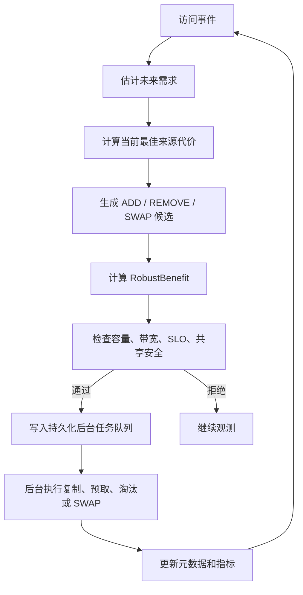
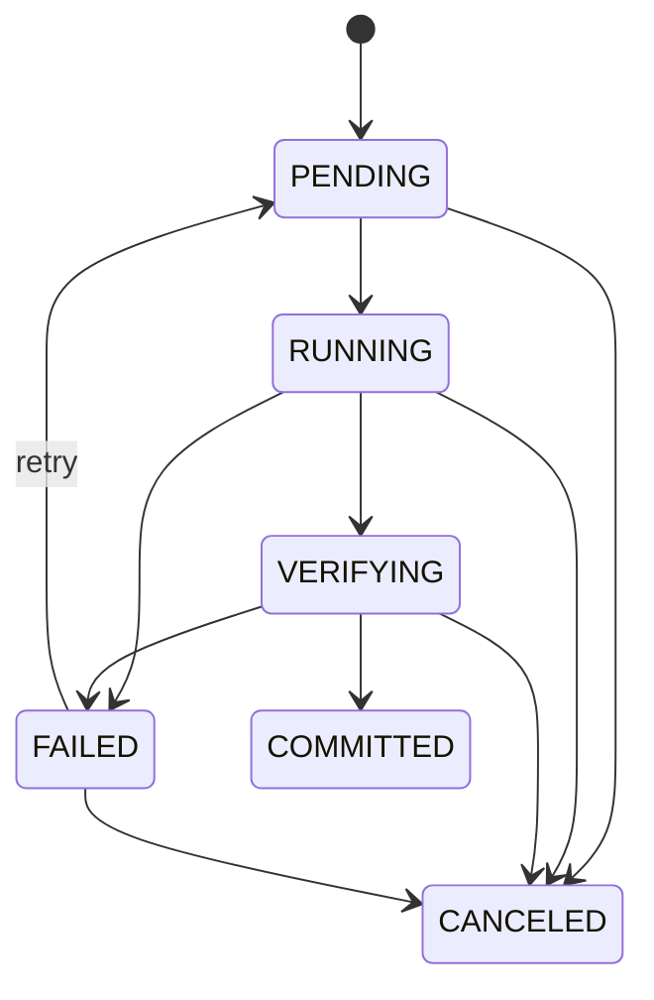
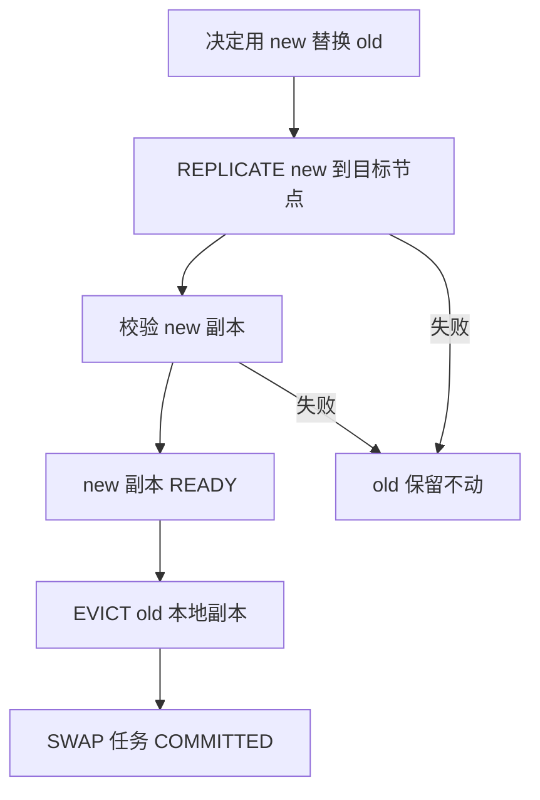

# 09 联合控制器

联合控制器把本地淘汰和副本放置放在同一个决策空间里。它不只是问“删谁”或“复制谁”，而是问“在容量、带宽和安全约束下，整个布局怎样更好”。

## 1. 控制器输入

```text
当前布局 X
KV Cache 对象和大小
本地/远端/peer 副本状态
访问统计和未来需求估计
来源代价模型
本地容量和后台带宽预算
安全约束
```

## 2. 候选动作

| 动作 | 含义 |
|---|---|
| ADD | 从远端或其他来源复制一个本地副本 |
| REMOVE | 删除一个本地缓存副本 |
| SWAP | 删除低价值副本并新增高价值副本 |
| PROMOTE | 远端主副本被热点 GPU 读后复制到本地 |
| PREFETCH | 连续 shard 的下一片提前拉到本地 |
| GC | 清理冷副本和未完成状态 |

## 3. 决策顺序



这条链路里，前台请求不直接做重复制和删除。它只产生访问事件，并触发控制器生成任务计划；真正的数据搬迁由后台任务执行器完成。

## 4. 后台任务状态机

AURA-KV 现在把布局动作变成持久化任务，任务和副本状态分开管理。

任务类型：

| 任务 | 含义 |
|---|---|
| PROMOTE | 前台读到热点后，把远端副本提升到请求节点本地 |
| PREFETCH | 根据连续访问或预测，把未来可能访问的块提前拉到本地 |
| REPLICATE | 创建一个指定节点的本地副本 |
| EVICT | 删除一个本地 READY 副本 |
| SWAP | “新增高收益副本 + 删除低收益副本”的组合动作 |

任务状态：



每个任务记录：

```text
task_id、任务类型、cache_key、source、target、layout_version、
状态、重试次数、创建/开始/结束时间、预留空间、预期收益、
错误码、错误信息、校验和、依赖任务
```

这样做的目的有三个：

- 系统崩溃后，未完成的迁移不会凭空消失，可以从 SQLite 队列表恢复。
- 前台访问和后台迁移解耦，避免一次读请求被大文件复制拖慢。
- SWAP 不再是“先删旧再复制新”，而是必须先创建并校验新副本，再允许删除旧副本。

## 5. 为什么要联合

如果替换和复制分开做，会出现：

```text
复制策略发现 A 很热，想复制 A
淘汰策略独立发现空间不够，删了 B
但删 B 的损失可能比复制 A 的收益还大
```

联合控制器会先构造完整候选布局，再比较整体收益：

```text
新增 A 的收益 - 删除 B 的损失 - 后台复制成本
```

只有整体收益超过阈值才执行。

## 6. SWAP 安全流程

SWAP 是最容易出错的动作，因为它同时涉及“新增”和“删除”。当前实现采用依赖任务方式：



关键规则：

- 新副本没有进入 READY 前，旧副本不能删除。
- 复制失败、校验失败、布局版本过期时，旧副本保持可用。
- 任务携带 `layout_version`，如果执行时发现布局已经变化，任务会被取消，避免用旧判断修改新布局。
- `REPLICATE`、`EVICT` 和 `SWAP` 三个任务通过依赖关系串起来，崩溃恢复时仍能判断做到哪一步。

## 7. 安全门控

即使收益为正，也必须满足：

- 不超过本地容量。
- 不超过重复副本预算。
- 后台复制带宽没有超限。
- 前台 SLO 没有明显恶化。
- sharing domain 允许共享。
- 删除后仍有远端、peer 或可重算来源。
- 目标文件没有处于未完成迁移状态。

## 8. 当前状态

Implemented：

- Python AURA-KV 层的 ADD/REMOVE 收益计算。
- 容量、重复预算、后台带宽、并发、SLO 和共享安全约束。
- 多个 baseline 与 `AuraKVPolicy` 模拟。
- TokenFS 主路径具备 promote、prefetch、evict、cache-gc 工程动作。
- `aura_kv.tasks` 提供 SQLite 持久化后台任务队列和任务状态机。
- `aura_kv.executor` 提供目录后端执行器，可模拟 NVMe-oF 挂载目录上的复制、校验、提交、淘汰。
- `aura_kv.controller` 能把前台访问事件转换为 PROMOTE / PREFETCH / REPLICATE / EVICT / SWAP 任务计划。
- 单元测试覆盖任务持久化、非法状态跳转、布局版本取消、复制校验和 SWAP 失败保旧。

Partial：

- Python 执行器当前使用目录后端；真实环境下远端目录应挂载在 NVMe-oF Namespace 上。
- TokenFS C++ 前台路径已有工程动作，但尚未直接复用 Python AURA-KV 任务队列表。
- 真实 metrics 尚未在线回灌到 AURA-KV Python 控制器。

Planned：

- 将 TokenFS metrics 转换为 AURA-KV trace。
- 真实环境下根据 P95/P99 和远端队列动态调节阈值。
