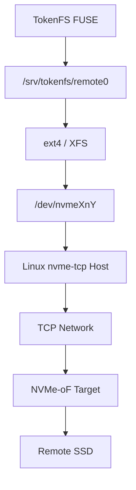

# 10 存储后端与 NVMe-oF 接入

TokenFS 当前支持两类远端后端：目录模拟后端和真实 NVMe-oF 挂载后端。当前仓库已经在双 Ubuntu VM 中跑通 Linux NVMe/TCP Host/Target 链路；真实物理 SSD Target 仍需后续硬件环境复测。

## 1. 当前开发模式

没有真实 IP、NQN 和 SSD Target 时，使用目录模拟：

```text
本地层: /var/lib/tokenfs/local/gpu0
远端层: /var/lib/tokenfs/remote-sim/gpu0
挂载点: /mnt/tokenfs
```

这种模式可以验证：

- FUSE 文件操作。
- SQLite 元数据。
- 本地优先和远端溢写。
- 热点提升、预取、淘汰。
- 共享副本统计。
- 一致性和恢复流程。

不能验证：

- 真实 NVMe/TCP 网络延迟。
- 真实远端 SSD 带宽。
- NVMe 队列深度和路径故障。

## 2. 真实 NVMe-oF 模式

真实部署时，远端 SSD 通过 NVMe/TCP 导出为 Namespace，GPU Host 连接后看到类似：

```text
/dev/nvme1n1
```

然后格式化或挂载成普通目录：

```text
/srv/tokenfs/remote0
```

TokenFS 不直接实现 NVMe 协议，而是通过 Linux NVMe/TCP Host 和文件系统挂载点访问远端层。



当前已经验证的双 VM 拓扑：

```text
tokenfs-dev     192.168.64.2  NVMe/TCP Host + TokenFS
tokenfs-target  192.168.64.3  Linux nvmet Target
```

这条路径是真实 NVMe/TCP 协议，不是目录模拟；但 Target 后端使用 VM loop/虚拟磁盘，因此性能只代表当前开发环境，不代表真实 SSD 集群。

## 3. 配置字段

配置入口：

```text
config/tokenfs.dev.yaml
```

远端后端字段：

```yaml
backends:
  - id: remote0
    type: directory
    root: /var/lib/tokenfs/remote-sim
    nvme:
      transport: tcp
      target_ip: "__SSD_TARGET_IP__"
      port: "4420"
      subsystem_nqn: "__SUBSYSTEM_NQN__"
      host_nqn: "__HOST_NQN__"
      device_by_id: "__NVME_DEVICE_BY_ID__"
      mount_point: /srv/tokenfs/remote0
      filesystem: ext4
```

真实环境到位后，把 `root` 改成 NVMe-oF 挂载目录，并填写 `nvme` 字段。

## 4. 脚本入口

| 脚本 | 作用 |
|---|---|
| `scripts/check_environment.sh` | 检查 FUSE、SQLite、nvme-cli、fio 等环境 |
| `scripts/connect_nvme.sh` | 连接 NVMe/TCP Target，支持 dry-run |
| `scripts/disconnect_nvme.sh` | 断开远端 Namespace |
| `scripts/setup_nvme_target.sh` | 在 Target VM 配置 Linux nvmet |
| `scripts/cleanup_nvme_target.sh` | 清理 Target 配置 |
| `scripts/nvmeof_two_vm_test.sh` | 双 VM NVMe-oF 联通测试 |
| `scripts/nvmeof_perf_test.sh` | NVMe-oF 性能测试模板 |
| `scripts/nvmeof_loopback_test.sh` | 单机 loopback 测试 |

## 5. 共享安全

普通 ext4/XFS 不能被多台 Host 同时读写挂载到同一个 Namespace。推荐实验路线：

```text
每个 GPU Host 使用独立 Namespace
或者只有一个服务节点挂载 Namespace，其他节点通过上层服务访问
```

如果必须多 Host 同时挂载同一个共享块设备，需要集群文件系统或更强的一致性协议，这不属于当前第一阶段目标。

## 6. 当前状态

Implemented：

- 目录后端。
- NVMe-oF 配置占位。
- NVMe-oF 连接、断开、Target 配置和双 VM 测试脚本。
- 双 VM Linux NVMe/TCP Host/Target 功能测试和性能基线。

Partial：

- 真实物理 SSD Target 未验证。
- TokenFS 目前依赖外部脚本先完成 NVMe-oF 挂载。

Planned：

- 真实物理 IP/NQN 到位后完成端到端复测。
- 采集本地 SSD、远端 NVMe-oF、TokenFS 叠加开销和多 GPU 并发数据。
