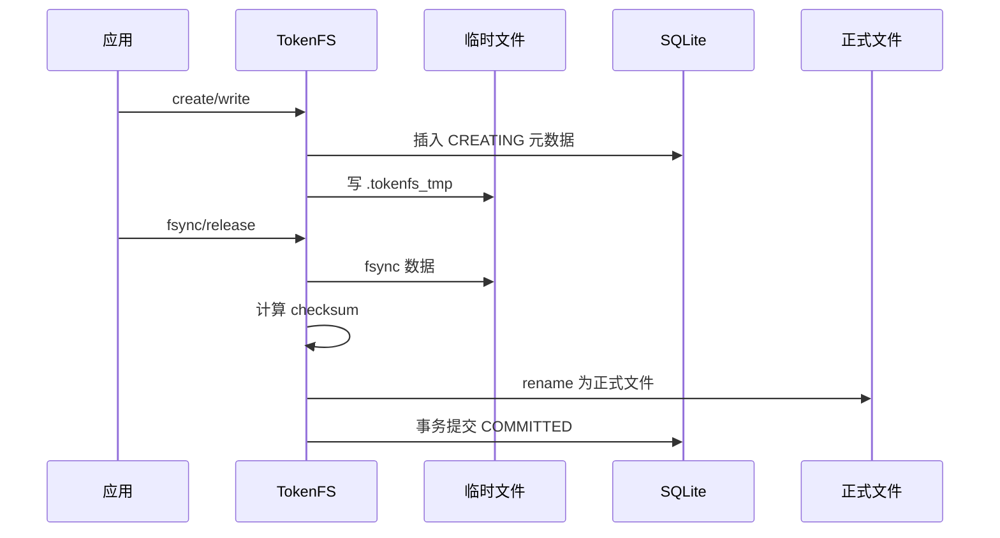

# 11 一致性与恢复

TokenFS 的一致性目标是：不能把写了一半、迁移一半或校验失败的数据当成已提交数据暴露给上层程序。

## 1. 文件状态

SQLite `files` 表中使用状态区分生命周期：

| 状态 | 含义 |
|---|---|
| `CREATING` | 正在创建或写入临时文件 |
| `COMMITTED` | 文件已完整提交，可读 |
| `MIGRATING` | 正在跨层迁移 |
| `ERROR` | 操作失败，需要检查或恢复 |
| `DELETING` | 删除过程中 |

不同版本中字段名称会围绕这些语义扩展，但核心原则不变：未提交文件不能作为正常文件返回。

## 2. 可靠写入流程



如果中途崩溃，重启扫描会根据状态和临时文件清理或修复。

## 3. 跨层迁移状态机

本地迁远端或远端提升本地都不能简单复制后立刻删除源文件。推荐状态：

```text
LOCAL
  -> COPY_PLANNED
  -> COPYING
  -> REMOTE_READY / LOCAL_CACHE_READY
  -> METADATA_COMMITTED
  -> CLEAN
```

当前 TokenFS 实现了临时文件、校验、rename、元数据状态和启动恢复的工程路径。AURA-KV Python 控制层尚未拥有完整持久化后台执行器。

## 4. 远端主副本与本地缓存

当前推荐语义：

```text
远端主副本是共享权威层；
本地副本是可删除缓存；
GC 只能删除确认有远端主副本的本地缓存。
```

本地新写入的数据可以先处于 `LOCAL_ONLY`，后续根据策略迁到远端或保留为本地缓存。

## 5. 校验

当前使用 `fnv1a64` 作为开发阶段轻量 checksum：

```text
写入完成 -> 计算 checksum -> 写入元数据
读取/检查 -> 重新计算 -> 对比元数据
```

它用于检测开发和迁移错误，不是密码学安全哈希。真实生产场景可替换为 CRC32C、xxHash 或 SHA-256。

## 6. 恢复脚本和检查

| 命令 | 作用 |
|---|---|
| `./scripts/tokenfsctl.py check` | 检查元数据和物理文件一致性 |
| `./scripts/tokenfsctl.py cache-gc` | 清理可删除本地缓存 |
| `./scripts/consistency_test.sh` | 一致性专项测试 |
| `./scripts/fault_injection_test.sh` | 故障注入模板 |

## 7. 当前状态

Implemented：

- SQLite WAL。
- 临时文件写入。
- `fsync`、rename、checksum、提交状态。
- 启动恢复扫描。
- 元数据检查工具。

Partial：

- AURA-KV 后台复制动作没有完整持久化执行日志。
- 真实断电、真实 NVMe-oF Target 重启、真实网络断开需要硬件环境验证。

Planned：

- 后台任务 WAL。
- 复制任务断点恢复。
- 真实 kill、断网、Target 重启矩阵。
