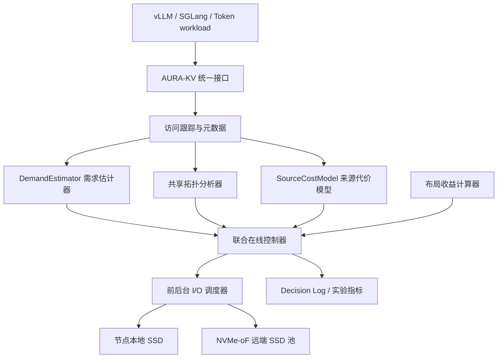
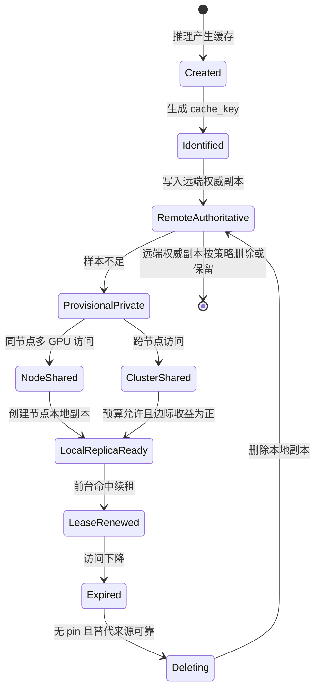

# AURA-KV 研究原型总览

```text
AURA-KV
Adaptive Unified Replacement and Affinity-aware KV Cache Management
```

中文暂定名：

```text
面向 NVMe-oF 分层存储的自适应 KV Cache 联合替换与共享副本管理系统
```

本文是整个项目的总入口。它既面向第一次接触本项目的人，也面向后续继续开发、调试和写论文的人。AURA-KV 当前仍是候选研究原型，不声称已经具备论文结论，不声称全球首次，也不把模拟结果包装成真实硬件实验。

## 1. 本文解决的问题

大语言模型推理时会产生大量中间数据，尤其是 KV Cache。GPU 显存速度最快但容量最贵，本地 SSD 容量更大但延迟更高，远端 NVMe-oF SSD 容量更大、可共享，但通过网络访问会有额外延迟和长尾。AURA-KV 研究的问题是：

```text
在多 GPU、多节点、本地 SSD 容量有限、远端 NVMe-oF SSD 容量较大的场景中，
如何在线决定哪些 KV Cache 留在本地，哪些放远端，
哪些共享缓存值得在某些节点建立本地副本，
以及这些决策如何避免互相冲突？
```

它不是一个普通网盘，也不是从零替代 ext4/XFS 的通用文件系统。现阶段由两层组成：

```text
TokenFS: 真实可挂载的 FUSE 文件系统原型
AURA-KV: 面向论文实验的策略、模拟器和联合控制框架
```

## 2. 阅读前需要知道的基础概念

### 2.1 Prompt、Token、Prefill、Decode 和 KV Cache

**Prompt** 是用户输入给大模型的文本，例如“请总结这篇论文”。模型不会直接处理汉字或英文单词，而是先把文本切成 **Token**，Token 可以理解为模型能够识别的“小词块”。

推理通常分两段：

```text
Prefill: 处理输入 Prompt，计算整段上下文的中间状态
Decode: 逐个生成新 token
```

Transformer 模型每一层注意力计算会产生 Key 和 Value 张量。为了避免每次生成新 token 都重新计算历史上下文，系统会保存这些 Key/Value 张量，这就是 **KV Cache**。KV Cache 的价值在于：如果同一段前缀之后还会被使用，保存它可以减少重复 prefill 计算。

本项目把 KV Cache、Prompt Token 和 Token Shard 抽象成不可变文件或不可变块。这样做是为了先研究存储和调度策略，而不是一开始陷入具体模型张量格式。

### 2.2 为什么 KV Cache 会占用大量空间

KV Cache 的大小和以下因素有关：

```text
模型层数
hidden size
注意力头数
token 数
数据类型，例如 fp16/bf16/int8
并行策略，例如 tensor parallel / pipeline parallel
```

长 Prompt、长文档问答、多轮 Agent 任务都会产生较大的缓存。GPU 显存优先服务正在运行的模型权重和活跃请求，不适合无限保存历史 KV Cache；本地 SSD 和远端 SSD 就成为“显存外缓存层”。

### 2.3 GPU 显存、CPU 内存、本地 SSD、远端 SSD 的区别

可以用办公桌类比：

```text
GPU 显存：手边最小但最快的桌面，正在计算的东西放这里
CPU 内存：旁边的大桌子，快但不如 GPU 显存
本地 SSD：办公室柜子，容量大、拿取较快
远端 NVMe-oF SSD：楼下仓库，容量更大、多人共享，但需要走网络
```

本项目重点在本地 SSD 和远端 SSD 之间做策略。GPU 在这里不是存储设备，而是访问来源和计算资源：系统要知道某份缓存由哪个 GPU 产生、哪个节点最常访问、是否跨节点共享。

### 2.4 NVMe-oF 是什么

NVMe 是主机访问高速 SSD 的协议。NVMe-oF，全称 **NVMe over Fabrics**，意思是把 NVMe 命令通过网络传到远端存储服务器。常见传输包括：

```text
NVMe/TCP: 通过普通 TCP/IP 网络传输，部署简单
NVMe/RDMA: 通过 RDMA 网络传输，延迟更低但环境复杂
```

在本项目中，AURA-KV 策略层不直接关心 TCP 还是 RDMA。真实设备接入后，启动脚本负责把远端 Namespace 连接并挂载成目录，例如：

```text
/srv/tokenfs/remote0
```

上层算法只看到“远端后端目录”和采集到的延迟、带宽、P99 等指标。这样做可以避免算法写死 IP、端口、RDMA 或 SPDK。

## 3. 通俗场景示例

假设有一个小型集群：

```text
NodeA: GPU0, GPU1, 本地 SSD 100 GB
NodeB: GPU0, GPU1, 本地 SSD 100 GB
NodeC: GPU0, GPU1, 本地 SSD 100 GB
RemotePool: 远端 NVMe-oF SSD 10 TB
```

请求分为三类：

```text
私有请求：每个 GPU 处理完全不同用户，不共享缓存
同节点共享：NodeA 的两个 GPU 都使用相同系统提示词
跨节点共享：NodeA、NodeB、NodeC 都反复访问同一个长文档前缀
```

如果所有数据只放远端，容量够但延迟高；如果所有热点都复制到所有节点，本地空间很快被重复副本占满；如果只看 LRU，可能删掉很久没访问但重算极贵的公共前缀；如果只看简单访问次数，可能不知道删掉后还有没有可靠替代来源。AURA-KV 试图把这些因素放进统一的代价驱动决策。

## 4. 现有简单方案及其不足

| 简单方案 | 通俗理解 | 不足 |
|---|---|---|
| RemoteOnly | 所有东西都放楼下仓库 | 本地命中率为 0，远端长尾会影响 P99 |
| ProducerLocal | 谁产生就放谁旁边 | 跨节点共享时其他节点仍频繁读远端 |
| NodeLRU | 每个节点删最久没用的 | 不知道重算代价、前缀依赖和替代来源 |
| NodeLFU | 每个节点删访问次数少的 | 对阶段变化和热点迁移反应慢 |
| StaticNReplica | 共享数据固定复制 N 份 | N 太小命中不足，N 太大浪费空间 |
| AffinityOnly | 哪个节点访问多就放哪 | 不看容量预算、替代来源和重算成本 |
| EWMAReplacement | 用 EWMA 估计未来需求后替换 | 不知道完整来源代价和布局变化 |
| WeightedScoreBaseline | 人工权重打分 | 权重缺少明确系统单位，容易重复计算 |
| 替换和副本模块分开跑 | 两个团队各管一摊 | 可能刚删完又复制回来，造成 churn 和预算冲突 |

这些方案都可以作为 baseline，但不足以作为最终研究方案。

## 5. 本项目的核心设计

AURA-KV 保留两个候选研究重点：

```text
候选创新一：替代来源与前缀有效需求感知的代价驱动型 KV Cache 替换
候选创新二：动态共享拓扑感知的预算化 KV Cache 副本放置
```

二者必须联合运行。创新点一回答“本地空间不够时，哪些缓存应该保留、降级、删除或预取”；创新点二回答“共享缓存应该在几个计算节点建立本地副本”。联合控制器把两者放进一个控制周期，统一检查容量、重复预算、SLO 和安全规则。

## 6. 系统总架构

### 6.1 Mermaid 架构图



图中上半部分是控制面，负责记录、预测和决策；下半部分是数据面，负责真实读写。本项目当前 FUSE 主程序已经能真实挂载和访问目录后端；AURA-KV 新增的 simulator 用于研究控制面。

### 6.2 ASCII 架构图

```text
LLM 推理引擎
  |
  v
FUSE / AURA-KV 接口
  |
  +--> 访问事件 AccessEvent
  +--> 元数据 CacheObject / Replica
  |
  v
联合控制器
  |-- 需求估计器
  |-- 共享拓扑分类器
  |-- SourceCostModel 来源代价模型
  |-- 布局收益计算器
  |-- 硬约束与 SafetyGuard
  |
  +--> 前台读取: 立即选择本地/远端/peer/recompute
  +--> 后台任务: prefetch / replicate / demote / GC
          |
          v
本地 SSD <----> 远端 NVMe-oF SSD
```

## 7. 关键数据结构和元数据

当前 AURA-KV 研究层的真实代码路径如下：

| 概念 | 作用 | 当前代码 |
|---|---|---|
| `CacheIdentity` | 判断缓存是否技术上可共享 | `aura_kv/core.py` |
| `CacheObject` | 缓存对象元数据，包含大小、生产者、重算成本 | `aura_kv/core.py` |
| `AccessEvent` | 每次访问事件，包含 node、gpu、bytes、foreground | `aura_kv/core.py` |
| `Replica` | 本地副本状态、租约和效用 | `aura_kv/core.py` |
| `NodeState` | 节点本地容量和已有副本 | `aura_kv/core.py` |
| `GammaPoissonDemandEstimator` | 统计未来需求均值、下界和上界 | `aura_kv/demand.py` |
| `EWMADemandEstimator` | 简单时间衰减需求估计 baseline | `aura_kv/demand.py` |
| `SourceCostModel` | 计算本地、peer、远端、重算来源代价 | `aura_kv/cost_model.py` |
| `LayoutCostEvaluator` | 计算 EvictionLoss、ReplicaGain、RobustBenefit | `aura_kv/layout.py` |
| `LayoutConstraints` | 检查容量、预算、带宽和 SLO 等硬约束 | `aura_kv/optimization.py` |
| `SharednessClassifier` | 私有/共享状态分类 | `aura_kv/policies.py` |
| `AlternativeSourceResolver` | 删除后的替代来源解析 | `aura_kv/policies.py` |
| `AuraKVPolicy` | 联合策略原型 | `aura_kv/policies.py` |
| `TraceSimulator` | trace-driven simulator | `aura_kv/simulator.py` |

TokenFS FUSE 主路径仍在 `src/main.cpp`，里面有 SQLite 表 `files`、`gpu_access`、`gpu_access_events`、`local_replicas`、`metrics` 等。AURA-KV simulator 当前没有直接写入 TokenFS 的 SQLite，而是独立验证策略逻辑。

## 8. KV Cache 完整生命周期

一份 KV Cache 从产生到删除的过程如下：



实际流程：

1. KV Cache 创建：推理引擎生成某段前缀的 KV。
2. cache_key 生成：包含模型、tokenizer、前缀 hash、sharing_domain 等。
3. 远端权威副本写入：远端层保证可恢复。
4. 初始状态分类：样本不足时是 `PROVISIONAL_PRIVATE`。
5. 前台读取：优先本地 READY 副本，否则立即选远端或重算。
6. 访问事件记录：写入 `AccessEvent`。
7. 需求更新：Gamma-Poisson/EWMA 根据时间衰减访问更新未来需求上下界。
8. 共享状态更新：根据 dominance、sharedness entropy、跨节点访问分类。
9. 本地副本创建：后台复制，前台不等待。
10. 租约续期：命中副本后更新 last_hit 和 lease。
11. 空间不足：联合控制器比较保留、迁移、淘汰。
12. 执行动作：promotion、replication、demotion、eviction 等。
13. 租约到期：标记 EXPIRED。
14. GC：安全删除可恢复的本地副本。
15. 崩溃恢复：扫描 COPYING、READY 但文件缺失、孤儿临时文件。

## 9. 一个端到端实例

### 9.1 NodeA GPU0 首次产生公共前缀

NodeA 的 GPU0 处理一个长文档问答任务，产生缓存：

```text
cache_key = common-doc-prefix
producer_node = NodeA
producer_gpu = GPU0
size = 256 MiB
recompute_cost = 5000 ms
sharing_domain = tenantA
```

系统先写远端权威副本。由于访问样本不足，状态为 `PROVISIONAL_PRIVATE`。此时不急着复制到所有节点。

### 9.2 NodeA GPU1 随后访问

NodeA 的 GPU1 也访问同一个公共前缀。访问图中 `common-doc-prefix -> NodeA` 的边权升高，但仍然只有一个节点活跃，因此它可能从 `PROVISIONAL_PRIVATE` 走向 `NODE_SHARED`。因为 NodeA 的两个 GPU 共享同一块本地 SSD，所以只需要一个节点级本地副本，不为 GPU0/GPU1 各复制一份。

### 9.3 NodeB 重复访问

NodeB 多次访问同一缓存后，访问图出现：

```text
NodeA: 8 次
NodeB: 6 次
NodeC: 0 次
```

active_node_count = 2，sharedness_entropy 较高，cross_node_accesses 足够，状态可能升级为 `CLUSTER_SHARED`。联合控制器计算 NodeB 新增副本的鲁棒收益：

```text
ReplicaGain =
    未来需求下界
    ×
    新增副本前后的最优来源代价差
```

如果 `ReplicaGain` 大于最小收益阈值，且容量、重复预算、后台带宽和前台 SLO 门控都允许，就在 NodeB 建立本地副本。

### 9.4 NodeA 空间不足

NodeA 本地 SSD 使用率达到 92%。控制器不会简单删除最旧缓存，而是解析替代来源：

```text
如果 common-doc-prefix 在远端有权威副本，并且 NodeB 有 READY 副本，
删除 NodeA 本地副本后的替代来源至少是 REMOTE_NVME_OF 或 PEER_NODE_REPLICA。
```

如果当前 NodeA 的未来需求上界很低，删除 NodeA 本地副本可能安全；但如果它是高重算成本公共前缀且 NodeA 仍会访问，则可能保留它，转而淘汰低价值私有后缀。

### 9.5 前台 P99 过高

如果前台 P99 接近 SLO，后台复制应暂停或降速。当前 TokenFS 主路径已有 QoS 工程指标；AURA-KV 文档和模拟器已保留 SLO 价格接口，但完整前后台调度器仍是 Planned。

## 10. 算法、公式和变量

总览文档只给核心公式，详细公式见：

```text
docs/formal_cost_model.md
docs/innovation1_replacement.md
docs/innovation2_sharing_replication.md
docs/joint_optimization.md
```

统一服务代价：

```text
J(X,H,N) =
    Σ_k Σ_m N_effective(k,m,H) * C_X(k,m)
```

`N_effective` 是未来窗口内的有效需求，`C_X` 是当前布局下的最优来源代价。删除使用 `EvictionLoss`，复制使用 `ReplicaGain`，最终候选动作使用 `RobustBenefit` 做布局差分验证。

## 11. 异常和边界情况

容易出错的情况包括：

```text
没有远端权威副本时误删唯一本地副本
不同 tenant 但相同前缀被错误共享
COPYING 状态崩溃后留下临时文件
需求估计冷启动导致过度保守或过度复制
固定 N 副本导致重复空间浪费
后台复制占用远端带宽导致前台 P99 变差
```

AURA-KV 的安全原则是：需求估计只提供未来需求上下界；真正删除前必须经过来源代价解析、候选布局验证、预算检查和 SafetyGuard。

## 12. 配置项

TokenFS 主路径配置：

```text
config/tokenfs.dev.yaml
```

AURA-KV 研究层配置模板：

```text
config/aura_kv.example.yaml
```

关键配置包括：

```text
prediction_horizon_seconds
access_decay_tau_seconds
confidence_fallback_threshold
global_duplicate_budget_bytes
node_duplicate_budget_bytes
target_foreground_read_p99_ms
max_actions_per_cycle
max_migration_bytes_per_cycle
```

## 13. 监控指标和实验入口

TokenFS 主路径：

```bash
./scripts/tokenfsctl.py status
./scripts/tokenfsctl.py metrics
./scripts/tokenfsctl.py replicas
./scripts/tokenfsctl.py affinity
./scripts/tokenfsctl.py check
```

AURA-KV simulator：

```bash
./scripts/aura_kv_test.sh
python3 scripts/aura_kv_sim.py --output reports/latest/aura-kv-sim
```

模拟结果在：

```text
reports/latest/aura-kv-sim/aura_sim_report.md
reports/latest/aura-kv-sim/aura_sim_results.csv
reports/latest/aura-kv-sim/aura_sim_results.json
```

这些结果明确标注 `SIMULATED RESULT`，不能作为真实硬件结论。

## 14. 容易误解的地方

1. **GPU 不是存储设备。** GPU 只是产生和访问缓存的计算资源，本地 SSD 才保存文件。
2. **远端 SSD 不是云盘抽象。** 在真实环境中它通过 NVMe-oF 暴露，最终仍表现为块设备或挂载目录。
3. **共享不是默认发生。** 大多数任务可以是私有的，只有前缀/KV Cache 确实被多节点访问时才考虑共享副本。
4. **副本越多不一定越好。** 副本能提高本地命中，但会占用本地 SSD 和后台带宽。
5. **模拟结果不是真实性能。** 它只能验证算法流程和实验框架。

## 15. 与论文贡献的关系

本文对应论文中的 Background、Motivation、System Overview 和 Implementation Overview。真正论文贡献仍需通过真实硬件实验、系统性相关工作检索和消融实验验证。

## 16. 实现状态

| 功能 | 状态 | 对应代码 | 对应测试 | 未完成原因 | 后续计划 |
|---|---|---|---|---|---|
| FUSE 统一命名空间 | Implemented | `src/main.cpp` | `scripts/smoke_test.sh` | 无 | 接入真实 workload |
| 本地/远端目录后端 | Implemented | `src/main.cpp` | `scripts/integration_test.sh` | 无 | 用真实 NVMe-oF 挂载目录替换 remote-sim |
| NVMe-oF 脚本 | Partial | `scripts/connect_nvme.sh`, `scripts/setup_nvme_target.sh` | `scripts/nvmeof_two_vm_test.sh` | 缺少导师真实 IP/NQN | 真实环境到位后复测 |
| CacheIdentity | Implemented | `aura_kv/core.py` | `tests/aura_kv_unit_test.py` | 无 | 与真实 KV schema 对齐 |
| 统计需求估计器 | Implemented | `aura_kv/demand.py` | `tests/aura_kv_unit_test.py` | 无 | 接入真实 trace |
| 来源代价模型 | Implemented | `aura_kv/cost_model.py` | `tests/aura_kv_unit_test.py` | 无真实 metrics | 接入 NVMe-oF 指标 |
| 布局收益计算 | Implemented | `aura_kv/layout.py` | `tests/aura_kv_unit_test.py` | SWAP 仍简化 | 增加完整 swap planner |
| 共享拓扑分类 | Implemented | `aura_kv/policies.py` | `tests/aura_kv_unit_test.py` | 目前是 simulator 内分类 | 接入 FUSE 元数据 |
| AURA-KV 联合策略 | Partial | `aura_kv/policies.py` | `scripts/aura_kv_test.sh` | 仍是模拟器原型 | 接入真实控制周期和 decision_log |
| 前后台 I/O 调度器 | Planned | 文档设计 | 无 | 真实 P99 采集未到位 | 接入真实 metrics 后实现 |
