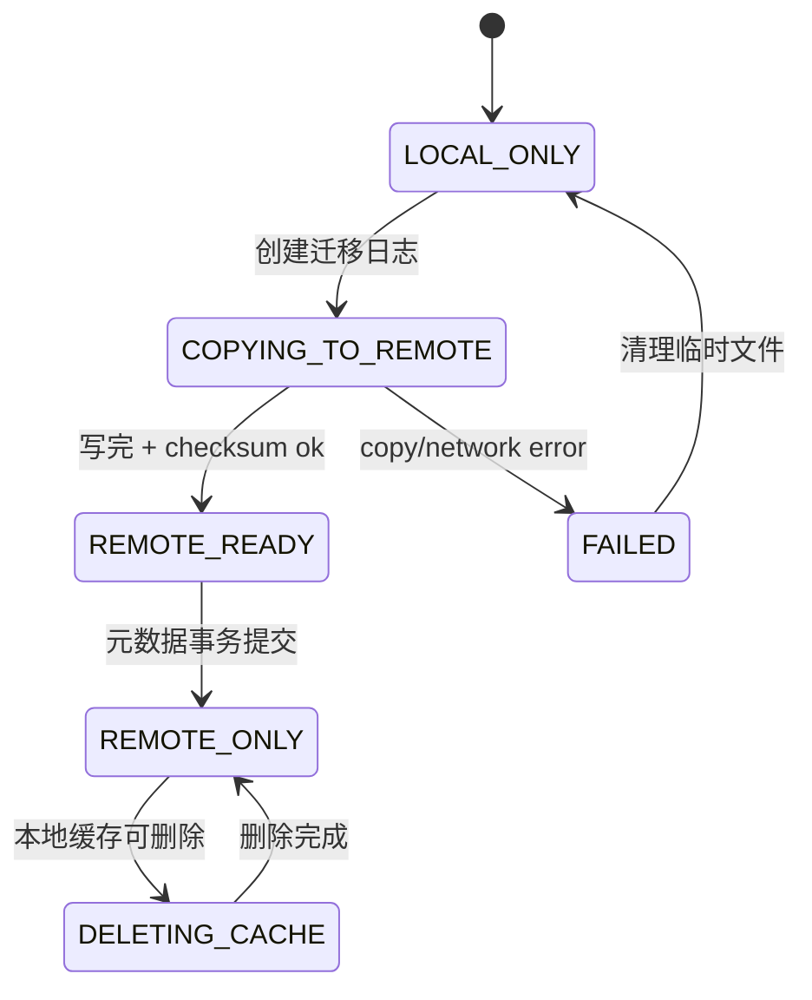

# AURA-KV / TokenFS 崩溃一致性设计

## 1. 本文解决的问题

缓存迁移和副本创建不是简单复制文件。若复制一半进程崩溃、远端网络断开或元数据写一半失败，系统必须恢复到可解释状态，不能让用户读到半文件，也不能删除唯一副本。

## 2. 通俗例子

把文件从本地搬到远端像搬家：不能刚把一半家具搬到新家，就把旧家钥匙扔了。正确流程是：先确认新家家具完整，再更新地址簿，最后清理旧家。

## 3. 本地到远端迁移流程

```text
1. 创建远端临时文件 .tmp
2. 从本地复制数据到临时文件
3. fsync 临时文件和目录
4. 计算 checksum 和 size
5. atomic rename 成正式文件
6. SQLite 事务更新元数据为 REMOTE_READY/REMOTE_ONLY
7. 确认远端权威副本存在后，才允许删除本地加速副本
```

## 4. 状态机



## 5. 异常处理

| 异常 | 风险 | 恢复 |
|---|---|---|
| 复制一半崩溃 | 远端半文件 | 删除 `.tmp`，保留本地 |
| rename 后数据库未提交 | 远端正式文件但元数据旧 | 启动扫描，补交或标记 orphan |
| 数据库 READY 但文件缺失 | 元数据指向不存在文件 | 标记 FAILED，回退替代来源 |
| checksum 不一致 | 数据损坏 | 禁止 READY，清理临时文件 |
| Target 重启 | 远端短暂不可用 | 返回错误或重试，不删除本地 |
| 租约过期但 pin_count > 0 | 正在读被删除 | 延迟删除 |

## 6. 幂等操作

后台任务要能安全重试。每个任务应有 `decision_id`，重复执行同一任务时检查目标状态：

```text
READY 已存在 -> 直接返回成功
临时文件存在但过期 -> 清理后重试
预算 reservation 存在 -> 复用或释放
```

## 7. 唯一副本保护

删除前必须满足：

```text
远端权威副本存在并校验通过
或 peer READY 副本存在
或数据明确可重算且重算输入完整
```

否则动作变为 `PIN`。

## 8. 当前实现

TokenFS 主路径已有迁移状态、checksum、临时文件和一致性检查；AURA-KV simulator 有副本状态字段，但尚未实现真实崩溃恢复执行器。

## 9. 实现状态

| 功能 | 状态 | 对应代码 | 对应测试 | 未完成原因 | 后续计划 |
|---|---|---|---|---|---|
| TokenFS 临时文件/迁移状态 | Partial | `src/main.cpp` | `fault_injection_test.sh` | 覆盖有限 | 扩充崩溃点 |
| 一致性检查 | Implemented | `scripts/tokenfsctl.py check` | 多个测试脚本 | 无 | 加 AURA-KV decision 检查 |
| Replica 状态字段 | Implemented | `aura_kv/core.py` | unit | 无 | 接入真实 DB |
| 预算 reservation 恢复 | Planned | 无 | 无 | 尚未实现事务表 | 新增 budget_reservations |
