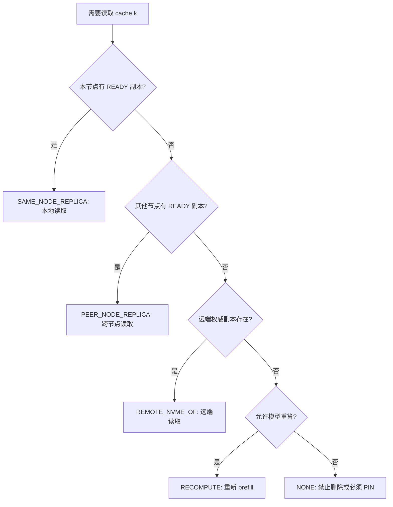

# 替代来源与前缀结构感知的学习型 KV Cache 多动作替换策略

暂定英文名：

```text
Alternative-Source-Aware Learned Replacement
```

## 1. 本文解决的问题

本地 SSD 空间不足时，为什么不能直接删除最久没有访问的缓存？

普通文件缓存常用 LRU，也就是 Least Recently Used，中文可以理解为“最近最少使用”。它的直觉是：很久没访问的数据，未来也不太会访问。但 KV Cache 场景不一样。下面几个例子会让 LRU 失效：

```text
例 1：一个 100 MB 公共系统前缀已经 10 分钟没访问，但重算需要 5 秒。
例 2：一个 20 GB 私有后缀刚访问过，但重算只要 30 毫秒。
例 3：某缓存看起来冷，但它没有远端权威副本，也没有其他节点副本。
例 4：某缓存很热，但远端 NVMe-oF 读取很快，本地保留收益有限。
例 5：某上游前缀本身很小，但很多后代缓存依赖它。
```

因此 AURA-KV 的第一个候选创新不是“把 LRU 换成 AI”，而是把替换问题改成：

```text
删除当前本地副本以后，未来还能从哪里拿回这份 KV Cache？
拿回它要付出多少额外代价？
它在前缀树中会影响多少后代缓存？
AI 对未来访问的预测有多可信？
在容量、重复副本预算和前台 SLO 约束下，应该执行哪个动作？
```

## 2. 基础概念

### 2.1 KV Cache 替换

替换不是只删除文件。对 AURA-KV 来说，替换包含多动作：

| 动作 | 含义 | 前置条件 | 风险 |
|---|---|---|---|
| `KEEP` | 保留当前本地副本 | 当前副本有价值 | 占用本地空间 |
| `PROMOTE` | 从远端提升到本地 | 远端权威副本存在，本地收益高 | 后台 I/O 可能影响前台 |
| `REPLICATE` | 在新热点节点建立副本 | 共享状态成立，预算允许 | 重复空间增加 |
| `DEMOTE` | 本地数据降级到远端 | 远端可写且校验通过 | 迁移失败需恢复 |
| `EVICT_LOCAL` | 删除可恢复的本地副本 | 有远端或 peer 替代来源 | 未来可能读慢 |
| `DROP_RECOMPUTABLE` | 删除低价值且可低成本重算的数据 | 重算安全且代价低 | 可能增加 GPU 计算 |
| `PIN` | 临时禁止替换 | 无可靠替代来源或正在读 | 可能阻塞空间回收 |
| `PREFETCH` | 预测即将访问时提前加载 | 有稳定预测和后台预算 | 预测错会浪费带宽 |

当前 `aura_kv/policies.py` 中 `CacheAction` 已定义这些动作；模拟器原型主要落地 `PROMOTE`、`REPLICATE`、`PIN`、`DEFER` 及 baseline 行为。完整执行器仍是后续任务。

### 2.2 替代来源

替代来源是指：如果节点 n 上缓存 k 的本地副本被删除，未来请求还能从哪里重新获得它。



每种来源的代价不同：

| 替代来源 | 数据路径 | 延迟组成 | 带宽开销 | 是否占 GPU | 可靠性 |
|---|---|---|---|---|---|
| `SAME_NODE_REPLICA` | 本节点本地 SSD | 本地 SSD 延迟 | 无网络 | 否 | 高 |
| `PEER_NODE_REPLICA` | 其他节点本地 SSD | peer 读取 + 网络 + 队列 | 占网络 | 否 | 取决于 peer 状态 |
| `REMOTE_NVME_OF` | 远端 NVMe-oF SSD | 远端 P99 + 队列 + 网络 | 占远端链路 | 否 | 高，若权威副本存在 |
| `RECOMPUTE` | 重新执行模型 prefill | GPU 排队 + prefill 计算 | 无存储读取 | 是 | 取决于模型和输入可重算 |
| `NONE` | 无 | 不可恢复 | 不适用 | 不适用 | 必须禁止删除 |

当前代码中 `AlternativeSourceResolver` 位于 `aura_kv/policies.py`。它在 simulator 中根据本节点副本、peer 副本、远端权威副本和可重算性解析替代来源。

## 3. 现有简单方案及其不足

| 方案 | 做法 | 不足 |
|---|---|---|
| LRU | 删除最久没访问的 | 不知道重算代价和替代来源 |
| LFU | 删除访问次数少的 | 对阶段变化反应慢 |
| 普通 AI 替换 | 预测未来访问冷热 | 如果不知道远端/peer/重算来源，仍可能删错 |
| 只看文件大小 | 删除大文件释放空间 | 可能误删高价值公共前缀 |
| 只看重算代价 | 保留重算贵的 | 可能把冷前缀永久锁死 |

因此创新点一必须把访问预测、替代来源、前缀依赖、资源价格和安全规则结合起来。

## 4. 输入和输出

### 4.1 输入

| 输入 | 含义 | 来源 | 单位/类型 | 更新时机 |
|---|---|---|---|---|
| 历史访问轨迹 | 谁在什么时候访问了缓存 | `AccessEvent` | 事件序列 | 每次访问 |
| KV Cache 语义 | token 数、模型、dtype、前缀 hash | `CacheIdentity`, `CacheObject` | 字符串/整数 | 创建时 |
| 前缀依赖 | parent/children 关系 | `parent_cache_key` | key | 创建和更新 |
| 当前副本分布 | 哪些节点有 READY 副本 | `NodeState.replicas` | 集合 | 控制周期 |
| 本地/远端延迟 | local/remote/peer P99 | metrics/provider | ms | 周期采集 |
| 重算代价 | 重新 prefill 的估计代价 | trace 或估计 | ms | 创建/采样 |
| 本地空间压力 | 节点 SSD 使用率 | `NodeState` | 0-1 | 控制周期 |
| 前台 SLO 状态 | P99 是否接近目标 | metrics | ms | 控制周期 |
| AI 预测结果 | future hits、冷却概率、置信度 | predictor | 次数/概率 | 控制周期 |

### 4.2 输出

输出不是单一 keep/evict，而是一组候选动作及理由：

```text
Decision(cache_key, node_id, action, alternative_source, reason, benefit, cost, confidence)
```

当前真实代码在 `aura_kv/core.py` 定义 `Decision`，在 `aura_kv/policies.py` 的 `AuraKVPolicy.on_access()` 中生成。

## 5. AI 模型：预测未来访问，而不是直接删文件

### 5.1 为什么需要 AI

LRU 只看过去最后一次访问，LFU 只看历史次数。KV Cache 的访问常常具有阶段性：某个 Agent 模板在一段时间内很热，随后换任务后迅速变冷；某个公共前缀可能在多个节点逐渐升温。AI 或学习型预测器的作用是估计未来窗口 H 内访问需求。

但 AURA-KV 明确规定：

```text
AI 只输出可解释中间量，不直接执行删除。
```

### 5.2 当前实现

当前已实现无需训练的解析式预测器：

```text
EWMAAccessPredictor
```

EWMA 是 Exponentially Weighted Moving Average，指数加权移动平均。它让最近访问权重更高，旧访问逐渐衰减。

公式：

```text
score_i(k,t) = Σ exp(-(t - t_j) / tau)
```

变量解释：

| 变量 | 含义 | 单位 | 来源 |
|---|---|---|---|
| `k` | 缓存对象 | cache key | `AccessEvent.cache_key` |
| `i` | 节点 | node id | `AccessEvent.node_id` |
| `t` | 当前时间 | 秒 | simulator clock |
| `t_j` | 第 j 次访问时间 | 秒 | history |
| `tau` | 衰减时间常数 | 秒 | 配置 |

如果数据不足，`confidence` 会较低，系统回退到解析式和安全规则。当前代码在 `aura_kv/prediction.py`。

### 5.3 训练型模型的设计要求

训练型模型尚未实现，状态是 Planned。未来可以从 trace 中提取特征，按时间切分训练集、验证集和测试集，避免未来信息泄漏。

特征表示例：

| 特征名 | 含义 | 类型 | 单位 | 采集来源 | 更新时间 | 缺失处理 |
|---|---|---|---|---|---|---|
| `last_access_gap` | 距离上次访问多久 | float | 秒 | access trace | 每次访问 | 设为 horizon |
| `ewma_hits_node` | 节点时间衰减访问 | float | 次 | EWMA | 每周期 | 0 |
| `window_hits_60s` | 60 秒内访问次数 | int | 次 | access trace | 每周期 | 0 |
| `burstiness` | 访问突发程度 | float | 无量纲 | 间隔统计 | 每周期 | 0 |
| `size_bytes` | 缓存大小 | int | byte | metadata | 创建时 | 必须存在 |
| `token_count` | token 数 | int | token | metadata | 创建时 | 估计 |
| `prefix_depth` | 前缀树深度 | int | 层 | prefix graph | 创建/更新 | 0 |
| `active_descendant_count` | 活跃后代数量 | int | 个 | prefix graph | 每周期 | 0 |
| `recompute_cost_ms` | 重算代价 | float | ms | profiler/估计 | 创建/采样 | 保守较高 |
| `remote_read_p99_ms` | 远端读 P99 | float | ms | metrics | 每周期 | 配置默认 |
| `current_replica_count` | 当前 READY 副本数 | int | 个 | replicas | 每周期 | 0 |
| `sharedness_entropy` | 共享熵 | float | 0-1 | access graph | 每周期 | 0 |
| `foreground_io_pressure` | 前台 I/O 压力 | float | 0-1 | metrics | 每周期 | 0 |
| `migration_churn` | 最近迁入迁出次数 | int | 次 | decision log | 每周期 | 0 |

标签可以是未来 H 秒内节点访问次数、下一次访问时间或是否冷却。若学习模型在预测精度或最终系统指标上不优于 EWMA，应诚实保留 EWMA 作为主策略。

## 6. 前缀依赖价值

KV Cache 不是彼此完全独立的普通文件。很多缓存有前缀关系：

```text
公共系统提示词
  -> 公共知识库前缀
      -> 问题 A 的后缀
      -> 问题 B 的后缀
      -> 问题 C 的后缀
```

删除上游前缀可能导致多个后代请求都失去复用机会；删除某个叶子后缀影响较小。

关键变量：

| 变量 | 含义 | 单位 | 当前状态 |
|---|---|---|---|
| `parent_cache_key` | 父前缀 key | 字符串 | `AccessEvent`, `CacheObject` 已有字段 |
| `active_descendant_count` | 活跃后代数量 | 个 | simulator 中简化统计 |
| `prefix_reference_count` | 当前引用该前缀的请求数 | 个 | Planned |
| `dependent_recompute_cost` | 删除前缀导致后代重算代价 | ms | Planned |
| `prefix_dependency_benefit` | 前缀依赖收益 | ms 等价 | simulator 中简化实现 |

当前 `TraceSimulator.prefix_dependency_benefit()` 只做简化估计：如果某缓存有多个子对象，则给上游前缀有限 bonus。它不是最终论文公式。

## 7. RetentionBenefit 公式

完整设计公式：

```text
RetentionBenefit(k,n) =
    predicted_future_hits(k,n) * alternative_source_penalty(k,n)
  + recompute_saving(k,n)
  + prefix_dependency_benefit(k)
  + foreground_slo_benefit(k,n)
  - local_capacity_cost(k,n)
  - duplicate_storage_cost(k,n)
  - migration_interference_cost(k,n)
  - churn_cost(k,n)
```

变量解释：

| 项 | 含义 | 单位 | 输入来源 | 使用时机 |
|---|---|---|---|---|
| `predicted_future_hits` | 未来窗口内节点 n 预计访问次数 | 次 | predictor | 控制周期 |
| `alternative_source_penalty` | 删除本地副本后替代来源额外延迟 | ms/次 | source resolver + metrics | 候选动作评估 |
| `recompute_saving` | 避免重算的收益 | ms | metadata/profiler | 候选动作评估 |
| `prefix_dependency_benefit` | 保护上游前缀带来的收益 | ms | prefix graph | 候选动作评估 |
| `foreground_slo_benefit` | 降低前台 SLO 违约的收益 | ms 等价 | P99 metrics | 控制周期 |
| `local_capacity_cost` | 占用本地空间的代价 | ms 等价 | shadow price | 控制周期 |
| `duplicate_storage_cost` | 重复副本空间成本 | ms 等价 | duplicate price | 控制周期 |
| `migration_interference_cost` | 后台迁移干扰前台代价 | ms 等价 | I/O scheduler metrics | 控制周期 |
| `churn_cost` | 反复迁入迁出惩罚 | ms 等价 | decision log | 控制周期 |

### 7.1 数值案例

假设缓存 A 在 NodeB：

```text
大小: 100 MiB
未来访问预测: 6 次
如果删掉，本地替代来源为远端 NVMe-oF，额外 P99 约 8 ms/次
重算代价: 5000 ms，但远端权威副本存在，因此重算不是主要替代来源
前缀依赖收益: 20 ms
本地容量价格: 0.08 ms/MiB -> 8 ms
重复空间价格: 0.03 ms/MiB -> 3 ms
churn 惩罚: 5 ms
```

计算：

```text
RetentionBenefit = 6 * 8 + 20 - 8 - 3 - 5 = 52 ms
BenefitDensity = 52 / 100 = 0.52 ms/MiB
```

若系统阈值为 0.20 ms/MiB，则保留或复制是合理的。若预测置信度只有 0.2，控制器会降低激进程度，可能输出 `DEFER` 而不是立刻复制。

## 8. 安全保护层

安全层的规则优先于收益分数：

```text
正在读取的缓存不能删除
没有可靠替代来源时禁止删除并 PIN
远端权威副本不存在时禁止 EVICT_LOCAL
checksum 校验失败时禁止标记 READY
AI 模型不可用时回退 EWMA 或解析式策略
预测置信度低时降低动作激进程度
前台 P99 恶化时暂停非必要后台动作
每周期动作数量不能超过 max_actions_per_cycle
副本必须满足最小驻留时间
每周期迁移字节不能超过 max_migration_bytes_per_cycle
重算代价未知时采用保守较高值
```

当前 simulator 已有 `AlternativeSource.NONE -> PIN` 的安全逻辑；完整 SafetyGuard 仍是 Partial。

## 9. 伪代码

```text
FeatureExtraction(cache k, node n):
    read access history
    compute EWMA hits and window counts
    read size, token_count, recompute_cost
    read replica locations
    read local and remote latency metrics
    return feature vector

PredictAccess(k):
    if learned model available and features complete:
        prediction = model.predict(features)
    else:
        prediction = EWMAAccessPredictor.predict(k)
    if prediction.confidence < threshold:
        mark low confidence
    return prediction

ResolveAlternativeSource(k, n):
    if same node has another READY replica:
        return SAME_NODE_REPLICA
    if peer node has READY replica:
        return PEER_NODE_REPLICA
    if remote authoritative copy exists:
        return REMOTE_NVME_OF
    if cache is safely recomputable:
        return RECOMPUTE
    return NONE

ComputeRetentionBenefit(k, n):
    pred = PredictAccess(k)
    source = ResolveAlternativeSource(k, n)
    if source == NONE:
        return +infinity with action PIN
    benefit = predicted_hits * source_penalty
    benefit += recompute_saving + prefix_dependency_benefit
    benefit -= capacity_cost + duplicate_cost + interference_cost + churn_cost
    return benefit

GenerateActions(k, n):
    candidates = KEEP, PROMOTE, REPLICATE, DEMOTE, EVICT_LOCAL, DROP, PIN, PREFETCH
    remove actions whose preconditions are false
    return candidates

SafetyGuard(candidates):
    remove unsafe delete actions
    remove actions that exceed budget
    remove background actions when foreground P99 is high
    return safe candidates

SelectAction(k, n):
    candidates = GenerateActions(k, n)
    safe = SafetyGuard(candidates)
    score every action
    sort by joint benefit density
    execute highest scoring action through transaction
```

代码对应：

| 伪代码步骤 | 当前代码 |
|---|---|
| `PredictAccess` | `aura_kv/prediction.py` |
| `ResolveAlternativeSource` | `AlternativeSourceResolver` |
| `ComputeRetentionBenefit` | `AuraKVPolicy.on_access()` 简化实现 |
| `GenerateActions` | `AuraKVPolicy.on_access()` 简化实现 |
| `SafetyGuard` | Partial，在 `AuraKVPolicy` 中有基础规则 |
| `SelectAction` | `AuraKVPolicy` + `TraceSimulator.ensure_space_and_add()` |

## 10. 三个完整示例

### 10.1 私有、低重算成本缓存被淘汰

缓存 B 是 20 GB 私有后缀，最近访问过一次，重算成本 30 ms，远端权威副本存在。NodeA 本地空间 95%。虽然 B 最近访问过，但：

```text
预测未来访问少
重算代价低
占用空间大
删除后可从远端或重算恢复
```

系统倾向 `EVICT_LOCAL` 或 `DEMOTE`。

### 10.2 跨节点共享、高重算成本前缀被保留

缓存 A 是 100 MB 公共前缀，NodeA、NodeB 都访问，重算 5000 ms。即使 A 最近一段时间没有访问，前缀依赖和替代来源代价仍高。系统倾向 `KEEP` 或为 NodeB `REPLICATE`，而不是 LRU 删除。

### 10.3 当前缓存很热，但已有邻近副本

缓存 C 在 NodeA 很热，但 NodeA 本地空间不足，NodeB 有 READY 副本，远端 P99 较低。若 NodeA 未来访问预测下降，且 peer 读取代价可接受，则 NodeA 本地副本仍可能被替换。原因是：热不是唯一标准，替代来源和容量价格会改变真实损失。

## 11. 测试和实验验证

创新点一应通过以下实验验证：

```text
LRU / LFU / EWMA / AIReplacementOnly / AlternativeAwareNoLearning / AURA-KV 对比
预测精度 MAE/RMSE 或分类 AUC
P50/P95/P99
远端读取字节
重算 token 或 recompute_ms
重复空间
决策开销
预测错误鲁棒性
消融 prefix_dependency_benefit
消融 alternative_source_awareness
```

当前可运行：

```bash
./scripts/aura_kv_test.sh
python3 scripts/aura_kv_sim.py --output reports/latest/aura-kv-sim
```

结果文件：

```text
reports/latest/aura-kv-sim/aura_sim_report.md
```

结果为 `SIMULATED RESULT`，不能作为真实硬件结论。

## 12. 容易误解的地方

1. **AI 不是删除文件的执行者。** AI 只预测未来访问，删除必须经过安全规则。
2. **热数据不一定永远保留。** 如果有低代价替代来源，热数据也可能被替换。
3. **冷数据不一定删除。** 如果没有替代来源，冷数据也必须 PIN。
4. **前缀价值不是无限大。** 需要看活跃后代、引用数和重算代价，避免所有前缀都被永久保留。
5. **当前公式不是最终最优公式。** 它是可解释原型，后续要通过真实 trace 校准。

## 13. 与其他模块的交互

创新点一需要创新点二提供：

```text
当前副本位置
共享状态
READY 副本数量
重复副本预算压力
删除后最优替代来源
```

创新点一向联合控制器提供：

```text
保留收益
淘汰风险
预测置信度
前缀依赖价值
候选动作
```

如果没有联合控制器，替换模块可能刚删除某个本地副本，副本模块又马上因为共享热度把它复制回来。

## 14. 实现状态

| 功能 | 状态 | 对应代码 | 对应测试 | 未完成原因 | 后续计划 |
|---|---|---|---|---|---|
| 替代来源枚举 | Implemented | `aura_kv/core.py` | `tests/aura_kv_unit_test.py` | 无 | 增加更多来源类型 |
| 替代来源解析 | Implemented | `AlternativeSourceResolver` | `scripts/aura_kv_test.sh` | 当前基于 simulator 状态 | 接入真实元数据表 |
| EWMA 预测器 | Implemented | `EWMAAccessPredictor` | `tests/aura_kv_unit_test.py` | 无 | 导出特征训练模型 |
| LastAccess/MovingAverage | Implemented | `aura_kv/prediction.py` | simulator baseline | 无 | 增加预测评估脚本 |
| RetentionBenefit | Partial | `AuraKVPolicy.on_access()` | `scripts/aura_kv_test.sh` | 当前是简化公式 | 接入完整 metrics 和 decision_log |
| 前缀依赖价值 | Partial | `TraceSimulator.prefix_dependency_benefit()` | simulator | 当前只有简化 children bonus | 建立真实 prefix graph |
| SafetyGuard | Partial | `AuraKVPolicy.on_access()` | unit/smoke | 缺少完整事务执行器 | 增加独立 SafetyGuard 类 |
| 学习型模型训练 | Planned | 无 | 无 | 缺少真实 trace | 实现 feature exporter 和 trainer |
