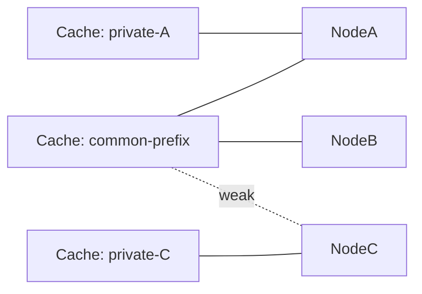
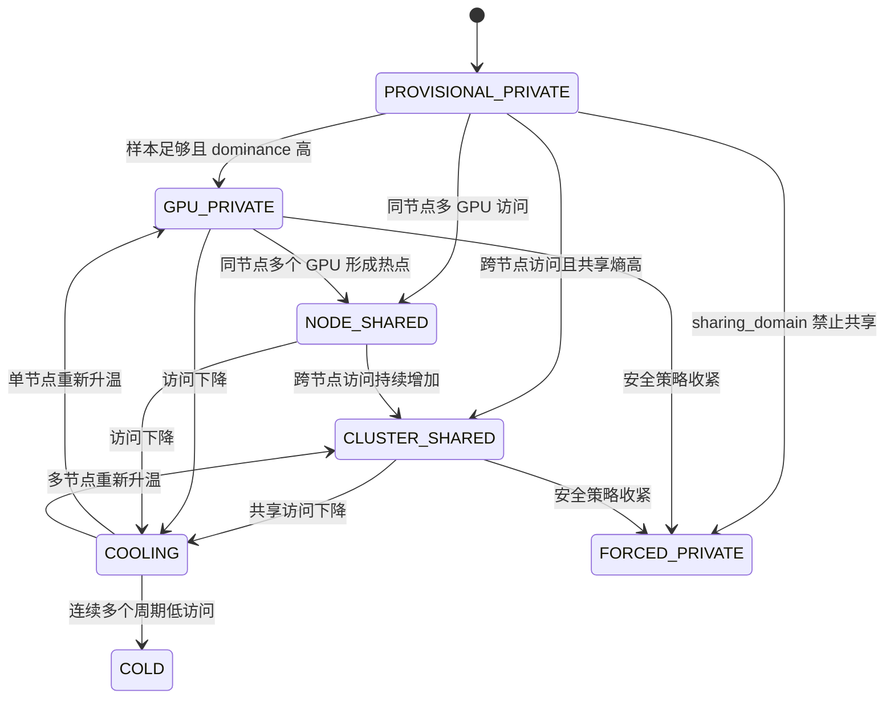
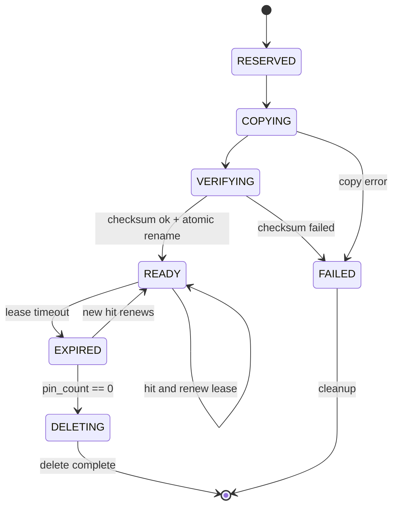

# 动态共享拓扑感知的预算化 KV Cache 副本放置机制

暂定英文名：

```text
Dynamic Sharing-Topology-Aware Budgeted Replication
```

## 1. 本文解决的问题

KV Cache 能否共享，和共享 KV Cache 应该复制到哪里，是两个不同问题。

第一件事是安全性问题：两个请求的 KV Cache 是否真的兼容？如果模型版本、tokenizer、LoRA、位置编码或租户隔离不同，即使文本看起来相同，也不能共享。

第二件事是放置问题：如果某份缓存确实能共享，它应该只放远端，还是复制到 NodeA、NodeB，还是所有节点都复制？复制多了浪费本地 SSD 和后台带宽；复制少了远端读取多，前台 P99 可能变差。

因此创新点二不是“GPU 亲和力”这么简单，而是：

```text
建立缓存对象和计算节点之间的动态访问图，
在全局/节点重复副本预算下，
按边际收益决定本地副本放置。
```

## 2. 阅读前需要知道的基础概念

### 2.1 KV Cache 共享基础

标准情况下，KV Cache 主要共享相同前缀。比如多个请求都以同一个系统提示词开头，系统提示词对应的 KV 可以复用。相同后缀在不同上下文中通常不能直接共享，因为 Transformer 的位置编码和上下文状态会影响 KV 结果。

所以 cache key 不能只用文件名。AURA-KV 的 `CacheIdentity` 至少需要表达：

```text
model_id
model_version
tokenizer_version
token_prefix_hash
LoRA / Adapter
KV dtype
Transformer 层范围
position encoding
tensor parallel
pipeline parallel
cache schema version
tenant_id / sharing_domain
```

当前代码中 `CacheIdentity.share_safe_key` 位于 `aura_kv/core.py`。测试 `test_cache_identity_blocks_cross_domain_sharing` 会验证不同 sharing_domain 不能共享。

### 2.2 逻辑共享和物理副本

逻辑共享表示多个请求引用同一个缓存对象。物理副本表示这个对象在某个节点本地 SSD 上有一份 READY 文件。

```text
逻辑对象 common-prefix
  |
  +-- 远端权威副本
  +-- NodeA 本地副本
  +-- NodeB 本地副本
```

远端权威副本负责可靠恢复；本地副本负责加速前台读取。本地副本可以过期、删除和重建。

## 3. 通俗场景示例

假设 NodeA 和 NodeB 都在跑问答服务：

```text
NodeA GPU0: 使用公共系统提示词 S
NodeA GPU1: 也使用 S
NodeB GPU0: 使用同一个 S
NodeC GPU0: 完全不同任务
```

如果 `/remote/gpu0`、`/remote/gpu1` 只是按 GPU 分目录，它只能说明逻辑归属，不能解决以下问题：

```text
S 是否真的可以共享？
NodeA 的两个 GPU 是否应该各保存一份？
NodeB 是否值得建立本地副本？
NodeC 是否不该复制？
远端读取 P99 高时是否应该更积极复制？
本地空间紧张时该删哪个副本？
```

AURA-KV 的回答是：以计算节点为副本单位，建立访问图，按预算和边际收益决定。

## 4. 为什么不能简单按照 GPU 分目录

目录：

```text
/remote/gpu0
/remote/gpu1
```

解决的是“谁的逻辑空间”和“配额如何隔离”。它不能自动解决：

```text
相同公共前缀重复保存
多节点远端访问过多
本地副本数量控制
网络竞争和远端长尾
P99 延迟
共享数据放置
```

尤其是同一计算节点上的多个 GPU 通常共享一块本地 SSD。如果 NodeA 的 GPU0 和 GPU1 都访问 common-prefix，本地只需要一份节点级物理副本。为每个 GPU 都保存一份完全相同的本地文件，会浪费空间。

## 5. CacheNodeGraph 动态访问图

AURA-KV 把访问关系建成二部图：



左侧是缓存对象，右侧是计算节点。边表示访问关系，边权不是简单累计次数，而应包含：

```text
时间衰减访问次数
前台读取次数
读取字节数
避免的重计算时间
最近访问时间
预测窗口内访问需求
同节点多 GPU 聚合访问
```

当前 simulator 中 `TraceSimulator.access_graph` 已实现简化访问计数；`SharednessClassifier` 使用节点级统计分类。更完整的边权结构是后续任务。

### 5.1 为什么以节点为副本单位

GPU 信息仍然有用，因为它告诉我们请求来自哪张 GPU、同节点是否多个 GPU 共享。但物理副本应该以节点为单位，因为：

```text
同一节点多个 GPU 通常共享本地 SSD
一个节点本地副本即可服务该节点多个 GPU
节点级副本更容易做容量预算
跨节点才真正涉及网络和远端读取
```

## 6. 私有与共享状态机

每个缓存对象至少有以下状态：

| 状态 | 定义 | 进入条件 | 退出条件 | 推荐副本策略 |
|---|---|---|---|---|
| `PROVISIONAL_PRIVATE` | 新创建，样本不足 | 创建后访问样本少 | 样本达到阈值 | 不急着复制 |
| `GPU_PRIVATE` | 访问高度集中在单 GPU/单节点 | dominance 高 | 其他节点访问增加 | 生产者或热点节点本地保留 |
| `NODE_SHARED` | 同节点多个 GPU 经常访问 | 同节点访问聚合高 | 跨节点访问增加或变冷 | 一份节点级本地副本 |
| `CLUSTER_SHARED` | 两个以上节点持续访问 | 共享熵高、跨节点访问足够 | 共享下降 | 预算化多节点副本 |
| `COOLING` | 曾经热但正在下降 | 近期访问下降 | 继续冷却或重新升温 | 减少续租 |
| `COLD` | 长时间无有效访问 | 超过冷却时间 | 新访问出现 | 不主动复制 |
| `FORCED_PRIVATE` | 安全策略禁止共享 | sharing_domain 不允许 | 策略变更 | 禁止跨域共享 |



状态变化不能因为一次偶然访问就触发，必须有最小样本数、双阈值、cooldown 和连续周期确认。

## 7. 共享指标公式

时间衰减访问分数：

```text
a_i(t) = Σ exp(-(t - t_j) / tau)
```

节点访问比例：

```text
p_i = a_i / Σa_i
```

标准化共享熵：

```text
sharedness_entropy =
    -Σ(p_i * ln(p_i)) / ln(active_node_count)
```

变量：

| 变量 | 含义 | 单位 | 来源 |
|---|---|---|---|
| `i` | 节点 | node id | AccessEvent |
| `t` | 当前时间 | 秒 | 控制器时钟 |
| `t_j` | 历史访问时间 | 秒 | access trace |
| `tau` | 衰减时间常数 | 秒 | 配置 |
| `a_i` | 节点 i 的衰减访问强度 | 次 | 计算得到 |
| `p_i` | 节点 i 的访问占比 | 0-1 | 计算得到 |
| `active_node_count` | 有有效访问的节点数 | 个 | access graph |

dominance：

```text
dominance = max(p_i)
```

cross_node_ratio：

```text
cross_node_ratio = cross_node_accesses / total_accesses
```

### 7.1 计算例子

假设 common-prefix 最近窗口访问：

```text
NodeA: 10 次
NodeB: 8 次
NodeC: 0 次
```

则：

```text
total = 18
pA = 10/18 = 0.556
pB = 8/18 = 0.444
dominance = 0.556
active_node_count = 2
entropy ≈ -(0.556 ln 0.556 + 0.444 ln 0.444) / ln 2 ≈ 0.99
```

这说明访问不是单节点私有，而是很强的跨节点共享。如果最小样本和跨节点访问次数都满足，则可进入 `CLUSTER_SHARED`。

当前 `SharednessClassifier` 已实现 dominance、entropy、active_node_count 和 cross_node_accesses 的简化版本。

## 8. 边际副本收益

为什么不能固定复制 N 份？因为不同缓存大小、重算成本、访问分布和远端延迟不同。一个 10 MiB 高频公共前缀可能值得复制到多个节点；一个 20 GiB 低价值后缀即使访问两次，也未必值得复制。

设计公式：

```text
ReplicaMarginalBenefit(k,n) =
    predicted_local_hit_saving(k,n)
  + avoided_remote_io_cost(k,n)
  + avoided_recompute_cost(k,n)
  + slo_violation_reduction(k,n)
  - replica_creation_cost(k,n)
  - local_space_shadow_price(n)
  - global_duplicate_shadow_price
  - background_bandwidth_shadow_price
  - foreground_interference_cost(n)
  - churn_penalty(k,n)
```

然后用收益密度排序：

```text
benefit_density(k,n) =
    ReplicaMarginalBenefit(k,n) / size_bytes(k)
```

这样可以避免大文件只凭总收益垄断本地空间。

### 8.1 数值案例

缓存 A：

```text
大小 100 MiB
预测 NodeB 未来访问 10 次
本地命中相比远端每次节省 8 ms
创建副本成本 5 ms 等价
本地容量价格 0.05 ms/MiB -> 5 ms
全局重复价格 0.02 ms/MiB -> 2 ms
churn 惩罚 3 ms
```

计算：

```text
benefit = 10 * 8 - 5 - 5 - 2 - 3 = 65 ms
density = 65 / 100 = 0.65 ms/MiB
```

缓存 B：

```text
大小 1000 MiB
预测收益 200 ms
成本 50 ms
density = 150 / 1000 = 0.15 ms/MiB
```

虽然 B 总收益更高，但单位空间收益低。在容量紧张时 A 更优。

如果创建新副本需要先淘汰旧副本，必须比较：

```text
new_replica_benefit - victim_retention_benefit
```

只有超过 `minimum_replacement_gain` 才替换，避免微小收益导致 churn。

## 9. 重复容量预算

远端权威副本不算本地重复预算；本地加速副本计入 duplicate bytes。

关键概念：

| 概念 | 含义 |
|---|---|
| 权威副本 | 远端可恢复主数据 |
| 本地加速副本 | 节点 SSD 上用于加速的缓存 |
| `duplicate_bytes` | 所有本地加速副本占用空间 |
| 全局预算 | 整个集群允许的重复空间 |
| 节点预算 | 单节点允许的重复空间 |
| 预算预留 | 决定复制前先占额度 |
| 预算提交 | 副本 READY 后正式占用 |
| 预算释放 | 副本删除后释放 |

并发超卖例子：

```text
全局剩余预算 100 MiB
线程 T1 想创建 80 MiB 副本
线程 T2 也想创建 80 MiB 副本
如果二者同时看到剩余 100 MiB，就可能提交 160 MiB
```

解决方式是事务或全局决策锁：

```text
BEGIN TRANSACTION
检查预算
写 budget_reservation
提交
```

当前 simulator 是单线程，预算检查在 `AuraKVPolicy` 中完成；真正并发预算预留仍是 Planned。

## 10. 副本租约

本地副本不能永久存在，因为热点会变化。租约机制让副本“有有效期”：

```text
lease_created_at
lease_expire_at
last_renew_at
last_hit_at
pin_count
```



当前 `Replica` 数据结构已有 `lease_expire_at`、`last_hit_at`、`pin_count` 字段；完整后台 lease manager 尚未实现。

## 11. 请求读取与副本建立

前台读取路径必须快：

```text
1. 当前节点有 READY 副本 -> 立即本地读取
2. 没有本地副本 -> 立即选择远端、peer 或重算
3. 记录访问事件
4. 后台控制器稍后决定是否创建本地副本
```

为什么不在远端读取后立刻无条件缓存？因为这样会把一次偶然访问也复制成本地副本。AURA-KV 需要等待访问图和边际收益证明这份数据值得复制。

## 12. 完整示例

### 12.1 单 GPU 私有热点

NodeA GPU0 反复访问 private-A。状态是 `GPU_PRIVATE`，远端权威副本存在。本地应保留 1 份，不需要复制到 NodeB。

### 12.2 同节点两个 GPU 共享

NodeA GPU0 和 GPU1 都访问 system-prefix。因为它们共享 NodeA 本地 SSD，只保存一份 NodeA 节点级副本。

### 12.3 三个节点跨节点共享

NodeA、NodeB、NodeC 都访问 common-doc-prefix。共享熵高，但副本预算有限。系统按 benefit_density 选择收益最高的两个节点，而不是三节点全复制。

### 12.4 热点从 NodeA 移到 NodeB

前半段 NodeA 访问多，后半段 NodeB 访问多。状态先是 NodeA 主导，随后进入 `COOLING` 或 shift。系统应先让 NodeB 副本升温并续租，再等 NodeA 副本过期删除，避免立即来回抖动。

### 12.5 共享缓存逐渐变冷

common-prefix 曾经 `CLUSTER_SHARED`，但多个周期无访问。租约不再续期，副本进入 `EXPIRED`，GC 删除本地副本，远端权威副本仍保留。

### 12.6 共享度高但副本收益为负

一个 30 GiB 的共享后缀被两个节点访问，但远端读取很快、重算代价低、本地容量紧张。共享熵高不代表一定复制；benefit_density 可能为负，因此输出 `DEFER`。

### 12.7 不同 tenant 的相同前缀不能共享

tenantA 和 tenantB 都有相同系统提示词文本，但 sharing_domain 不同。`CacheIdentity.share_safe_key` 不同，系统必须禁止跨 tenant 命中和复制。

## 13. 与创新点一的交互

创新点二向创新点一提供：

```text
当前全局副本位置
共享状态
当前重复空间压力
删除某副本后的替代来源
其他节点副本是否 READY
```

创新点一向创新点二提供：

```text
未来各节点访问预测
冷却概率
重算代价
前缀依赖价值
预测置信度
```

如果二者分开运行，副本模块可能为共享热点创建副本，而替换模块因为本地空间不足马上删掉它；或者替换模块刚删掉低置信度但高共享价值的前缀，副本模块又重新复制回来。

## 14. 实验验证

要验证创新点二，应比较：

```text
ProducerLocal
StaticNReplica
AffinityOnly
AURA-KV
```

核心问题：

```text
副本数量是不是越多越好？
相同预算下本地命中率和 P99 是否改善？
相同 P99 下重复空间是否减少？
热点移动时 churn 是否受控？
几乎无共享时额外开销是否很小？
状态分类是否稳定？
双阈值和租约是否减少抖动？
不同 sharing_domain 是否隔离？
```

当前可运行：

```bash
python3 scripts/aura_kv_sim.py --output reports/latest/aura-kv-sim
```

查看：

```text
reports/latest/aura-kv-sim/aura_sim_report.md
```

结果是 `SIMULATED RESULT`。

## 15. 容易误解的地方

1. **共享不等于所有 GPU 都复制。** 共享只是说明有多方访问，是否复制还要看收益和预算。
2. **GPU 目录不等于副本策略。** `/gpu0` 只是逻辑归属，不代表物理放置。
3. **同节点多个 GPU 不应重复保存。** 若共享同一块本地 SSD，一份节点级副本即可。
4. **副本删除不等于数据丢失。** 只要远端权威副本还在，本地副本可以安全回收。
5. **共享状态需要防抖。** 一次偶然跨节点访问不能让缓存变成 CLUSTER_SHARED。

## 16. 实现状态

| 功能 | 状态 | 对应代码 | 对应测试 | 未完成原因 | 后续计划 |
|---|---|---|---|---|---|
| CacheIdentity 共享安全键 | Implemented | `aura_kv/core.py` | `tests/aura_kv_unit_test.py` | 无 | 加入真实模型 schema |
| 访问图 | Partial | `TraceSimulator.access_graph` | `scripts/aura_kv_test.sh` | 目前只统计节点访问次数 | 增加衰减边权和字节权重 |
| 共享状态分类 | Implemented | `SharednessClassifier` | `tests/aura_kv_unit_test.py` | 状态少于最终设计 | 加入 COOLING/COLD 完整转换 |
| 节点级副本 | Implemented in simulator | `NodeState.replicas` | simulator | FUSE 主路径仍按 GPU local root | 后续映射到计算节点级目录 |
| 边际副本收益 | Partial | `AuraKVPolicy.on_access()` | `scripts/aura_kv_test.sh` | 当前公式简化 | 引入完整 bandwidth/interference 项 |
| 重复预算 | Partial | `AuraKVPolicy` | simulator | 单线程，无事务预留 | 增加 budget_reservations 表 |
| 副本租约 | Partial | `Replica` 字段 | 无独立测试 | 缺少后台 lease manager | 实现续租、过期和恢复测试 |
| 租户隔离测试 | Implemented | `tests/aura_kv_unit_test.py` | unit test | 无 | 加入集成 trace 场景断言 |
