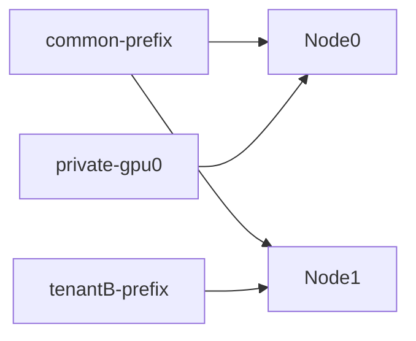
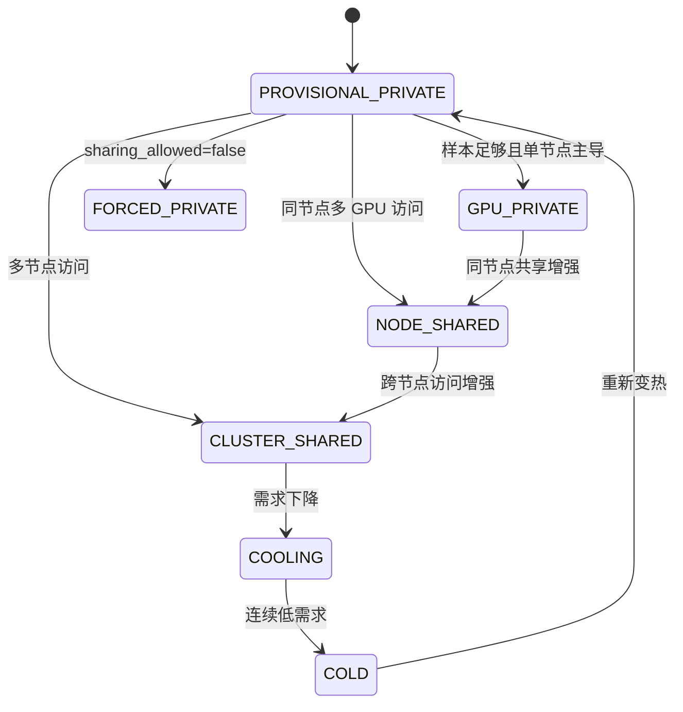
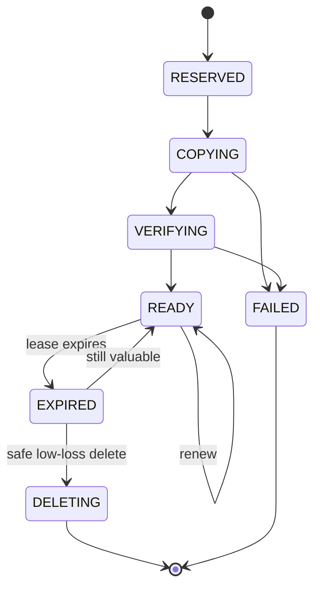

# 动态共享拓扑感知的预算化 KV Cache 副本放置机制

## 1. 本文解决的问题

KV Cache 能否共享，和共享 KV Cache 应该复制到哪里，是两个不同问题。共享安全由 `CacheIdentity.share_safe_key` 决定；副本放置由未来有效需求、来源代价、复制完成时间和预算约束共同决定。

本机制回答：

```text
在节点 n 为缓存 k 新增一个 READY 本地副本，未来窗口内能降低多少累计服务代价？
```

## 2. 共享基础

标准情况下，KV Cache 主要共享相同前缀。cache key 不能只用文件名，必须包含模型版本、tokenizer、LoRA、KV dtype、位置编码、并行配置、schema version、tenant 和 sharing_domain。

逻辑共享表示多个请求引用同一缓存对象；物理副本表示该对象在某节点本地 SSD 上有一份 READY 文件。远端 NVMe-oF 层保存权威副本，本地副本只是加速缓存。

## 3. 动态访问图

AURA-KV 使用缓存对象到计算节点的访问关系：



边权来自时间衰减有效访问次数。同节点多个 GPU 聚合到节点级副本，因为它们通常共享同一块本地 SSD；GPU 信息仍用于解释访问来源和任务归属。

## 4. 私有和共享状态

状态包括 `PROVISIONAL_PRIVATE`、`GPU_PRIVATE`、`NODE_SHARED`、`CLUSTER_SHARED`、`COOLING`、`COLD`、`FORCED_PRIVATE`。



状态用于生成候选，而不是直接决定复制。共享程度高但远端很快、缓存很大或未来需求下界低时，仍可能不复制。

## 5. 鲁棒副本收益

新增节点 `n` 上缓存 `k`：

```text
X_add = X ∪ {(k,n)}

D_ready(k,n) =
    CopyQueueDelay(n)
  + SourceReadTime(k)
  + Size(k) / AvailableBackgroundBandwidth(n)
  + VerificationTime(k,n)
  + MetadataCommitTime(k,n)

H_remaining = max(H - D_ready(k,n), 0)

ReplicaGain(k,n,H) =
    Σ_m N_effective_lower(k,m,H_remaining)
    * max(C_X(k,m) - C_X_add(k,m), 0)
```

如果 `D_ready >= H`，收益为 0。

单位空间收益：

```text
ReplicaGainDensity = ReplicaGain / Size(k)
```

密度用于筛选；最终执行仍检查完整候选布局和硬约束。

### 数值案例

Node1 未来需求下界为 20 次。当前从远端读 30 ms；新增 Node1 本地副本后变成 5 ms。副本 100 秒后 READY，预测窗口 600 秒，因此还有 500 秒产生收益：

```text
ReplicaGain = 20 * max(30 - 5, 0) = 500 ms
```

若缓存大小 100 MiB：

```text
ReplicaGainDensity = 5 ms/MiB
```

若远端读取已经是 6 ms，本地读取 5 ms：

```text
ReplicaGain = 20 * 1 = 20 ms
```

即使共享度高，也可能因为收益小而不复制。

## 6. 重复容量预算

本地副本占用重复容量。系统同时检查：

```text
DuplicateBytes(X') <= GlobalDuplicateBudgetBytes
DuplicateBytes(n,X') <= NodeDuplicateBudgetBytes(n)
```

并发复制必须先预留预算，完成后提交，失败后释放。当前 simulator 是单线程，预算检查已实现；真实并发执行器需要 decision transaction。

## 7. 副本租约

租约用于稳定副本生命周期，不进入核心代价公式。租约到期后只是标记为重新评估，不能自动删除。删除仍需重新计算 `EvictionLoss` 并通过安全约束。



## 8. 读取与复制流程

前台读取：

```text
当前节点有 READY 副本 -> 本地读
否则选择 peer / remote / recompute 中代价最低来源
记录访问事件
不等待后台复制
```

后台控制器：

```text
更新需求下界
计算 ReplicaGain
检查容量、重复预算、后台带宽、SLO、sharing_domain
通过后才复制
```

## 9. 示例

### 单 GPU 私有热点

需求集中在 Node0，Node1 需求下界接近 0。Node0 副本收益高，Node1 副本收益为 0。

### 同节点两个 GPU 共享

Node0 的 GPU0 和 GPU1 都访问同一公共前缀。物理副本只需一份放在 Node0 本地 SSD，不为每张 GPU 重复保存。

### 跨节点共享

Node0、Node1 都有稳定需求。若远端 P99 高且复制时间短，Node1 新副本的 `ReplicaGain` 为正；若远端足够快或需求下界低，则不复制。

### 热点移动

Node0 需求下降，Node1 需求上升。Node1 的 `ReplicaGain` 增大；Node0 副本是否删除由 `EvictionLoss` 判断。

### tenant 隔离

tenantA 和 tenantB 的相同前缀拥有不同 `share_safe_key`，不能作为彼此来源。

## 10. 测试和实验

需要验证：

```text
READY 来源增加不会提高最优来源代价
D_ready >= H 时 ReplicaGain=0
未来需求为 0 时 ReplicaGain=0
同节点多个 GPU 只保留一个物理副本
预算不会超卖
租约到期不会无条件删除
不同 sharing_domain 不能共享
```

baseline 包括 StaticNReplica、AffinityOnly、IndependentControllers、OracleDemand 和 ExhaustiveOptimal。

## 11. 容易误解的地方

1. 副本不是越多越好，复制也有时间、空间和后台带宽成本。
2. 共享状态只负责生成候选，是否执行由 `ReplicaGain` 和硬约束决定。
3. GPU 分目录只能解决逻辑归属，不能解决共享对象的节点级副本放置。
4. 本地副本是远端权威副本的加速副本，不是唯一可靠数据。

## 12. 实现状态

| 功能 | 状态 | 对应代码 | 对应测试 | 未完成原因 | 后续计划 |
|---|---|---|---|---|---|
| 共享安全键 | Implemented | `aura_kv/core.py` | unit | 无 | 接入真实 KV schema |
| 动态访问图 | Partial | `TraceSimulator.access_graph` | simulator | 当前统计简单 | 增加衰减边权 |
| 状态分类 | Implemented | `SharednessClassifier` | unit/sim | 状态迁移未完整持久化 | 接入 DB |
| ReplicaGain | Implemented | `aura_kv/layout.py` | unit | 真实后台 metrics 未接入 | 接入 NVMe-oF 指标 |
| 重复预算 | Partial | `LayoutConstraints` | unit | simulator 单线程 | 增加预算事务 |
| 副本租约 | Partial | `Replica` 字段 | unit | 缺后台 lease manager | 加 recovery 测试 |
