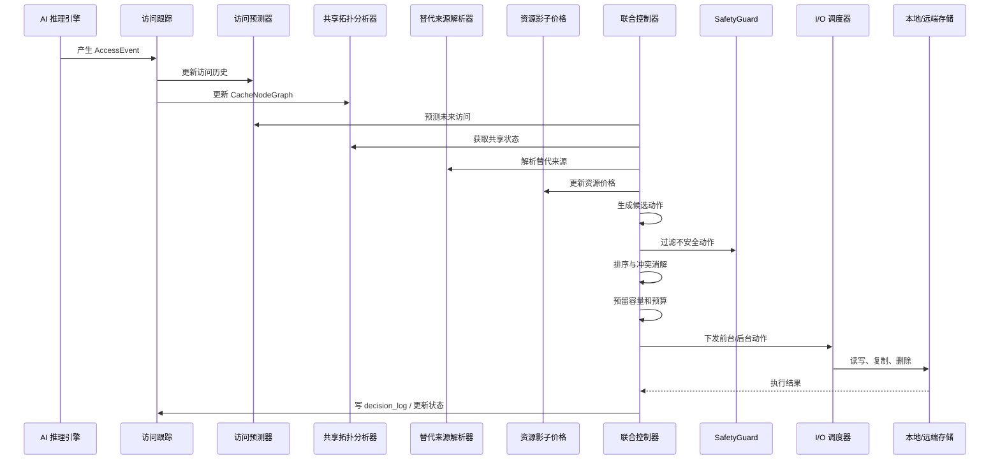

# AURA-KV 联合在线控制器：替换、复制、迁移和资源约束的统一决策

## 1. 本文解决的问题

AURA-KV 有两个候选创新：

```text
创新点一：替代来源与前缀结构感知的多动作替换
创新点二：动态共享拓扑感知的预算化副本放置
```

如果二者各自独立运行，会出现冲突。联合控制器的作用是把“该不该保留本地缓存”和“该不该为共享缓存创建副本”放进同一个控制周期，统一检查容量、重复预算、前台 P99、安全来源和动作依赖。

通俗类比：一个仓库里有采购员和清仓员。采购员看到某商品要火，就进货；清仓员看到仓库满了，就把它清掉。如果两人不沟通，就会出现“刚进货又清掉，刚清掉又进货”。联合控制器就是仓库经理，统一看需求、库存、预算和运输能力后再下命令。

## 2. 两个模块分别运行会出现什么冲突

### 冲突 1：刚删除又复制

替换模块看到 NodeA 空间满了，删除 common-prefix 的本地副本。副本模块随后看到 common-prefix 是跨节点共享热点，又把它复制回 NodeA。结果是 churn 增加，后台 I/O 浪费。

### 冲突 2：复制大文件迫使淘汰更有价值缓存

副本模块给 NodeB 复制 20 GB 大后缀，只因为它最近被访问两次。复制完成后 NodeB 空间不足，替换模块只好删除一个 100 MB 高重算公共前缀。总命中率可能上升，但 P99 和重算成本变差。

### 冲突 3：预算超卖

全局重复预算剩余 100 MiB。两个模块或两个线程同时认为预算足够，各自创建 80 MiB 副本，最终占用 160 MiB。没有原子预留就会超卖。

### 冲突 4：共享状态和 AI 预测相反

共享拓扑模块刚把某缓存升级为 `CLUSTER_SHARED`，但 AI 预测热点即将结束。若不联合，副本模块会复制，替换模块很快删除。

### 冲突 5：缓存所在节点不等于请求应调度节点

NodeA 有本地缓存，但 NodeA GPU 队列过载；NodeB 没本地缓存但空闲。如果上层只看缓存亲和，可能把请求调到 NodeA，反而增加端到端延迟。

### 冲突 6：后台迁移影响前台 P99

副本模块大量复制远端数据，占用 NVMe-oF 带宽，前台读取 P99 升高。替换模块可能只看到缓存收益，没看到后台干扰。

这些冲突说明：两个创新点不是两个 if-else，而要在同一决策器中联合优化。

## 3. 联合控制器的职责

联合控制器负责：

```text
收集访问事件
聚合访问统计
运行访问预测
更新共享拓扑
解析替代来源
更新全局副本视图
更新资源影子价格
生成候选动作
检查容量、预算和 SLO
处理动作依赖和冲突
排序并选择动作
原子预留资源
下发前台或后台任务
写 decision_log
根据执行结果更新状态
```

当前代码中 `AuraKVPolicy` 是联合控制器的简化原型，位于 `aura_kv/policies.py`。它已经在一次访问决策中同时读取预测、共享状态、替代来源、容量价格和重复预算；完整周期控制器、事务和后台执行器仍是 Planned。

## 4. 完整控制周期



每个 controller interval 中发生：

1. 获取最近访问事件。
2. 聚合每个 cache-node 边权。
3. 更新节点性能指标，例如本地使用率、远端 P99。
4. 运行 AI/EWMA 预测。
5. 更新共享分类。
6. 更新全局副本视图。
7. 解析每个缓存的替代来源。
8. 更新资源影子价格。
9. 生成候选动作：KEEP、PROMOTE、REPLICATE、DEMOTE、EVICT、DROP、PREFETCH。
10. SafetyGuard 过滤。
11. 计算联合收益。
12. 处理动作依赖。
13. 处理动作冲突。
14. 原子预留预算。
15. 执行动作。
16. 写 decision_log。
17. 根据结果更新状态。

## 5. 联合优化模型

定义变量：

| 变量 | 含义 | 类型 |
|---|---|---|
| `x(k,n)` | 节点 n 是否保存缓存 k 的 READY 本地副本 | 0/1 |
| `a(k,n)` | 对缓存 k 在节点 n 的动作 | 枚举 |
| `C_n` | 节点 n 本地 SSD 容量 | byte |
| `D` | 全局重复副本预算 | byte |
| `B_n` | 节点 n 后台迁移带宽预算 | byte/s |
| `SLO` | 前台 P99 目标 | ms |

约束：

```text
Σ_k x(k,n) * size(k) <= C_n
Σ_n Σ_k x(k,n) * size(k) <= D
background_bytes(n) <= B_n
foreground_p99 <= SLO 或触发后台降速
sharing_domain 不同不能共享
没有替代来源时禁止删除
```

目标不是抽象数学，而是对应实际系统问题：

```text
降低 P99 TTFT
减少远端读取
减少重算
减少重复空间
减少迁移干扰
减少 churn
```

当前实现使用在线启发式近似，而不是求解全局整数规划。原因是 KV Cache 访问是在线到达的，精确求解成本太高。

## 6. 资源影子价格

生活类比：停车场空位很多时，停车价格低；快满时价格高。资源影子价格也是这样：本地 SSD 越满，保留或创建本地副本的成本越高；远端 P99 越差，减少远端读取的收益越高。

当前设计维护：

| 价格 | 含义 | 单位 | 当前代码 |
|---|---|---|---|
| `lambda_capacity[n]` | 节点 n 本地容量价格 | ms 等价/MiB | `ResourcePrices` |
| `lambda_duplicate` | 全局重复空间价格 | ms 等价/MiB | `ResourcePrices` |
| `lambda_background_bw[n]` | 后台带宽价格 | ms 等价/MiB | Planned |
| `lambda_slo` | 前台 P99 SLO 违反价格 | ms 等价 | `ResourcePrices` 基础字段 |

更新公式：

```text
lambda_capacity[n] =
    max(0, lambda_capacity[n] + eta_capacity * (used_ratio[n] - capacity_target))

lambda_duplicate =
    max(0, lambda_duplicate + eta_duplicate * (duplicate_ratio - duplicate_target))

lambda_slo =
    max(0, lambda_slo + eta_slo * (observed_p99 - target_p99))
```

变量：

| 变量 | 含义 | 单位 |
|---|---|---|
| `eta_capacity` | 容量价格学习率 | 无量纲 |
| `used_ratio` | 本地 SSD 使用率 | 0-1 |
| `capacity_target` | 目标使用率 | 0-1 |
| `duplicate_ratio` | 重复副本占总本地容量比例 | 0-1 |
| `observed_p99` | 当前前台 P99 | ms |
| `target_p99` | 目标 P99 | ms |

三个周期示例：

```text
周期 1: used_ratio=0.70, target=0.80, lambda_capacity=0
        价格保持 0，系统可以较积极复制

周期 2: used_ratio=0.88, eta=0.10
        lambda += 0.10*(0.88-0.80)=0.008
        创建副本成本上升

周期 3: used_ratio=0.95
        lambda += 0.10*(0.95-0.80)=0.015
        低收益副本被推迟或淘汰
```

为了防止振荡，后续应加入上下限、平滑窗口、最小驻留时间和 hysteresis。当前实现是基础版。

## 7. 动作依赖与冲突

动作依赖规则：

```text
REPLICATE 依赖远端权威副本或 peer READY 副本存在
EVICT_LOCAL 依赖替代来源可用
DEMOTE 必须先写远端成功，才能删除本地
DROP_RECOMPUTABLE 依赖允许重算
PIN 会阻止 DELETE/EVICT
COPYING 状态不能再次复制
同一缓存同一版本不能同时 REPLICATE 和 DELETE
```

动作冲突矩阵：

| 动作 A | 动作 B | 是否冲突 | 处理 |
|---|---|---|---|
| `REPLICATE` | `EVICT_LOCAL` 同一节点同一缓存 | 是 | 比较联合收益，只保留一个 |
| `PROMOTE` | `DEMOTE` 同一缓存 | 是 | 以版本号和状态机为准 |
| `PREFETCH` | `EVICT_LOCAL` | 可能 | 若前台 P99 高，取消 prefetch |
| `PIN` | 任意删除动作 | 是 | `PIN` 优先 |
| `KEEP` | `REPLICATE` 其他节点 | 否 | 可同时存在 |
| `DELETE` | `READY hit` | 是 | 正在读取时禁止删除 |

当前 simulator 中冲突处理较简化，主要通过单线程策略避免并发；真实系统需要 decision transaction。

## 8. 决策事务

决策事务要保证：

```text
两个控制线程不会同时修改同一缓存
预算不会超卖
元数据版本不会被旧决策覆盖
动作失败后可以回滚
控制器重启后能恢复未完成动作
```

建议字段：

```text
decision_id
cache_key
cache_version
action
status
budget_reservation_id
created_at
updated_at
reason
```

执行方式：

```text
BEGIN TRANSACTION
读取 cache_version
检查状态和预算
写 budget_reservation
写 decision_log
提交
后台执行任务
完成后 CAS 更新 cache_version
失败则释放 reservation
```

当前 TokenFS 主路径已有 SQLite 和 WAL；AURA-KV 研究层尚未实现真实 decision transaction。

## 9. 前后台 I/O 联动

前台请求包括：

```text
FOREGROUND_READ
FOREGROUND_WRITE
当前推理必需 KV 获取
```

后台任务包括：

```text
PREFETCH
REPLICATE
PROMOTE
DEMOTE
MIGRATION
GC
EXPIRED_REPLICA_DELETE
```

规则：

```text
前台读取不能等待后台复制
本地未命中时立即选择最优可用替代来源
后台任务用令牌桶或带权队列限速
P99 接近 SLO 时暂停或降低后台带宽
本地危险水位时 GC 可临时提高优先级
```

为什么需要两个阈值：

```text
background_pause_ratio = 0.95
background_resume_ratio = 0.80
```

当 P99 达到 SLO 的 95% 时暂停后台，降到 80% 后恢复。两个阈值形成 hysteresis，避免后台任务反复开关。

时间线示例：

```text
t0: 远端 P99 = 7 ms，SLO = 10 ms，后台复制正常
t1: 大量 REPLICATE 开始，远端 P99 升到 9.8 ms
t2: 控制器检测 9.8/10 > 0.95，暂停非必要 prefetch/replicate
t3: 前台 P99 降到 7.5 ms
t4: 7.5/10 < 0.80，后台以较低速率恢复
```

当前 TokenFS 主路径有 QoS 工程指标和限速配置；完整 `ForegroundAwareIOScheduler` 是 Planned。

## 10. 请求调度提示

缓存在哪，不代表请求必须调度到哪。联合控制器可以给上层提供 node hints：

```text
本地副本是否存在
节点 GPU 队列压力
本地读取预计时间
远端读取预计时间
peer 读取预计时间
重算预计时间
预计完成时间
```

如果 NodeA 有本地副本但 GPU 排队严重，NodeB 远端读取也许更快。缓存亲和只是因素之一，不是唯一调度依据。当前项目尚未接入 vLLM/SGLang 调度器，这部分是 Planned。

## 11. 伪代码

```text
MainControlLoop():
    while running:
        events = read_recent_access_events()
        update_access_graph(events)
        metrics = collect_node_metrics()
        predictions = predictor.predict_all(candidates)
        shared_states = classify_sharedness(candidates)
        replica_view = read_global_replica_view()
        sources = resolve_alternative_sources(candidates)
        prices = update_shadow_prices(metrics, budgets)
        actions = generate_candidate_actions(candidates, predictions, shared_states, sources, prices)
        safe_actions = safety_guard(actions)
        ordered = resolve_conflicts_and_sort(safe_actions)
        selected = reserve_budgets(ordered)
        dispatch(selected)
        write_decision_log(selected)
        sleep(controller_interval)

UpdateShadowPrices():
    for each node:
        lambda_capacity[node] = max(0, lambda_capacity[node] + eta * (used_ratio - target))
    lambda_duplicate = max(0, lambda_duplicate + eta * (duplicate_ratio - target))
    lambda_slo = max(0, lambda_slo + eta * (observed_p99 - target_p99))

GenerateCandidateActions(cache k, node n):
    source = ResolveAlternativeSource(k,n)
    if source == NONE:
        emit PIN
    if local benefit positive:
        emit KEEP or PROMOTE
    if shared benefit density positive:
        emit REPLICATE
    if local pressure high and source safe:
        emit EVICT_LOCAL
    if recompute cheap and safe:
        emit DROP_RECOMPUTABLE

ResolveConflicts(actions):
    group by cache_key and node_id
    remove actions blocked by PIN
    remove duplicate COPYING actions
    compare benefit density
    enforce per-cycle max actions and max bytes

ReserveBudgets(actions):
    begin transaction
    for action in actions:
        check cache_version
        check capacity and duplicate budget
        write reservation
    commit

RecoveryLoop():
    scan decisions in RUNNING state
    scan replicas in COPYING/VERIFYING
    cleanup orphan temp files
    release stale reservations
    retry idempotent actions
```

## 12. 复杂度和系统开销

设缓存对象数量为 K，节点数量为 N。朴素地为每个缓存和每个节点生成动作，复杂度是 O(KN)。在大规模集群中需要筛选候选：

```text
只考虑最近访问过的缓存
只考虑容量压力节点
只考虑共享状态变化的缓存
只考虑预测收益超过阈值的缓存
```

访问图统计复杂度与近期事件数 E 有关，约 O(E)。EWMA 预测可以按缓存维护滑动窗口，避免扫描全部历史。第一版可以采用中心控制器，因为当前目标是研究原型和小规模实验；后续可按 sharing_domain、cache_key hash 或节点分片演化为分布式控制器。

## 13. 完整端到端案例

设：

```text
Cache A: 100 MiB 跨节点共享高价值前缀，重算 5000 ms
Cache B: 20 GiB 近期访问的大后缀，重算 30 ms
NodeA 本地使用率: 92%
NodeB 远端访问增多
全局重复预算使用率: 85%
前台 P99: 9.4 ms，SLO: 10 ms
AI 预测 Cache A 在 NodeB 继续升温
```

控制器读取：

```text
Cache A predicted_hits(NodeB)=8
Cache A alternative_source=REMOTE_NVME_OF
Cache A prefix_dependency_benefit 高
Cache B predicted_hits(NodeA)=1
Cache B recompute_cost 低
lambda_capacity(NodeA) 上升
lambda_duplicate 中等偏高
lambda_slo 上升
```

候选动作：

```text
保留 A 在 NodeA
复制 A 到 NodeB
删除 B 的本地副本
暂停预取
降低后台带宽
```

决策理由：

```text
A 是高重算共享前缀，保留价值高
NodeB 对 A 的预测访问升温，但 P99 接近 SLO，因此复制应进入限速后台队列
B 虽近期访问，但低重算且占用巨大，适合作为淘汰候选
全局重复预算 85%，复制 A 之前需要确认 density 足够高
暂停非必要 prefetch，避免前台 P99 超过 SLO
```

最终动作可能是：

```text
EVICT_LOCAL(B, NodeA)
REPLICATE(A, NodeB) with background limit
KEEP(A, NodeA)
PAUSE_PREFETCH
```

## 14. 联合方案实验

需要比较：

```text
Innovation 1 only
Innovation 2 only
两个模块独立运行
联合但无资源价格
完整 AURA-KV
```

回答：

```text
联合控制是否减少相互冲突？
是否降低 churn？
是否避免预算超卖？
是否降低 P99？
是否在相同空间下提高收益？
是否在预测错误时仍然稳定？
```

当前 simulator 已有部分 baseline：

```text
RemoteOnly
ProducerLocal
NodeLRU
NodeLFU
StaticNReplica
AffinityOnly
AIReplacementOnly
AlternativeAwareNoLearning
AURA-KV
```

缺少“两模块独立运行”和“联合但无资源价格”的独立 ablation，状态为 Planned。

## 15. 容易误解的地方

1. **联合控制不是把两个分数相加。** 它要处理依赖、冲突、预算和安全。
2. **资源价格不是论文结论。** 当前是在线控制工具，参数需要实验校准。
3. **有本地副本不等于请求必须调度到该节点。** GPU 队列和端到端延迟也要考虑。
4. **后台任务不是越快越好。** 它可能伤害前台 P99。
5. **当前实现是原型。** 完整事务、后台队列和真实 metrics 仍需后续实现。

## 16. 实现状态

| 功能 | 状态 | 对应代码 | 对应测试 | 未完成原因 | 后续计划 |
|---|---|---|---|---|---|
| 联合策略入口 | Partial | `AuraKVPolicy` | `scripts/aura_kv_test.sh` | 目前按访问触发，不是周期控制器 | 实现 controller loop |
| 访问预测接入 | Implemented | `EWMAAccessPredictor` | `tests/aura_kv_unit_test.py` | 无 | 加 learned predictor |
| 共享分类接入 | Implemented | `SharednessClassifier` | unit/sim | 无 | 增加双阈值和 cooldown |
| 替代来源接入 | Implemented | `AlternativeSourceResolver` | sim | 无 | 接入真实 SQLite 元数据 |
| 影子价格 | Partial | `ResourcePrices` | sim | 只实现容量/副本/SLO 基础更新 | 增加后台带宽价格和平滑 |
| 动作冲突矩阵 | Planned | 文档设计 | 无 | simulator 单线程简化 | 增加 conflict resolver |
| 决策事务 | Planned | 文档设计 | 无 | 缺少 decision_log 表 | 增加 SQLite decision/reservation |
| 前后台 I/O 调度 | Partial | `src/main.cpp` QoS 指标/限速 | `advanced_policy_test.sh` | 未接入 AURA-KV 控制器 | 实现 ForegroundAwareIOScheduler |
| 请求调度 hints | Planned | 文档设计 | 无 | 未接入推理引擎 | 预留 API |
