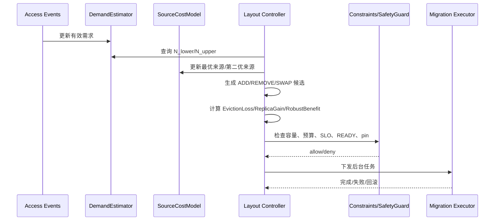

# AURA-KV 联合在线控制器

## 1. 本文解决的问题

替换和副本放置不能分别使用两套互不兼容的分数。删除副本会改变其他节点的最优来源；新增副本也可能要求先删除低价值副本腾空间。因此控制器统一构造候选布局，使用同一套代价模型验证动作。

## 2. 完整控制周期



每个周期执行：

1. 更新访问统计；
2. 更新 Gamma-Poisson 和 EWMA 需求估计；
3. 更新前缀有效需求；
4. 更新来源延迟和带宽；
5. 更新最优来源和第二优来源；
6. 更新容量和重复预算；
7. 生成 REMOVE 候选；
8. 生成 ADD 候选；
9. 用密度做初筛；
10. 对高优先级候选构造完整布局；
11. 计算 `RobustBenefit`；
12. 检查全部硬约束；
13. 原子预留资源；
14. 下发任务；
15. 写 decision_log；
16. 完成后更新布局版本。

前台读取不等待该控制流程。

## 3. 统一目标函数

布局 `X` 和窗口 `H` 下：

```text
J(X,H,N) =
    Σ_k Σ_m N_effective(k,m,H) * C_X(k,m)
```

单位是毫秒。该值表示未来窗口内获取 KV Cache 的累计服务代价，是在线布局优化的代理目标，不直接等同真实 TTFT P99。

## 4. 布局差分收益

对候选动作 `A`：

```text
DeltaC_A(k,m,t) = C_X(k,m) - C_X_A(t)(k,m)

RobustBenefit(A;X,H) =
Σ_k Σ_m ∫_0^H [
    lambda_lower(k,m,t) * max(DeltaC_A(k,m,t), 0)
  - lambda_upper(k,m,t) * max(-DeltaC_A(k,m,t), 0)
] dt
```

改善部分使用需求下界，退化部分使用需求上界。普通动作只有满足：

```text
RobustBenefit > MinimumLayoutImprovementMs
```

才允许执行。

SWAP 不能简单计算 `ReplicaGain - ΣEvictionLoss`，因为多个动作共同改变最优来源。必须构造完整候选布局重新计算。

## 5. 动作依赖和冲突

| 动作 | 依赖 | 冲突 |
|---|---|---|
| ADD/REPLICATE | 权威副本或可靠来源存在、预算可预留 | 同一 `(k,n)` 已 READY/COPYING |
| REMOVE/EVICT_LOCAL | 删除后仍有可靠来源、无 pin、非读取中 | 同一副本正在 COPYING/VERIFYING |
| DEMOTE | 远端写入和 checksum 完成 | 元数据版本不一致 |
| PREFETCH | 前台 SLO 安全、后台带宽可用 | GC 紧急任务优先 |
| SWAP | ADD 和 REMOVE 都可构成合法布局 | 不能只用局部分数相减 |

## 6. 硬约束

```text
Σ Size(k) on node n <= LocalCapacity(n)
DuplicateBytes(X') <= GlobalDuplicateBudgetBytes
DuplicateBytes(n,X') <= NodeDuplicateBudgetBytes(n)
MigrationBytesPerCycle <= BackgroundBandwidthBudget * ControlInterval
ConcurrentCopyTasks <= MaxConcurrentCopyTasks
```

以下副本禁止普通删除：`pin_count > 0`、正在读取、`RESERVED`、`COPYING`、`VERIFYING`、唯一可靠副本、checksum 未通过、metadata version 不一致、删除后无可靠来源且不可重算。

## 7. 决策事务

真实执行器应使用：

```text
decision_id
cache_version
compare-and-swap
budget reservation
SQLite transaction
idempotent background task
```

当前 simulator 是单线程，已经实现容量和重复预算检查；并发预算预留和 decision_log 持久化为后续任务。

## 8. 前后台 I/O 联动

前台 P99 接近 SLO 时：

```text
暂停普通预取
暂停低收益复制
降低后台带宽
降低后台并发
保留必要 GC、安全恢复和权威写入
```

控制器使用两个阈值避免抖动：暂停阈值高于恢复阈值。当前代码中 `LayoutConstraints.foreground_slo_gate` 已提供门控字段，真实 P99 metrics 接入后可驱动它。

## 9. 伪代码

```text
MainControlLoop:
    collect events and metrics
    update demand estimates
    update source costs
    remove_candidates = []
    add_candidates = []

    for replica in READY replicas:
        loss = EvictionLoss(replica.cache, replica.node, H)
        if loss is finite:
            remove_candidates.add(loss)

    for cache,node in missing local replicas:
        gain = ReplicaGain(cache,node,H)
        if gain > 0:
            add_candidates.add(gain)

    candidates = rank by density
    for candidate in candidates:
        layout_prime = build_candidate_layout(candidate)
        robust = RobustBenefit(candidate, layout_prime)
        constraints = check_hard_constraints(layout_prime)
        if robust.allowed and constraints.allowed:
            reserve budgets
            emit decision
```

## 10. 小规模穷举验证

在 2 个节点、3 至 6 个缓存的模拟器中，可以枚举全部合法布局，计算每个布局的 `J(X)`，比较在线算法和小规模最优布局的差距。该结果只用于验证实现性质，不是完整理论最优证明。

## 11. 实验问题

实验回答：

1. 代价模型是否优于人工权重打分；
2. 替代来源感知是否减少错误删除；
3. 前缀有效需求是否保护高复用前缀；
4. 副本边际收益是否优于固定副本数；
5. 联合控制是否优于两个模块独立运行；
6. 需求上下界是否减少抖动；
7. 远端很快时是否自动减少副本；
8. 相同容量下是否降低 P99 和远端流量。

所有模拟结果必须标记 `SIMULATED RESULT`。

## 12. 实现状态

| 功能 | 状态 | 对应代码 | 对应测试 | 未完成原因 | 后续计划 |
|---|---|---|---|---|---|
| DemandEstimator | Implemented | `aura_kv/demand.py` | unit | 无 | 接入真实 trace |
| SourceCostModel | Implemented | `aura_kv/cost_model.py` | unit | 真实 metrics 未接入 | 接 NVMe-oF metrics |
| EvictionLoss/ReplicaGain | Implemented | `aura_kv/layout.py` | unit | SWAP 简化 | 完整 swap planner |
| RobustBenefit | Partial | `LayoutCostEvaluator` | unit | 当前 ADD/REMOVE 原型 | 扩展完整布局差分 |
| LayoutConstraints | Implemented | `aura_kv/optimization.py` | unit | 并发事务缺失 | 增加 decision_log |
| AURA-KV 策略入口 | Partial | `aura_kv/policies.py` | `aura_kv_test.sh` | simulator 原型 | 接入 FUSE 元数据 |
