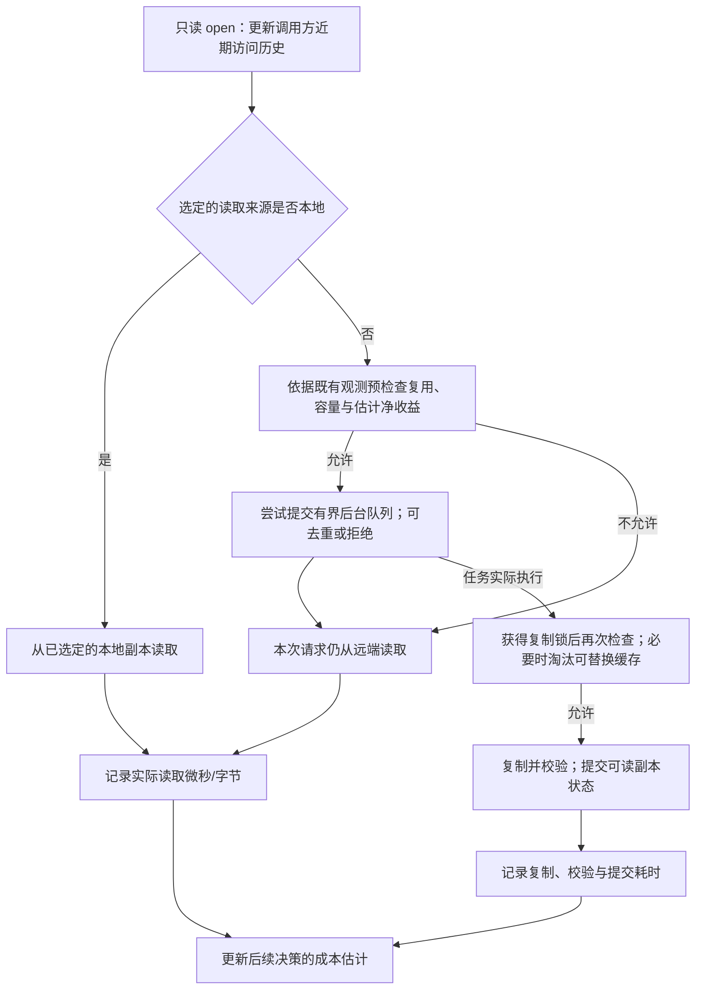

# 第二轮：实测成本准入与有限历史价值

2026-09-19，在查看 formal-02 后启动的新开发工作。formal-02 与其代码、负结果原样保留；它不是新算法的未知测试集。

## 研究假设与实现

新模式 AURA-adaptive 显式启用 measured_policy。每个逻辑域使用最近128次只读 open 的有界频率历史；老热度自然退出。当前 miss 不被计为未来 hit。以前台实际读的微秒/字节差估计缓存节约，以实际复制、双份校验与布局提交耗时估计创建成本。为新对象腾空间时，合计所有被替换对象的估计损失；只有净收益为正才允许复制，并在串行复制锁下再次检查。按预期节约/字节排序 victim，LRU 用于平分时的确定性选择。

当前所有对象共用一个远端/本地每字节服务率差 `s`。整对象读取下，价值为 `max(freq-1,0) * s * bytes`；默认按价值/字节排序会化简为 `max(freq-1,0) * s`，在 `s>0` 时与近期频率同序。因此，实测成本在此实现中主要影响准入及所有 victim 的总损失比较，并没有提供逐对象不同服务成本的排序模型。no-value 对照 LRU 的收益也不能单独证明逐对象成本预测有效。

这是需求估计下的启发式净收益，不是假称已实现 Python 完整 RobustBenefit 或数学最优。冷启动成本先验为未测远端0.01微秒/字节、未测本地为远端一半、未测复制为一次远端读取；测到成本后替换先验。先验是估计，不注入延迟。所有策略实际 I/O 路径和复制校验相同，新策略额外计算开销计入任务时间。

本轮每次请求完整读取一个不可变对象。当前收益估计按对象完整字节数计算；任意小片段读取、写入更新和真实模型重计算代价不在已验证范围内。事件区分使用冷启动先验与三类成本样本均已出现的准入；没有实际触发的模型项不因一次耗时差异就被判为有效。

计时边界为请求回放开始至最后请求返回，另外报告复制队列收尾时间；初始化、数据生成、回放后的副本校验和卸载不计入这两个时间。复制成本样本从获得复制锁后开始，不是后台排队等待的预测；排队和共享I/O的实际影响仍体现在回放耗时中。不同策略使用完全相同的边界。 含后台时间只等待 TokenFS 用户态复制队列排空，不等待内核全部写回或卸载；本地副本是可重建缓存，实验未启用 durable_local_cache，因此不能把该时间解释为所有物理 I/O 已持久化完成。

对等 LRU/LFU 和 RemoteOnly 保留；增加 RecentLFU-admit：相同近期频率记录，按频率选择 victim 并比较准入，不使用实测成本或大小密度。它是精确计数参考基线，不冒称复现 TinyLFU 的 sketch、Doorkeeper 或 W-TinyLFU。频率准入思路参考 https://arxiv.org/abs/1512.00727 。

单项消融：no-admission、no-aging、no-value、no-size、no-cost、synchronous；no-joint 同时去掉准入与价值 victim，用于二因素交互。去掉任何组件未必变慢；未触发、无收益和负效应必须保留。禁用准入只解除收益/复用筛选，不解除容量和内容正确性约束。

消融粒度按已实现的开关解释：no-cost 同时去掉实测服务收益与复制成本扣项，换为单位重复访问价值；变长对象的字节权重也随之变化。因此它评价整套成本估值，不是在线校准与固定每字节成本的纯对照，也不能分别证明各成本子项。no-aging 同时关闭自然滑窗与热点重置，no-shift 才只关闭额外重置。没有独立对照的子贡献不能从这些表格中进一步拆出。

## 数据与隔离

合成负载含稳定热点、四阶段热点转移、热点+扫描、所有对象均可入缓存的变长对象、均匀随机。公开应用来源使用 Mooncake FAST'25 conversation/toolagent，固定提交97030cacfbf8db7d0098e35da46c58abbae04593。每份源文件前20%请求只供开发，后80%为后续确认候选；新实验不得调用未来访问序列辅助决策。

官方数据说明：https://github.com/kvcache-ai/Mooncake/blob/97030cacfbf8db7d0098e35da46c58abbae04593/FAST25-release/README.md 。原hash身份和块顺序保持，每个512-token块映射到同样大小的合成payload；不宣称该字节数代表特定模型真实KV体积。饱和顺序回放与原始时间戳回放分开标记；仅后者复现到达时间，二者都不是完整推理或多GPU并发实验。

## 执行与冻结

1. 独立 C++ 单元回归与 FUSE 全内容校验先行；校验数据不进入速度统计。
2. 开发种子从301起，先测短批次定位实现问题，再增加持续时长与容量。开发结果不得作确认性显著提速声明。
3. 根据开发方差、实际收益和运行预算，另行提交固定确认矩阵/样本量/新种子/应用窗口；冻结后才启动确认。不能追加样本直到显著，也不为希望的结论删场景。
4. 主比较为新策略对 LRU、LFU、RecentLFU-admit，所选场景/容量作为一个预先固定的检验家族；各组件单独家族。保留全批次原始请求、动作、配置、源hash、CPU与RSS。含后台完成时间同时报告。
5. 外层 monotonic wall /实际 MiB/s 为主；逐请求 SHA256 只在正确性批次开启。性能运行后完整校验留存副本，复制校验始终开启。
6. cn7→cn13 的专用 namespace，cn8 正确性，cn14禁用。只清理本批自己生成且已完成验证的canonical payload，保留生成种子/哈希，不触及原项目或既有证据。

生产迹线的到达并发、真实GPU拓扑、强SWAP、复制中断恢复、物理峰值约束等仍需对应专项，不能由新准入速度表代替。

## 开发修订 B2（尚未查看确认段）

B1 开发观察：成本门槛比近期频率准入更保守，减少复制不总是提速；固定128次窗口响应短阶段热点转移较慢。修订统一候选/驻留对象的重复访问证据估计，避免只扣减候选当前访问而额外偏向旧缓存。RecentLFU 基线单独使用原始频率比较；no-cost 保留与完整策略相同的需求估计，只去掉成本模型，防止单组件消融夹带估计规则变化。

新加可关闭的需求转移检测：同域连续8次未命中且这8次访问的不同对象数不超过4，保留这8次历史，丢弃旧热度；单次扫描/随机唯一访问不触发。只使用过去观察和已选择的真实数据来源，不读取负载阶段标签。no-shift 单独关闭该检测，no-aging 禁止所有历史遗忘；RecentLFU 基线保持固定近期窗口。检测阈值与时间窗口须在开发后冻结，并包含敏感性检查。

同时补充初始已超配时的腾挪量边界回归，以及 ADMIT 事件中的候选收益、被替换损失、复制成本、频率和是否已有三类成本样本。开发B1、B2代码与结果分别归档，不混为同一正式批次。

## B3：修复持续复用却无法准入的边界

B2 正式确认尚未启动时，代码审查构造出反例：四个对象持续循环访问、复制需要较多复用才能回本，连续未命中会每8次清空一次旧热度，使频率永远达不到准入门槛。逐请求内容校验通过不能发现这种策略活性缺陷。相同反例在B2出现11次重置且始终不准入，在B3零次重置且最终准入；这里的服务成本是确定性单元测试输入，不是实际吞吐证据。

B3 仅在近期集合外存在占优的旧需求时允许清空热度：旧峰值至少为8且超过近期集合峰值的两倍。它仍只使用已观察访问，不读取未来、阶段标签或测试答案。原冻结在运行任何确认请求之前撤回，B2开发数据保留；重新通过正确性、循环复用与逻辑域检查后再冻结。确认样本量与已预先选定且未用于性能测试的窗口不因这个修复改变。

## 复现开关与配置边界

论文中的 `AURA-adaptive` 是完整实验配置名，不能只在旧开发配置里加一个 `measured_policy: true` 就视为相同运行。旧开发配置默认关闭提升/异步，C++ 默认还关闭快速热点重置。完整配置以每次运行的 `config.json` 和 `scripts/measured_study.py::configuration` 为准，包含相同配额、只读 canonical、前台直接 I/O、复制/校验规则及逻辑域路径。

已测完整模式明确设置以下新策略参数：

```yaml
policy:
  measured_policy: true
  measured_window: 128
  measured_aging: true
  measured_admission: true
  measured_cost: true
  measured_value_victim: true
  measured_size_aware: true
  measured_frequency_admission: false
  measured_shift_reset: true
  measured_shift_window: 8
  promote_on_read: true
  async_promote_on_read: true
  cross_gpu_local_cache: true
  async_cross_gpu_replica: true
  prefetch_on_read: false
```

这只是关键开关说明，不是可直接覆盖服务器配置的完整文件。新模式默认未启用；历史 `AURA-core` 结果与新模式分开引用。实验脚本为每个配置生成独立目录，不复用旧缓存、元数据或结果目录。

## 当前 C++ 模式的实际路径



示意图对应异步完整模式；同步消融等待同一复制路径返回。本次 miss 的来源在放置工作前已经选定并固定，不因后台复制完成而追记为 hit。预检查允许不等于保证最终复制，队列执行时还要重新判断。净收益是基于近期访问和实测成本的预测，不能保证每次准入最终回本；实际速度实验检验的是整套策略的结果。

这里的缓存腾挪不构成保留旧副本直至新副本提交的强 SWAP 事务。数据权威副本仍在远端；复制失败恢复、严格物理峰值占用等更强主张需要另外的实现与实验。
