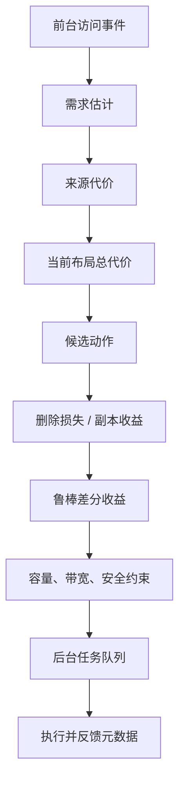

> **当前论文主张边界：** 实测对象是逻辑消费域共享存储放置与 C++ 受害缓存损失感知的联合准入；本页完整理论模型不等于全部接入实测路径。NoJoint 只识别现有准入项的边际作用，不证明物理 GPU 收益、最优控制或超加性。详见[收紧后的论文主张](paper-final-claims.md)。

# 模型与控制器

> 论文收口边界：B3 的性能结果对应 C++ measured 启发式；其准入/副本决策绕过旧亲和状态门槛，不能作为本页完整亲和或联合模型的实测证明。当前有证据的贡献和源码复核见 [最终结果](../reports/latest/paper-experiments/12_paper_closeout/README.md)。

本文说明 AURA-KV 的核心模型如何一起工作。重点不是堆公式，而是解释它们如何共同决定“留谁、删谁、复制到哪里”。

> 实现边界：本页的统一模型主要对应 Python 参考实现，不等于 C++ FUSE 已完整执行全部公式。真实速度实验应按 [证据方案](evidence-experiments.md) 区分 AURA-core 与完整联合模型。Python 控制器目前拒绝没有临时空间的满容量 copy-before-delete；不能把这种拒绝记为已成功 SWAP。同一规划批次会预留容量、复制并发及带宽预算，重复访问不生成重复任务；跨规划批次的持久预留仍待接入任务队列。

## 1. 整体流水线



一句话概括：

```text
先预测未来谁会访问，再估计从哪里取最划算，
然后判断新增副本能省多少、删除副本会亏多少，
最后只有整体收益足够并通过约束时，才交给后台执行。
```

## 2. 需求估计

需求估计回答：

```text
未来一段时间内，某个 GPU 节点可能会访问某个 KV Cache 多少次？
```

AURA-KV 支持 EWMA、Gamma-Poisson 和双窗口趋势估计。核心思想是：越新的访问权重越大，越旧的访问逐渐淡出；同时用短窗口和长窗口判断热点是不是正在转移。

输出不是一个单点，而是：

| 输出 | 用途 |
|---|---|
| `mean` | 平均预期需求 |
| `lower` | 保守下界，用于新增副本 |
| `upper` | 悲观上界，用于删除副本 |

新增副本用下界，因为复制会占空间和带宽，不能太乐观。删除副本用上界，因为误删热点代价更高。

## 3. 来源代价

同一个 KV Cache 可能来自多个来源：

```text
本地 SSD
同节点共享副本
其他节点 Peer 副本
远端 NVMe-oF 权威副本
模型重计算兜底
```

来源代价由固定延迟、队列等待、传输时间、反序列化和 Host-to-Device 成本组成：

```text
C(source, cache) =
    queue_delay
  + fixed_latency
  + cache_size / bandwidth
  + deserialize_cost
  + host_to_device_cost
```

布局 `X` 下，系统选择可用来源里最便宜的一个：

```text
C_X(cache, node) = min available source cost
```

远端 NVMe-oF 是权威层。只要远端或本地副本可用，系统默认不会把重计算当作常规来源来竞争。

## 4. 统一服务代价

统一服务代价回答：

```text
如果未来一段时间保持当前布局不变，所有请求获取 KV Cache 总共要付出多少代价？
```

```text
J(X,H,N) = sum demand(cache,node,H) * C_X(cache,node)
```

这个值不是真实 TTFT，而是控制器使用的代理目标。它让不同策略可以在同一口径下比较。

## 5. 删除损失 EvictionLoss

删除损失回答：

```text
如果删掉某个本地副本，未来访问会多慢多少？
```

直觉例子：

```text
删除前 GPU0 本地读 A：2 ms
删除后 GPU0 只能远端读 A：10 ms
每次多花 8 ms
未来悲观估计还有 20 次访问
EvictionLoss = 160 ms
```

本地空间满了时，系统优先删除 `EvictionLossDensity` 低的对象，也就是单位空间损失最小的对象。

删除前必须满足：

- 远端权威副本存在，或有其他可靠副本。
- 文件不处于复制、校验、迁移状态。
- 未违反最短驻留时间和冷却时间。
- sharing domain 允许。

## 6. 新增副本收益 ReplicaGain

新增副本收益回答：

```text
把远端权威副本复制到某个 GPU 节点本地，未来能省多少？
```

复制不是马上生效，所以要扣除复制完成前的等待：

```text
H_remaining = H - copy_ready_delay
```

直觉例子：

```text
复制前 GPU1 远端读 A：10 ms
复制后 GPU1 本地读 A：2 ms
每次节省 8 ms
保守估计复制完成后还有 15 次访问
ReplicaGain = 120 ms
```

如果对象很大，收益密度会下降，因为它占用更多本地 SSD 和后台带宽。

## 7. 鲁棒布局收益 RobustBenefit

实际动作常常不是单独复制或单独删除，而是组合：

```text
复制高价值 A
删除低价值 B 腾空间
或者先复制新副本再删除旧副本
```

RobustBenefit 衡量候选动作执行后，整个布局是否真的更好：

```text
好处按保守需求下界算
坏处按悲观需求上界算
仍然超过阈值才执行
```

这样可以防止模型因为短时间热度就频繁复制，也可以防止误删未来可能继续热的数据。

## 8. 多 GPU 共享副本放置

共享副本放置不是假设所有 GPU 都共享同一份数据，而是在共享确实出现时做更好的放置：

- 公共 prompt 前缀被多个请求复用。
- 任务迁移后，新 GPU 继续访问旧缓存。
- 多 GPU 推理或调度导致同一 KV Cache 被多个 GPU 读取。
- 一个节点上的多个 GPU 共享同一块本地 SSD。

如果每个 GPU 完全独立工作，策略会自然退化为：

```text
谁产生、谁访问、谁本地缓存；
冷了就淘汰；
远端保留权威副本。
```

当前模型记录长期主访问方、短期主访问方、趋势、目标副本数和防抖动状态。副本数量由收益、容量、预算和冷却时间共同决定，不是越多越好。

## 9. 防抖动机制

系统避免这种来回抖动：

```text
GPU0 刚热 -> 复制到 GPU0
GPU1 短暂访问 -> 马上迁到 GPU1
GPU0 又热 -> 又迁回 GPU0
```

当前采用：

- 短窗口热度识别最近热点。
- 长窗口判断趋势是否稳定。
- 最小样本数过滤偶然访问。
- 冷却时间限制短时间反复动作。
- 最短驻留时间保护刚创建的本地副本。
- 副本预算限制过度复制。

## 10. 控制器输出

控制器不直接搬数据，而是生成后台任务：

| 任务 | 含义 |
|---|---|
| PROMOTE | 当前节点频繁从远端读，把副本提升到本地 |
| PREFETCH | 预测连续 shard 即将访问，提前拉取 |
| REPLICATE | 在指定节点创建本地副本 |
| EVICT | 删除低价值本地副本 |
| SWAP | 先复制高价值副本，再删除低价值副本 |

任务进入 SQLite 队列后，由执行器异步处理。任务带 `layout_version`，如果执行时布局已经变化，就取消旧任务。

## 11. 代码位置

| 能力 | 文件 |
|---|---|
| 需求估计 | `aura_kv/demand.py` |
| 来源代价 | `aura_kv/cost_model.py` |
| 删除损失/副本收益 | `aura_kv/layout.py` |
| 约束和候选动作 | `aura_kv/optimization.py` |
| 策略 baseline | `aura_kv/policies.py` |
| 控制器 | `aura_kv/controller.py` |
| 任务队列 | `aura_kv/tasks.py` |
| 执行器 | `aura_kv/executor.py` |
| 单元测试 | `tests/aura_kv_unit_test.py` |
