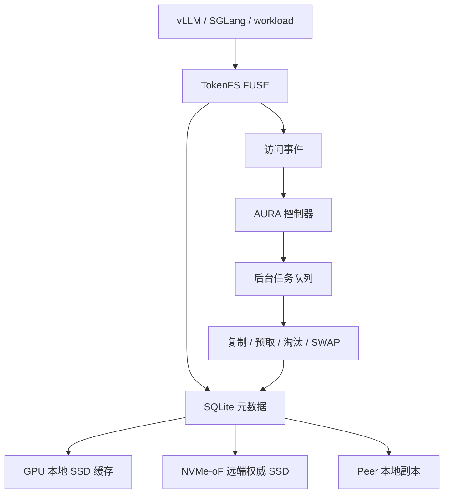

# 系统设计

本文说明 AURA-KV / TokenFS 的系统结构、数据生命周期和一致性边界。

## 1. 系统目标

AURA-KV 面向大模型 KV Cache 和 Token Shard 的分层存储。系统把远端 NVMe-oF SSD 作为权威容量层，把 GPU 节点本地 SSD 作为热点缓存层，让上层 vLLM、SGLang 或测试程序通过统一文件路径访问数据。

核心目标：

- 本地有高价值副本时优先走本地。
- 本地没有时从远端 NVMe-oF 权威层读取。
- 对共享热点，按访问分布创建有限数量本地副本。
- 本地空间不足时删除低价值副本。
- 复制、预取、淘汰放到后台，不阻塞前台请求。

非目标：

- 当前不是生产级分布式文件系统。
- 当前不直接管理裸 LBA，而是让 ext4/xfs 管理 NVMe-oF Namespace，再由 TokenFS 使用挂载目录。
- 当前不宣称已经完成真实 vLLM/SGLang 端到端 TTFT 收益。

## 2. 架构



前台路径负责当前请求，后台路径负责未来布局优化。一次前台读取不会等待大对象复制完成；它只记录事件，然后由控制器在后台判断后续是否值得创建副本。

## 3. 代码结构

```text
src/main.cpp              TokenFS FUSE 主程序
aura_kv/core.py           核心对象、节点状态、指标结构
aura_kv/demand.py         需求估计和前缀有效需求
aura_kv/cost_model.py     本地、Peer、远端、重计算来源代价
aura_kv/layout.py         EvictionLoss / ReplicaGain / RobustBenefit
aura_kv/optimization.py   布局约束和候选动作
aura_kv/policies.py       baseline 与 AURA-Joint 策略
aura_kv/controller.py     前台事件到后台任务计划
aura_kv/tasks.py          SQLite 持久化后台任务队列
aura_kv/executor.py       目录后端执行器
aura_kv/simulator.py      trace-driven simulator
aura_kv/monitoring.py     统一事件和指标输出
aura_kv/dashboard.py      动态监控页面
```

## 4. 数据模型

核心对象：

| 对象 | 含义 |
|---|---|
| CacheObject | 一个 KV Cache 或 token shard |
| Replica | 某个 cache 在某个节点上的本地副本 |
| Remote Canonical Copy | 远端 NVMe-oF 权威副本 |
| AccessEvent | 一次前台访问事件 |
| BackgroundTask | 后台复制、预取、淘汰或 SWAP 任务 |

副本状态：

```text
MISSING -> COPYING -> VERIFYING -> READY
READY -> EVICTING -> REMOVED
COPYING / VERIFYING -> FAILED
```

任务状态：

```text
PENDING -> RUNNING -> VERIFYING -> COMMITTED
                 \-> FAILED / CANCELED
```

## 5. 写入语义

当前推荐语义是：

```text
远端 NVMe-oF SSD 保存权威副本
本地 SSD 保存可重建热点副本
```

如果数据先写入本地，则后续需要通过后台任务复制到远端权威层；提交成功后，本地副本可以继续保留为热点缓存。删除本地副本时不能删除远端权威副本。

第一版 TokenFS 也支持本地优先、空间不足远端溢写的工程路径，但论文叙事应以“远端权威层 + 本地热缓存”为主。

## 6. 读取语义

读取时按可用来源选择：

```text
本地 READY 副本 -> 同节点/Peer READY 副本 -> 远端 NVMe-oF 权威副本 -> 重计算兜底
```

只要存在可靠存储来源，系统默认不会让重计算与远端读取直接竞争。重计算只作为无可靠存储来源时的兜底路径。

## 7. 迁移一致性

跨层迁移不能简单地“复制、删除、改数据库”。安全流程是：

```text
1. 写入后台任务
2. 复制到临时文件或临时副本
3. 校验内容哈希/大小
4. 原子提交元数据
5. 新副本 READY
6. 延迟删除旧副本
```

SWAP 必须先创建并校验新副本，再删除旧副本。失败时旧副本保持可用。

## 8. 当前边界

已经完成：

- FUSE 目录后端与元数据路径。
- 双 VM Linux NVMe/TCP Host/Target。
- 实验室 `cn14 -> cn13` NVMe/TCP 单客户端真实复测；当前多 GPU 仍为同一客户端内的逻辑 GPU。
- AURA-KV 控制器、任务队列、模拟器和动态监控。

仍有限制：

- 跨真实物理机器的 GPU 亲和放置还未完整验证。
- TokenFS C++ 主进程尚未完全复用 Python AURA-KV 任务队列。
- 真实 vLLM/SGLang trace 尚未接入。
