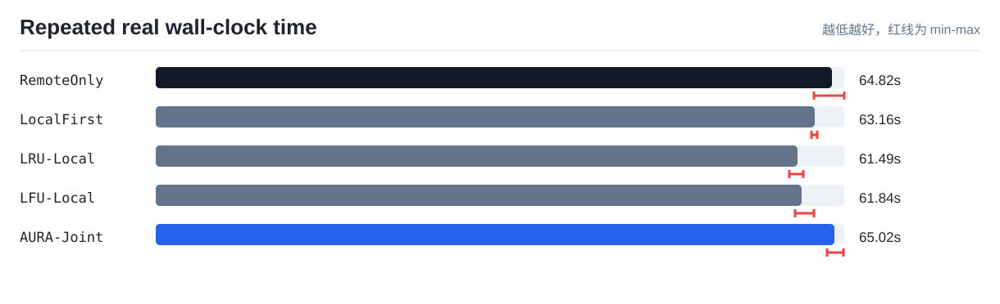
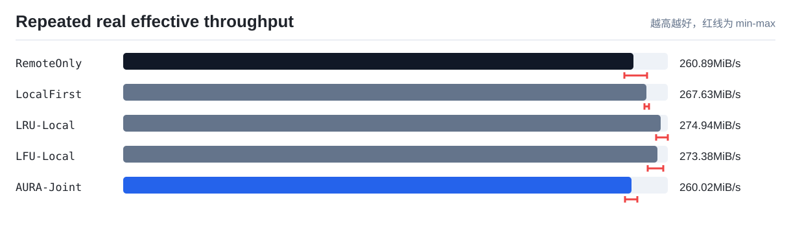
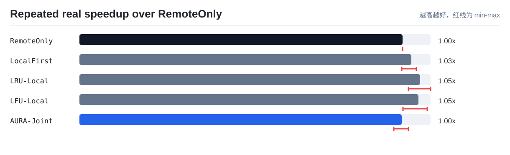

# AURA-KV / TokenFS 最新统一结果报告

本文是当前仓库的最终结果入口。项目说明看 [README.md](../../README.md)，实验设计看 [docs/experiments.md](../../docs/experiments.md)，机器可读数据看 [paper-experiments](paper-experiments/)。

## 1. 当前结论

AURA-KV / TokenFS 当前已经完成从软件原型到实验室真实 NVMe-oF 单客户端实验的闭环：

| 内容 | 当前状态 | 说明 |
|---|---|---|
| TokenFS FUSE 原型 | 已完成 | 支持基础 POSIX 文件操作、本地配额、远端溢写、SQLite 元数据和指标记录 |
| AURA 控制器 | 已完成 | 支持价值感知本地缓存管理、多 GPU 逻辑副本放置、后台任务队列和布局反馈 |
| 策略消融 | 已完成 | 已对比 RemoteOnly、LocalFirst、LRU、LFU、DualWindow、AffinityOnly、AURA-Joint 等策略 |
| 真实 NVMe-oF 实验 | 已完成单客户端 | `cn14` 直连 `cn13:4420`，远端 `/dev/nvme3n1` 挂载为 `/srv/tokenfs/remote0` |
| 多物理 GPU 集群 | 未完成 | 当前 `gpu0/gpu1/gpu2` 是同一客户端内的多逻辑 GPU，用于验证亲和副本机制 |
| vLLM/SGLang TTFT | 未完成 | 当前测的是 TokenFS/KV shard workload，不是真实模型 TTFT |

因此目前可以向老师汇报：系统功能、控制器机制、真实 NVMe-oF 接入和单客户端多逻辑 GPU 实验已经完成；论文还不能声称完成真实多 GPU 物理集群端到端推理加速。

## 2. 最新真实环境

本次真实实验环境：

```text
cn14 内网客户端
  ├── TokenFS / AURA-KV / FUSE
  ├── gpu0/gpu1/gpu2 多逻辑 GPU 本地缓存目录
  └── /srv/tokenfs/remote0
        ↓ Linux NVMe/TCP
cn13 远端 NVMe-oF Target：28.10.10.13:4420
```

证据文件：

```text
reports/latest/paper-experiments/09_real_cn14_nvmeof/environment_evidence.txt
reports/latest/paper-experiments/09_real_cn14_nvmeof/02_single_run_speed/nvmeof_mount_evidence.txt
```

关键挂载证据：

| 项 | 值 |
|---|---|
| 客户端 | `cn14` |
| 远端 Target | `28.10.10.13:4420` |
| Subsystem NQN | `nqn.2026-09.local.aura-kv:remote0` |
| NVMe-oF 设备 | `/dev/nvme3n1` |
| 挂载目录 | `/srv/tokenfs/remote0` |
| 文件系统 | `ext4, noatime` |

## 3. 本地与远端差距

环境差距诊断先单独测本地目录和远端 NVMe-oF 目录，不涉及任何 AURA 策略。

| 层级 | 数据量 | 写耗时 | 写吞吐 | 读耗时 | 读吞吐 |
|---|---:|---:|---:|---:|---:|
| local | 1024 MiB | 6.855 s | 149.37 MiB/s | 6.234 s | 164.27 MiB/s |
| remote NVMe-oF | 1024 MiB | 13.019 s | 78.65 MiB/s | 9.272 s | 110.45 MiB/s |

这说明在当前 `cn14 -> cn13` 环境里，远端 NVMe-oF 比本地慢，但差距不是数量级差距。AURA 减少远端访问是有效的，但端到端速度提升能否明显超过 LRU/LFU，还会受 FUSE、SQLite 指标写入、后台复制/预取开销影响。

## 4. 真实速度实验

最新真实结果在：

```text
reports/latest/paper-experiments/09_real_cn14_nvmeof/
├── lab_single_client_multigpu_report.md
├── 01_environment_gap/storage_gap_summary.csv
├── 02_single_run_speed/real_speed_summary.csv
└── 03_repeat_speed/repeat_summary.csv
```

实验设置：

| 项 | 值 |
|---|---|
| 实验形态 | 单客户端多逻辑 GPU + 实验室真实 NVMe-oF 远端层 |
| 策略 | RemoteOnly、LocalFirst、LRU-Local、LFU-Local、AURA-Joint |
| 每轮逻辑读写量 | 16904 MiB |
| shard 大小 | 64 MiB |
| 本地配额 | 512 MiB |
| 重复次数 | 3 |

三轮重复结果：

| 策略 | 平均总耗时 | 耗时范围 | 平均吞吐 | 相对 RemoteOnly | 本地读命中率 | 远端打开读取 |
|---|---:|---:|---:|---:|---:|---:|
| RemoteOnly | 64.82 s | 63.06-65.92 s | 260.89 MiB/s | 1.000x | 0.00% | 260 |
| LocalFirst | 63.16 s | 62.84-63.37 s | 267.63 MiB/s | 1.026x | 0.38% | 259 |
| LRU-Local | 61.49 s | 60.72-62.00 s | 274.94 MiB/s | 1.054x | 0.38% | 259 |
| LFU-Local | 61.84 s | 61.22-63.03 s | 273.38 MiB/s | 1.048x | 0.38% | 259 |
| AURA-Joint | 65.02 s | 64.30-65.88 s | 260.02 MiB/s | 0.997x | 95.38% | 12 |

真实结果需要如实解释：

- AURA-Joint 的机制已经真实触发：本地读命中率从 `0%` 提升到 `95.38%`，远端打开读取从 `260` 次降到 `12` 次。
- 但在当前实现和环境下，AURA-Joint 平均总耗时没有超过 LRU/LFU。当前最快的是 `LRU-Local`，平均 `61.49 s`。
- 这说明系统“减少远端访问”的方向是成立的，但后台复制、预取、指标写入和 FUSE 路径开销仍会抵消部分收益。
- 论文中不能只写“命中率提高”，必须同时报告 wall-clock 总耗时、吞吐、远端访问减少和后台动作开销。

图表：







## 5. 策略消融结果

Trace-driven 消融结果来自：

```text
reports/latest/paper-experiments/01_trace_replay/trace_summary.csv
```

| 策略 | 本地命中率 | 远端读取 MiB | P99 代理延迟 | 综合代价/请求 |
|---|---:|---:|---:|---:|
| RemoteOnly | 0.0000 | 2244.77 | 9.0188 ms | 3.1889 |
| LocalFirst | 0.7290 | 949.23 | 5.5199 ms | 1.8880 |
| LRU-Local | 0.7362 | 400.62 | 3.0247 ms | 1.7085 |
| LFU-Local | 0.7586 | 380.31 | 3.0594 ms | 1.5691 |
| DualWindowReplacement | 0.8907 | 146.15 | 1.4685 ms | 0.7717 |
| SourceAwareReplacement | 0.9423 | 0.00 | 0.4228 ms | 0.9318 |
| AffinityOnly | 0.5900 | 1182.31 | 5.5917 ms | 1.6883 |
| WA-Affinity-Independent | 0.7864 | 368.92 | 2.8872 ms | 0.9922 |
| AURA-Joint | 0.8822 | 228.31 | 1.4749 ms | 0.5376 |

这组结果说明 AURA-Joint 在综合代价模型中明显优于 LRU/LFU；真实速度实验则说明当前工程实现还需要继续压低控制和后台搬迁开销，才能把模型收益更稳定地转换成 wall-clock 加速。

## 6. 论文表述建议

可以写：

- 提出了面向多 GPU 大模型 KV Cache 的本地-远程自适应分层文件系统 AURA-KV / TokenFS。
- 实现了 FUSE 原型、SQLite 元数据、远端权威副本、本地热点副本、价值感知淘汰和多逻辑 GPU 副本放置。
- 在实验室真实 NVMe-oF 环境中完成单客户端多逻辑 GPU 实验，证明系统可通过 NVMe/TCP 接入远端 SSD，并显著减少远端读取次数。
- Trace-driven 消融显示 AURA-Joint 相比 LRU/LFU 能降低综合服务代价。
- 真实速度实验显示当前 AURA 已触发机制，但端到端耗时仍受后台复制和实现开销影响，后续优化重点是降低策略执行开销。

不要写：

- 已经完成多台真实 GPU 物理服务器并发实验。
- 已经证明 vLLM/SGLang 的 TTFT 被显著降低。
- AURA-Joint 在所有真实速度指标上都超过 LRU/LFU。

## 7. 后续优化重点

| 优先级 | 方向 | 目的 |
|---:|---|---|
| 1 | 减少前台 FUSE 路径同步数据库写入 | 降低每次 read/open 的固定开销 |
| 2 | 后台复制限速与批量化 | 避免 promote/prefetch 抢占前台 I/O |
| 3 | 更严格的迁移收益门槛 | 只复制未来收益能覆盖成本的数据 |
| 4 | 使用真实 KV Cache trace | 让访问序列更接近 vLLM/SGLang |
| 5 | 多物理客户端实验 | 验证真正跨 GPU 服务器的亲和副本收益 |

