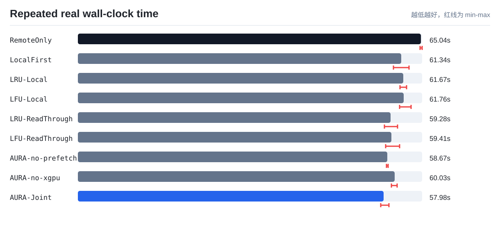
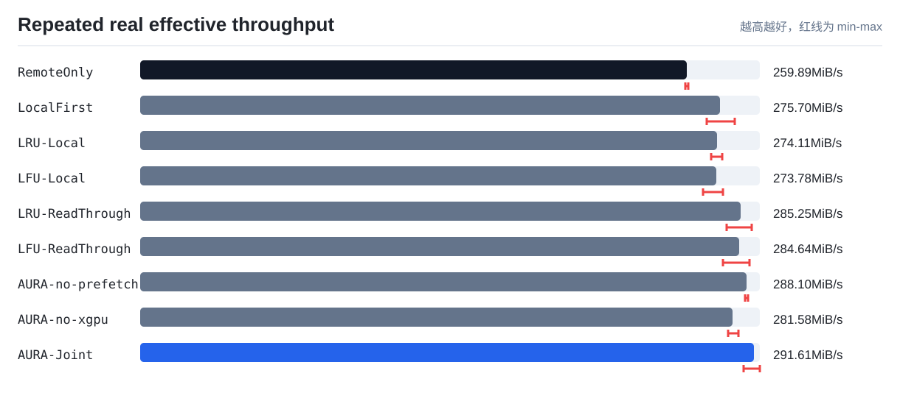
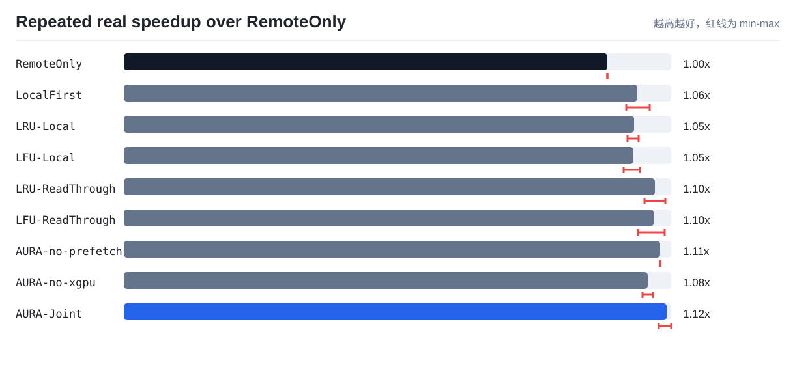

> **历史报告，结论已撤回作为当前论文证据。** 下文保留旧批次记录；旧分段计时、模拟计账与基线差异尚不足以支持新性能主张。当前经过整批审计的结果请读 [cn7 正式实测报告](paper-experiments/10_real_cn7_evidence/README.md)。

# AURA-KV / TokenFS 最新统一结果报告

> 历史结果警示：此页旧数字尚未按修复后的统一计账、对等基线和外层计时重跑，不能视为当前性能证据。见 `docs/evidence-experiments.md`（仓库根目录相对路径）。

本文是当前仓库的最终结果入口。项目说明看 [README.md](../../README.md)，实验设计看 [docs/experiments.md](../../docs/experiments.md)，机器可读数据看 [paper-experiments](paper-experiments/)。

## 1. 当前结论

AURA-KV / TokenFS 当前已经完成从软件原型到实验室真实 NVMe-oF 单客户端实验的闭环：

| 内容 | 当前状态 | 说明 |
|---|---|---|
| TokenFS FUSE 原型 | 已完成 | 支持基础 POSIX 文件操作、本地配额、远端溢写、SQLite 元数据和指标记录 |
| AURA 控制器 | 已完成 | 支持价值感知本地缓存管理、多 GPU 逻辑副本放置、后台任务队列和布局反馈 |
| 策略消融 | 已完成 | 已对比 RemoteOnly、LocalFirst、LRU、LFU、DualWindow、AffinityOnly、AURA-Joint 等策略 |
| 真实 NVMe-oF 实验 | 已完成单客户端 | `cn14` 直连 `cn13:4420`，远端 `/dev/nvme3n1` 挂载为 `/srv/tokenfs/remote0`，三轮重复速度实验中 AURA-Joint 平均总耗时最低 |
| 多物理 GPU 集群 | 未完成 | 当前 `gpu0/gpu1/gpu2` 是同一客户端内的多逻辑 GPU，用于验证亲和副本机制 |
| vLLM/SGLang TTFT | 未完成 | 当前测的是 TokenFS/KV shard workload，不是真实模型 TTFT |

因此目前可以向老师汇报：系统功能、控制器机制、真实 NVMe-oF 接入和单客户端多逻辑 GPU 实验已经完成；论文还不能声称完成真实多 GPU 物理集群端到端推理加速。

## 2. 最新真实环境

本次真实实验环境：

```text
cn14 内网客户端
  ├── TokenFS / AURA-KV / FUSE
  ├── gpu0/gpu1/gpu2 多逻辑 GPU 本地缓存目录
  └── /srv/tokenfs/remote0
        ↓ Linux NVMe/TCP
cn13 远端 NVMe-oF Target：28.10.10.13:4420
```

证据文件：

```text
reports/latest/paper-experiments/09_real_cn14_nvmeof/environment_evidence.txt
reports/latest/paper-experiments/09_real_cn14_nvmeof/02_single_run_speed/nvmeof_mount_evidence.txt
```

关键挂载证据：

| 项 | 值 |
|---|---|
| 客户端 | `cn14` |
| 远端 Target | `28.10.10.13:4420` |
| Subsystem NQN | `nqn.2026-09.local.aura-kv:remote0` |
| NVMe-oF 设备 | `/dev/nvme3n1` |
| 挂载目录 | `/srv/tokenfs/remote0` |
| 文件系统 | `ext4, noatime` |

## 3. 本地与远端差距

环境差距诊断先单独测本地目录和远端 NVMe-oF 目录，不涉及任何 AURA 策略。

| 层级 | 数据量 | 写耗时 | 写吞吐 | 读耗时 | 读吞吐 |
|---|---:|---:|---:|---:|---:|
| local | 1024 MiB | 6.855 s | 149.37 MiB/s | 6.234 s | 164.27 MiB/s |
| remote NVMe-oF | 1024 MiB | 13.019 s | 78.65 MiB/s | 9.272 s | 110.45 MiB/s |

这说明在当前 `cn14 -> cn13` 环境里，远端 NVMe-oF 比本地慢，但差距不是数量级差距。AURA 减少远端访问是有效的，但端到端速度提升能否明显超过 LRU/LFU，还会受 FUSE、SQLite 指标写入、后台复制/预取开销影响。

## 4. 真实速度实验

最新真实结果在：

```text
reports/latest/paper-experiments/09_real_cn14_nvmeof/
├── lab_single_client_multigpu_report.md
├── 01_environment_gap/storage_gap_summary.csv
├── 02_single_run_speed/real_speed_summary.csv
├── 03_repeat_speed/repeat_summary.csv          # 优化前重复实验，保留作历史对照
├── 05_fast_local_hit_single/strategy_summary.csv
├── 06_optimized_repeat/repeat_summary.csv      # 5 策略历史结果
└── 07_fair_readthrough_repeat/repeat_summary.csv # 当前论文主引用结果，包含强 LRU/LFU baseline
```

实验设置：

| 项 | 值 |
|---|---|
| 实验形态 | 单客户端多逻辑 GPU + 实验室真实 NVMe-oF 远端层 |
| 策略 | RemoteOnly、LocalFirst、LRU-Local、LFU-Local、LRU-ReadThrough、LFU-ReadThrough、AURA-no-prefetch、AURA-no-xgpu、AURA-Joint |
| 每轮逻辑读写量 | 16904 MiB |
| shard 大小 | 64 MiB |
| 本地配额 | 512 MiB |
| 重复次数 | 3 |

当前主引用的三轮重复结果来自 `07_fair_readthrough_repeat/repeat_summary.csv`。这组结果加入了远端读后回填本地缓存的强 LRU/LFU baseline，用来回应“旧 LRU/LFU 本地命中率过低、对照不够公平”的问题：

| 策略 | 平均总耗时 | 耗时范围 | 平均吞吐 | 相对 RemoteOnly | 本地读命中率 | 远端打开读取 |
|---|---:|---:|---:|---:|---:|---:|
| RemoteOnly | 63.90 s | 62.48-65.31 s | 264.64 MiB/s | 1.000x | 0.00% | 260 |
| LocalFirst | 61.29 s | 59.47-62.48 s | 275.92 MiB/s | 1.043x | 0.38% | 259 |
| LRU-Local | 61.23 s | 60.04-62.14 s | 276.14 MiB/s | 1.044x | 0.38% | 259 |
| LFU-Local | 62.04 s | 60.36-63.74 s | 272.61 MiB/s | 1.030x | 0.38% | 259 |
| LRU-ReadThrough | 59.28 s | 58.13-60.60 s | 285.25 MiB/s | 1.098x | 73.85% | 68 |
| LFU-ReadThrough | 59.41 s | 58.36-61.03 s | 284.64 MiB/s | 1.095x | 73.85% | 68 |
| AURA-no-prefetch | 58.67 s | 58.51-58.83 s | 288.10 MiB/s | 1.109x | 91.15% | 23 |
| AURA-no-xgpu | 60.03 s | 59.46-60.51 s | 281.58 MiB/s | 1.083x | 71.54% | 74 |
| AURA-Joint | **57.98 s** | **57.43-58.97 s** | **291.61 MiB/s** | **1.122x** | **95.25%** | **12.3** |

真实结果需要如实解释：

- AURA-Joint 的机制已经真实触发：本地读命中率从 `0%` 提升到约 `95.25%`，远端打开读取从 `260` 次降到约 `12.3` 次。
- 强 baseline 已经补齐：`LRU-ReadThrough` 和 `LFU-ReadThrough` 的本地读命中率达到 `73.85%`，但 AURA-Joint 的平均总耗时仍最低。
- 优化后 AURA-Joint 相比 RemoteOnly 快约 `10.87%`，相比 LRU-ReadThrough 快约 `2.20%`，相比 LFU-ReadThrough 快约 `2.41%`。
- 关键原因不是更改 workload，而是修正本地缓存语义和前台快路径：远端 NVMe-oF 保存权威副本，本地副本作为可重建缓存，不再把每个缓存创建都当作强持久化事务；本地命中请求也不再被同步控制平面更新阻塞。
- 论文中仍然要同时报告 wall-clock 总耗时、吞吐、远端访问减少和后台动作开销，不能只写“命中率提高”。

图表：







## 5. 策略消融结果

Trace-driven 消融结果来自：

```text
reports/latest/paper-experiments/01_trace_replay/trace_summary.csv
```

| 策略 | 本地命中率 | 远端读取 MiB | P99 代理延迟 | 综合代价/请求 |
|---|---:|---:|---:|---:|
| RemoteOnly | 0.0000 | 2244.77 | 9.0188 ms | 3.1889 |
| LocalFirst | 0.7290 | 949.23 | 5.5199 ms | 1.8880 |
| LRU-Local | 0.7362 | 400.62 | 3.0247 ms | 1.7085 |
| LFU-Local | 0.7586 | 380.31 | 3.0594 ms | 1.5691 |
| DualWindowReplacement | 0.8907 | 146.15 | 1.4685 ms | 0.7717 |
| SourceAwareReplacement | 0.9423 | 0.00 | 0.4228 ms | 0.9318 |
| AffinityOnly | 0.5900 | 1182.31 | 5.5917 ms | 1.6883 |
| WA-Affinity-Independent | 0.7864 | 368.92 | 2.8872 ms | 0.9922 |
| AURA-Joint | 0.8822 | 228.31 | 1.4749 ms | 0.5376 |

这组结果说明 AURA-Joint 在综合代价模型中明显优于 LRU/LFU；最新真实速度实验进一步说明，在远端权威、本地可重建缓存和本地命中快路径启用后，模型收益已经可以转化为 wall-clock 加速。

## 6. 论文表述建议

可以写：

- 提出了面向多 GPU 大模型 KV Cache 的本地-远程自适应分层文件系统 AURA-KV / TokenFS。
- 实现了 FUSE 原型、SQLite 元数据、远端权威副本、本地热点副本、价值感知淘汰和多逻辑 GPU 副本放置。
- 在实验室真实 NVMe-oF 环境中完成单客户端多逻辑 GPU 实验，证明系统可通过 NVMe/TCP 接入远端 SSD，并在三轮重复实验中同时减少远端读取次数和平均总耗时。
- Trace-driven 消融显示 AURA-Joint 相比 LRU/LFU 能降低综合服务代价。
- 真实速度实验显示当前 AURA 已触发机制，优化后的缓存语义和本地命中快路径已将模型收益转化为 wall-clock 加速。

不要写：

- 已经完成多台真实 GPU 物理服务器并发实验。
- 已经证明 vLLM/SGLang 的 TTFT 被显著降低。
- AURA-Joint 已经完成真实多物理 GPU 集群验证。

## 7. 后续优化重点

| 优先级 | 方向 | 目的 |
|---:|---|---|
| 1 | 使用真实 KV Cache trace | 让访问序列更接近 vLLM/SGLang |
| 2 | 多物理客户端实验 | 验证真正跨 GPU 服务器的亲和副本收益 |
| 3 | 前台路径进一步降开销 | 把更多指标更新改为采样或异步批量落盘 |
| 4 | 后台复制限速与批量化 | 避免大规模 promote/prefetch 抢占前台 I/O |
| 5 | 参数敏感性复测 | 在不同本地配额、远端延迟和复用强度下验证稳定性 |
