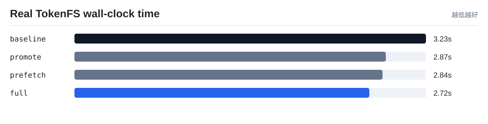
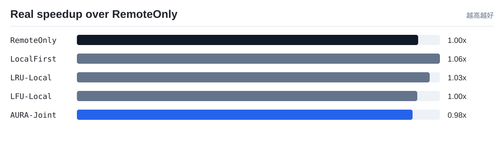
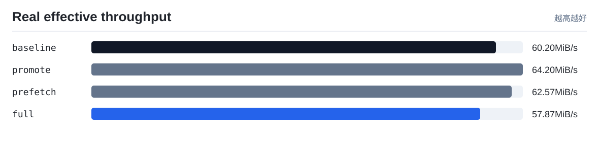

# TokenFS 真实速度实验

实验环境：TokenFS workload over SSH-tunneled NVMe/TCP mount: /dev/nvme0n1 -> /srv/tokenfs/remote0

本报告只使用真实程序运行产生的 wall-clock 时间、读写吞吐和 TokenFS 指标，不使用成本模型权重。它回答的是：在同一组 token shard workload 下，开启热点提升、顺序预取和联合策略后，系统端到端是否真的更快。

注意：`scripts/real_speed_benchmark.sh` 默认会强制检查远端后端已经通过 NVMe-oF 挂载。只有 `backends[].type = nvmeof`、远端根目录已挂载，并且挂载源为 `/dev/nvme...` 时，才会生成可用于论文的真实 NVMe-oF 端到端速度结果。若显式设置 `TOKENFS_REQUIRE_NVMEOF=0` 绕过检查，结果只能作为开发自测，不能写成真实 NVMe-oF 性能。

## 结果表

| 策略 | 总数据 MiB | 总耗时 s | 有效吞吐 MiB/s | 相对 baseline 加速 | 平均读 us | 读延迟变化 | 本地读命中率 | 远端打开读取 | 远端打开减少 | 后台动作 |
|---|---:|---:|---:|---:|---:|---:|---:|---:|---:|---|
| `baseline` | 176.0 | 3.2346 | 54.41 | 1.0x | 2705.2 | 0.0% | 20.0% | 4 | 0.0% | promote=0, prefetch=0, evict=0, spill=0 |
| `promote` | 176.0 | 2.8673 | 61.38 | 1.1281x | 2402.12 | 11.2% | 20.0% | 4 | 0.0% | promote=0, prefetch=0, evict=0, spill=0 |
| `prefetch` | 176.0 | 2.8368 | 62.04 | 1.1402x | 2400.4 | 11.27% | 20.0% | 4 | 0.0% | promote=0, prefetch=0, evict=0, spill=0 |
| `full` | 176.0 | 2.7165 | 64.79 | 1.1907x | 2386.05 | 11.8% | 20.0% | 4 | 0.0% | promote=0, prefetch=0, evict=0, spill=0 |

## 可视化

## 解读

- 当前 workload 下总耗时最短的是 `full`，耗时 `2.7165 s`。
- 当前 workload 下有效吞吐最高的是 `full`，约 `64.79 MiB/s`。
- `full` 相比 baseline 的真实端到端速度提升为 `1.1907x`。

## 论文中怎么使用

- `objective_cost_per_request` 用来解释控制器的决策质量，是策略层指标。
- `wall_time_s`、`effective_mib_s`、`avg_read_us` 用来回答系统实际快不快，是真实运行指标。
- 如果两者方向不一致，必须优先相信真实速度结果，并回头调整 workload、参数和成本权重。
