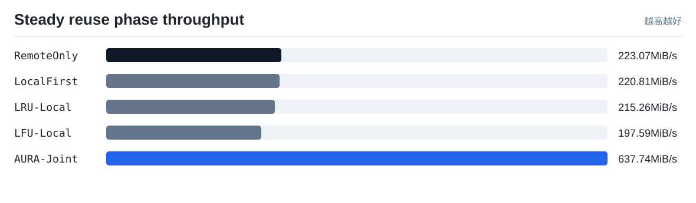

# TokenFS 真实速度实验

实验环境：TokenFS FUSE workload with verified NVMe-oF direct path: target=192.168.64.3, /dev/nvme0n1 -> /srv/tokenfs/remote0 (ext4)

本报告只使用真实程序运行产生的 wall-clock 时间、读写吞吐和 TokenFS 指标，不使用成本模型权重。它回答的是：在同一组 token shard workload 下，AURA-Joint 相比 RemoteOnly、LocalFirst、LRU-Local 和 LFU-Local 是否真的更快。

注意：`scripts/real_speed_benchmark.sh` 默认会强制检查远端后端已经通过 NVMe-oF 挂载，并要求 `TOKENFS_NVMEOF_PATH_MODE=direct`。只有 `backends[].type = nvmeof`、`nvme_target_ip` 是真实 Target IP、远端根目录已挂载、挂载源为 `/dev/nvme...` 时，才会生成可用于论文的直连 NVMe-oF 端到端速度结果。若显式设置 `TOKENFS_NVMEOF_PATH_MODE=tunnel`，结果只能作为功能验证，不能写成直连性能。

## 结果表

| 策略 | 总数据 MiB | 总耗时 s | 有效吞吐 MiB/s | 相对 RemoteOnly 加速 | 复用阶段吞吐 MiB/s | 复用阶段相对吞吐 | 平均读 us | 本地读命中率 | 远端打开读取 | 远端打开减少 | 后台动作证据 |
|---|---:|---:|---:|---:|---:|---:|---:|---:|---:|---:|---|
| `RemoteOnly` | 552.0 | 9.6369 | 57.28 | 1.0x | 59.92 | 1.0x | 2718.29 | 0.0% | 64 | 0.0% | promote=0, prefetch=0/0, evict=0, skip_hot=0, xgpu=0/0, spill=0 |
| `LocalFirst` | 552.0 | 9.062 | 60.91 | 1.0634x | 63.69 | 1.063x | 2576.61 | 1.56% | 63 | 1.56% | promote=0, prefetch=0/0, evict=0, skip_hot=0, xgpu=0/0, spill=1 |
| `LRU-Local` | 552.0 | 9.3226 | 59.21 | 1.0337x | 63.03 | 1.0519x | 2607.8 | 1.56% | 63 | 1.56% | promote=0, prefetch=0/0, evict=1, skip_hot=0, xgpu=0/0, spill=0 |
| `LFU-Local` | 552.0 | 9.655 | 57.17 | 0.9981x | 58.48 | 0.976x | 2763.16 | 1.56% | 63 | 1.56% | promote=0, prefetch=0/0, evict=1, skip_hot=0, xgpu=0/0, spill=0 |
| `AURA-Joint` | 552.0 | 9.7904 | 56.38 | 0.9843x | 61.63 | 1.0285x | 2714.6 | 96.88% | 3 | 95.31% | promote=1, prefetch=1/1, evict=3, skip_hot=0, xgpu=1/15, spill=0 |

## 可视化

## 解读

- 当前 workload 下总耗时最短的是 `LocalFirst`，耗时 `9.062 s`。
- 当前 workload 下有效吞吐最高的是 `LocalFirst`，约 `60.91 MiB/s`。
- `AURA-Joint` 相比 `RemoteOnly` 的真实端到端速度为 `0.9843x`，说明当前 workload 或参数下策略开销尚未被命中收益抵消。
- 这不是坏结果，而是后续调参和论文分析的依据：成本模型预测的是长期服务代价，真实速度还受 FUSE 开销、后台任务是否真正触发、远端是否足够慢、热点复用强度等因素影响。
- 只看策略生效后的热点/预取/跨 GPU 复用阶段，`AURA-Joint` 相对 `RemoteOnly` 的吞吐为 `1.0285x`。该指标用于观察后台策略完成后，后续读取收益是否出现。

## 论文中怎么使用

- `objective_cost_per_request` 用来解释控制器的决策质量，是策略层指标。
- `wall_time_s`、`effective_mib_s`、`avg_read_us` 用来回答系统实际快不快，是真实运行指标。
- 如果两者方向不一致，必须优先相信真实速度结果，并回头调整 workload、参数和成本权重。
