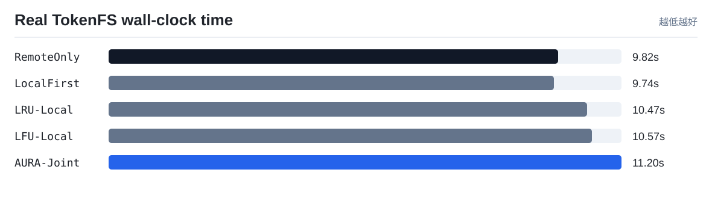
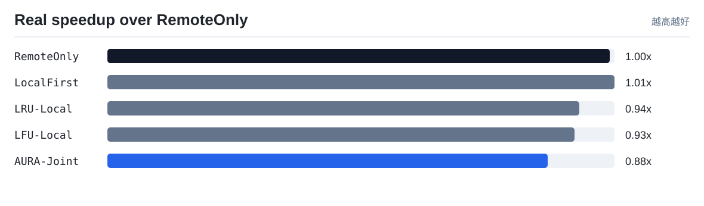
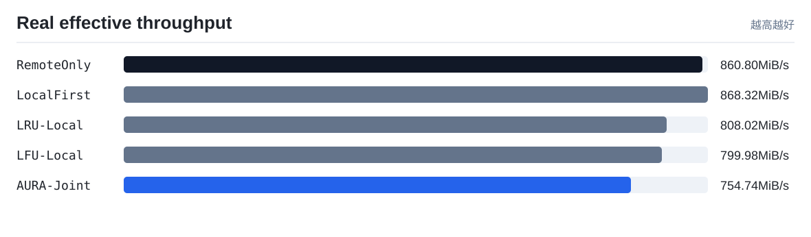
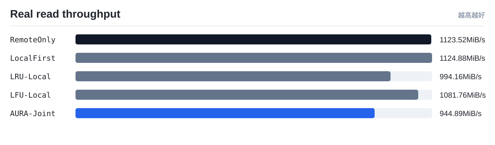
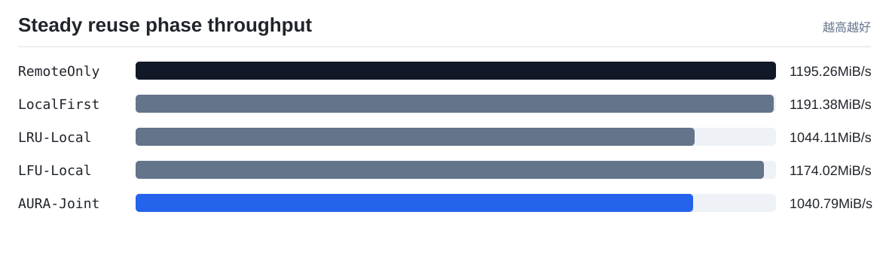

# TokenFS 真实速度实验

实验环境：Single-client multi-logical-GPU TokenFS workload on verified remote NVMe-oF

本报告只使用真实程序运行产生的 wall-clock 时间、读写吞吐和 TokenFS 指标，不使用成本模型权重。它回答的是：在同一组 token shard workload 下，AURA-Joint 相比 RemoteOnly、LocalFirst、LRU-Local 和 LFU-Local 是否真的更快。

注意：`scripts/real_speed_benchmark.sh` 默认会强制检查远端后端已经通过 NVMe-oF 挂载，并要求 `TOKENFS_NVMEOF_PATH_MODE=direct`。只有 `backends[].type = nvmeof`、`nvme_target_ip` 是真实 Target IP、远端根目录已挂载、挂载源为 `/dev/nvme...` 时，才会生成可用于论文的直连 NVMe-oF 端到端速度结果。若显式设置 `TOKENFS_NVMEOF_PATH_MODE=tunnel`，结果只能作为功能验证，不能写成直连性能。

为避免 Linux 页缓存把远端 NVMe-oF 重复读取伪装成内存命中，真实速度脚本默认在关键阶段以及每次逻辑读取计时前请求清理 OS page cache；清理动作本身只作为 `cache_control` 证据记录，不计入策略读写耗时。这个控制条件不改变 workload 的访问分布，只用于让比较对象回到“本地 SSD 路径 vs 远端 NVMe-oF 路径”。

## 结果表

| 策略 | 总数据 MiB | 总耗时 s | 总吞吐 MiB/s | 总吞吐相对 RemoteOnly | 读吞吐 MiB/s | 读吞吐相对 RemoteOnly | 复用阶段吞吐 MiB/s | 复用阶段相对吞吐 | 平均读 us | 本地读命中率 | 远端打开读取 | 远端打开减少 | 后台动作证据 |
|---|---:|---:|---:|---:|---:|---:|---:|---:|---:|---:|---:|---:|---|
| `RemoteOnly` | 8456.0 | 9.8234 | 860.8 | 1.0x | 1123.52 | 1.0x | 1195.26 | 1.0x | 29.33 | 0.0% | 260 | 0.0% | promote=0, prefetch=0/0, evict=0, skip_hot=0, xgpu=0/0, spill=0 |
| `LocalFirst` | 8456.0 | 9.7383 | 868.32 | 1.0087x | 1124.88 | 1.0012x | 1191.38 | 0.9968x | 30.63 | 0.38% | 259 | 0.38% | promote=0, prefetch=0/0, evict=0, skip_hot=0, xgpu=0/0, spill=0 |
| `LRU-Local` | 8456.0 | 10.4651 | 808.02 | 0.9387x | 994.16 | 0.8849x | 1044.11 | 0.8735x | 31.02 | 0.38% | 259 | 0.38% | promote=0, prefetch=0/0, evict=0, skip_hot=0, xgpu=0/0, spill=0 |
| `LFU-Local` | 8456.0 | 10.5702 | 799.98 | 0.9293x | 1081.76 | 0.9628x | 1174.02 | 0.9822x | 23.1 | 0.38% | 259 | 0.38% | promote=0, prefetch=0/0, evict=0, skip_hot=0, xgpu=0/0, spill=0 |
| `AURA-Joint` | 8456.0 | 11.2039 | 754.74 | 0.8768x | 944.89 | 0.841x | 1040.79 | 0.8708x | 26.54 | 93.46% | 17 | 93.46% | promote=2, prefetch=130/0, evict=2, skip_hot=0, xgpu=1/62, spill=0 |

## 可视化

## 解读

- 当前 workload 下总耗时最短的是 `LocalFirst`，耗时 `9.7383 s`。
- 当前 workload 下有效吞吐最高的是 `LocalFirst`，约 `868.32 MiB/s`。
- `AURA-Joint` 相比 `RemoteOnly` 的真实端到端速度为 `0.8768x`，说明当前 workload 或参数下策略开销尚未被命中收益抵消。
- 这不是坏结果，而是后续调参和论文分析的依据：成本模型预测的是长期服务代价，真实速度还受 FUSE 开销、后台任务是否真正触发、远端是否足够慢、热点复用强度等因素影响。
- 只看策略生效后的热点/预取/跨 GPU 复用阶段，`AURA-Joint` 相对 `RemoteOnly` 的吞吐为 `0.8708x`。该指标用于观察后台策略完成后，后续读取收益是否出现。

## 论文中怎么使用

- `objective_cost_per_request` 用来解释控制器的决策质量，是策略层指标。
- `wall_time_s`、`effective_mib_s`、`avg_read_us` 用来回答系统实际快不快，是真实运行指标。
- 如果两者方向不一致，必须优先相信真实速度结果，并回头检查实现开销、页缓存控制、后台迁移门槛和成本权重。
