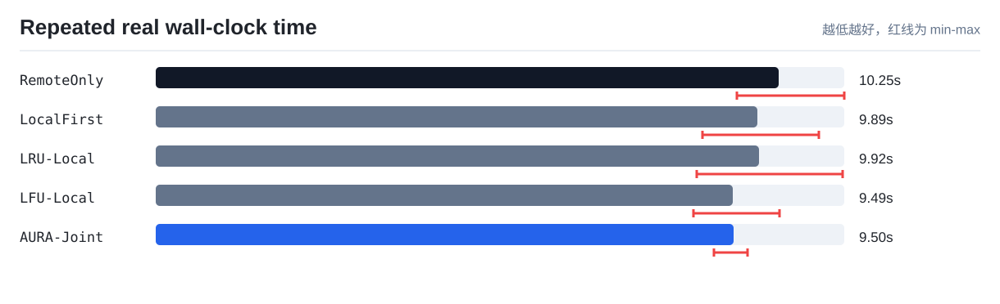
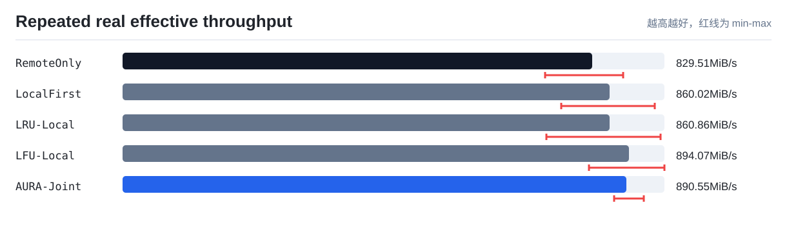
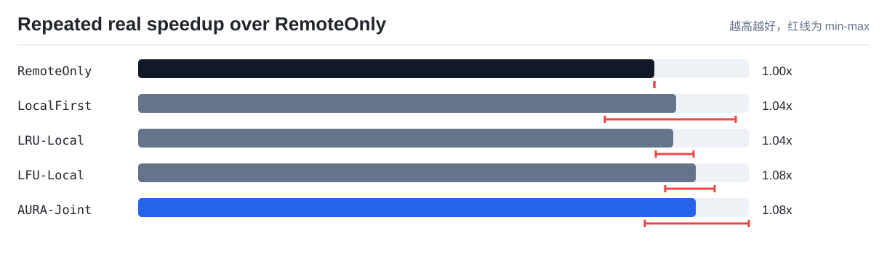

# 真实 NVMe-oF 多轮速度实验汇总

实验规模：single-client multi-logical-GPU, remote NVMe-oF, 32MiB shards, 160MiB quota, 3 runs。

本报告把同一套真实 TokenFS workload 在 NVMe-oF 挂载目录上重复运行多次，并汇总均值、标准差和最小/最大范围。它用于回答 AURA-Joint 的速度收益是否稳定，而不是只依赖一次运行结果。

所有策略使用同一访问形状：远端 canonical KV Cache、本地冷缓存占满、容量压力、热点复用、连续 shard 访问和跨 GPU 共享读取。与单轮验证相比，本实验只放大 shard 规模并重复采样，不额外构造只适合 AURA 的极端 trace。

实验默认控制 Linux page cache：清缓存动作记录为证据，但不计入策略读写耗时。这样可以避免 RemoteOnly 的重复读取被内存缓存伪装成本地速度。

## 均值结果

| 策略 | 轮数 | 总数据 MiB | 总耗时均值 s | 耗时范围 s | 总吞吐均值 MiB/s | 加速比均值 | 读吞吐均值 MiB/s | 本地读命中率均值 | 远端打开读取均值 | 后台动作均值 |
|---|---:|---:|---:|---:|---:|---:|---:|---:|---:|---|
| `RemoteOnly` | 3 | 8456 | 10.25 | 9.56-11.32 | 829.51 | 1x | 1112.82 | 0% | 260 | promote=0, prefetch=0, evict=0, xgpu_hit=0 |
| `LocalFirst` | 3 | 8456 | 9.89 | 8.99-10.91 | 860.02 | 1.042x | 1157.65 | 0.38% | 259 | promote=0, prefetch=0, evict=0, xgpu_hit=0 |
| `LRU-Local` | 3 | 8456 | 9.92 | 8.90-11.30 | 860.86 | 1.036x | 1063.65 | 0.38% | 259 | promote=0, prefetch=0, evict=0, xgpu_hit=0 |
| `LFU-Local` | 3 | 8456 | 9.49 | 8.84-10.27 | 894.07 | 1.079x | 1154.11 | 0.38% | 259 | promote=0, prefetch=0, evict=0, xgpu_hit=0 |
| `AURA-Joint` | 3 | 8456 | 9.50 | 9.18-9.74 | 890.55 | 1.079x | 1116.17 | 95.26% | 12.33 | promote=1.33, prefetch=0.67, evict=1.33, xgpu_hit=62 |

## 图表

## 结论提示

- AURA-Joint 平均端到端加速比为 `1.079x`，范围 `0.982x-1.181x`。
- AURA-Joint 平均远端打开读取为 `12.33` 次，RemoteOnly 为 `260` 次，说明本地副本和后台动作确实减少了远端访问。
- 当前环境中平均总耗时最低的是 `LFU-Local`，不是 AURA-Joint；这说明当前双 VM NVMe-oF 环境更适合证明机制和远端访问减少，暂时不能直接声称 AURA 端到端速度显著领先所有 baseline。
- 如果均值提升但波动较大，论文中应同时报告标准差或 min-max，而不是只放最好的一轮。
- 如果未来换成真实物理 GPU 服务器，只需要保持同一脚本和同一策略参数重新运行，即可得到可横向比较的数据。
