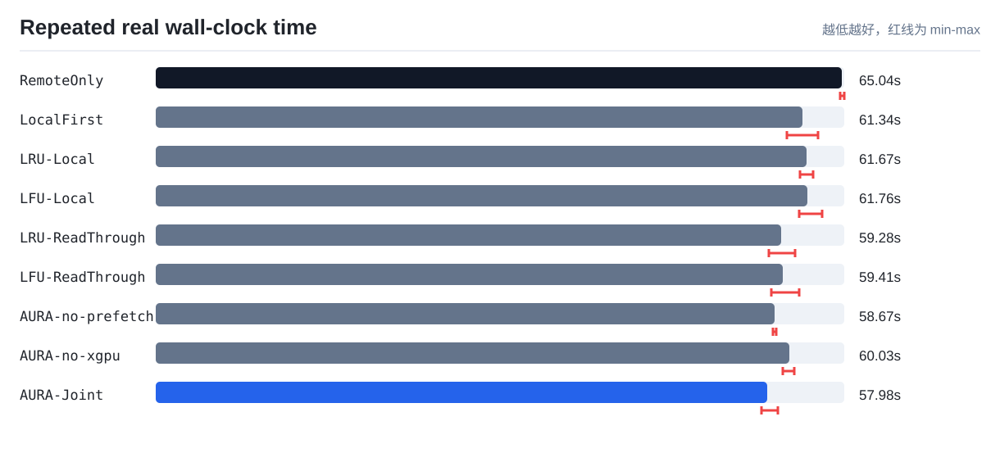
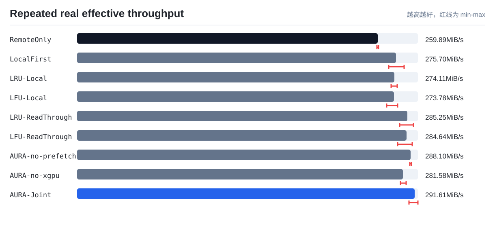
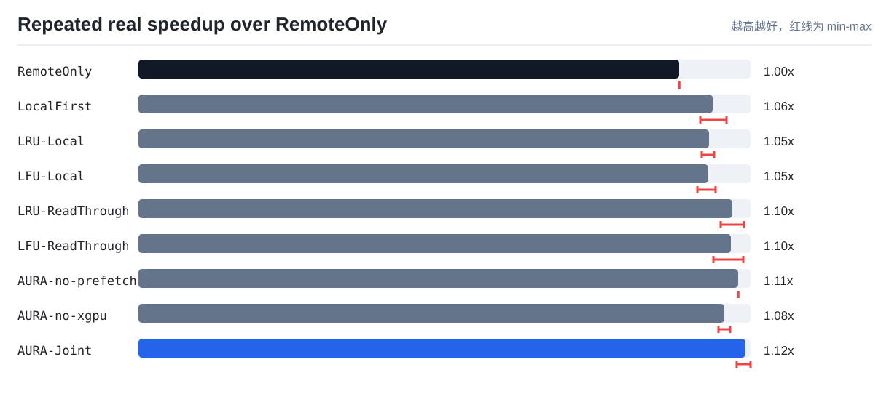

# 真实 NVMe-oF 多轮速度实验汇总

实验规模：cn14->cn13 real NVMe-oF fair read-through baselines, 64MiB shards, 512MiB quota, 3 runs。

本报告把同一套真实 TokenFS workload 在 NVMe-oF 挂载目录上重复运行多次，并汇总均值、标准差和最小/最大范围。它用于回答 AURA-Joint 的速度收益是否稳定，而不是只依赖一次运行结果。

所有策略使用同一访问形状：远端 canonical KV Cache、本地冷缓存占满、容量压力、热点复用、连续 shard 访问和跨 GPU 共享读取。与单轮验证相比，本实验只放大 shard 规模并重复采样，不额外构造只适合 AURA 的极端 trace。

实验默认控制 Linux page cache：清缓存动作记录为证据，但不计入策略读写耗时。这样可以避免 RemoteOnly 的重复读取被内存缓存伪装成本地速度。

## 均值结果

| 策略 | 轮数 | 总数据 MiB | 总耗时均值 s | 耗时范围 s | 总吞吐均值 MiB/s | 加速比均值 | 读吞吐均值 MiB/s | 本地读命中率均值 | 远端打开读取均值 | 后台动作均值 |
|---|---:|---:|---:|---:|---:|---:|---:|---:|---:|---|
| `RemoteOnly` | 3 | 16904 | 65.04 | 64.86-65.23 | 259.89 | 1x | 300.62 | 0% | 260 | promote=0, prefetch=0, evict=0, xgpu_hit=0 |
| `LocalFirst` | 3 | 16904 | 61.34 | 59.84-62.77 | 275.70 | 1.061x | 305.69 | 0.38% | 259 | promote=0, prefetch=0, evict=0, xgpu_hit=0 |
| `LRU-Local` | 3 | 16904 | 61.67 | 61.10-62.29 | 274.11 | 1.055x | 305.04 | 0.38% | 259 | promote=0, prefetch=0, evict=0, xgpu_hit=0 |
| `LFU-Local` | 3 | 16904 | 61.76 | 61.01-63.15 | 273.78 | 1.054x | 305.01 | 0.38% | 259 | promote=0, prefetch=0, evict=0, xgpu_hit=0 |
| `LRU-ReadThrough` | 3 | 16904 | 59.28 | 58.13-60.60 | 285.25 | 1.098x | 319.04 | 73.85% | 68 | promote=2, prefetch=0, evict=0, xgpu_hit=0 |
| `LFU-ReadThrough` | 3 | 16904 | 59.41 | 58.36-61.03 | 284.64 | 1.095x | 318.13 | 73.85% | 68 | promote=2, prefetch=0, evict=0, xgpu_hit=0 |
| `AURA-no-prefetch` | 3 | 16904 | 58.67 | 58.51-58.83 | 288.10 | 1.109x | 322.15 | 91.15% | 23 | promote=2, prefetch=0, evict=0, xgpu_hit=62 |
| `AURA-no-xgpu` | 3 | 16904 | 60.03 | 59.46-60.51 | 281.58 | 1.083x | 315.40 | 71.54% | 74 | promote=1, prefetch=1, evict=0, xgpu_hit=0 |
| `AURA-Joint` | 3 | 16904 | 57.98 | 57.43-58.97 | 291.61 | 1.122x | 327.83 | 95.25% | 12.33 | promote=1, prefetch=1, evict=0, xgpu_hit=62 |

## 图表

## 结论提示

- AURA-Joint 平均端到端加速比为 `1.122x`，范围 `1.106x-1.131x`。
- AURA-Joint 平均远端打开读取为 `12.33` 次，RemoteOnly 为 `260` 次，说明本地副本和后台动作确实减少了远端访问。
- AURA-Joint 是本轮多次重复实验中平均总耗时最低的策略。
- 如果均值提升但波动较大，论文中应同时报告标准差或 min-max，而不是只放最好的一轮。
- 如果未来换成真实物理 GPU 服务器，只需要保持同一脚本和同一策略参数重新运行，即可得到可横向比较的数据。
