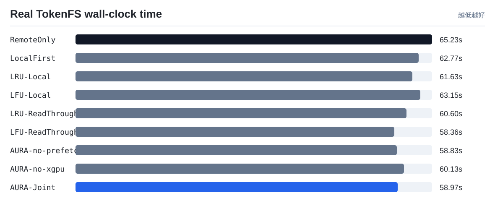
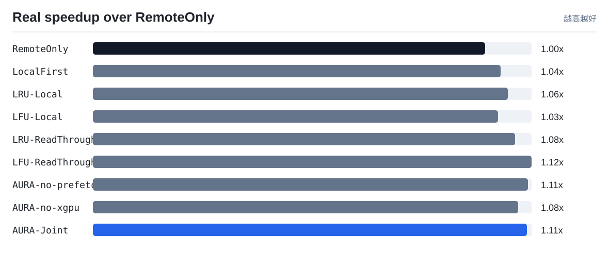
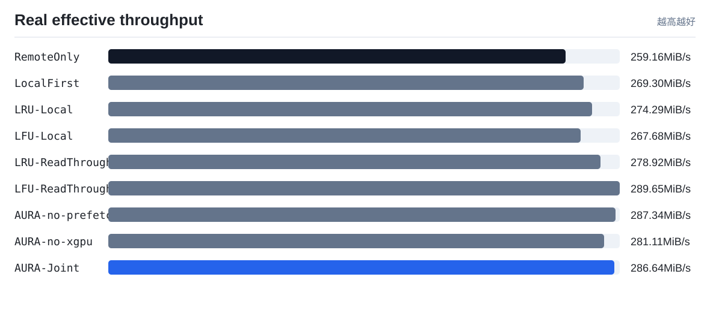
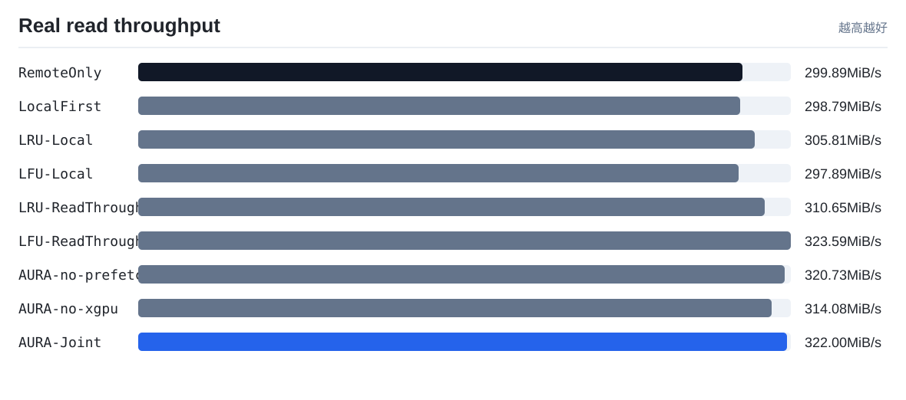
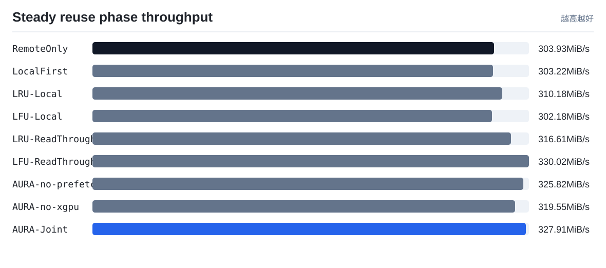

# TokenFS 真实速度实验

实验环境：Repeated real TokenFS workload on verified NVMe-oF, cn14->cn13 real NVMe-oF fair read-through baselines, 64MiB shards, 512MiB quota, 3 runs

本报告只使用真实程序运行产生的 wall-clock 时间、读写吞吐和 TokenFS 指标，不使用成本模型权重。它回答的是：在同一组 token shard workload 下，AURA-Joint 相比 RemoteOnly、LocalFirst、LRU-Local 和 LFU-Local 是否真的更快。

注意：`scripts/real_speed_benchmark.sh` 默认会强制检查远端后端已经通过 NVMe-oF 挂载，并要求 `TOKENFS_NVMEOF_PATH_MODE=direct`。只有 `backends[].type = nvmeof`、`nvme_target_ip` 是真实 Target IP、远端根目录已挂载、挂载源为 `/dev/nvme...` 时，才会生成可用于论文的直连 NVMe-oF 端到端速度结果。若显式设置 `TOKENFS_NVMEOF_PATH_MODE=tunnel`，结果只能作为功能验证，不能写成直连性能。

为避免 Linux 页缓存把远端 NVMe-oF 重复读取伪装成内存命中，真实速度脚本默认在关键阶段以及每次逻辑读取计时前请求清理 OS page cache；清理动作本身只作为 `cache_control` 证据记录，不计入策略读写耗时。这个控制条件不改变 workload 的访问分布，只用于让比较对象回到“本地 SSD 路径 vs 远端 NVMe-oF 路径”。

## 结果表

| 策略 | 总数据 MiB | 总耗时 s | 总吞吐 MiB/s | 总吞吐相对 RemoteOnly | 读吞吐 MiB/s | 读吞吐相对 RemoteOnly | 复用阶段吞吐 MiB/s | 复用阶段相对吞吐 | 平均读 us | 本地读命中率 | 远端打开读取 | 远端打开减少 | 后台动作证据 |
|---|---:|---:|---:|---:|---:|---:|---:|---:|---:|---:|---:|---:|---|
| `RemoteOnly` | 16904.0 | 65.2259 | 259.16 | 1.0x | 299.89 | 1.0x | 303.93 | 1.0x | 46.56 | 0.0% | 260 | 0.0% | promote=0, prefetch=0/0, evict=0, skip_hot=0, xgpu=0/0, spill=0 |
| `LocalFirst` | 16904.0 | 62.7704 | 269.3 | 1.0391x | 298.79 | 0.9963x | 303.22 | 0.9977x | 43.7 | 0.38% | 259 | 0.38% | promote=0, prefetch=0/0, evict=0, skip_hot=0, xgpu=0/0, spill=0 |
| `LRU-Local` | 16904.0 | 61.6284 | 274.29 | 1.0584x | 305.81 | 1.0197x | 310.18 | 1.0205x | 48.55 | 0.38% | 259 | 0.38% | promote=0, prefetch=0/0, evict=0, skip_hot=0, xgpu=0/0, spill=0 |
| `LFU-Local` | 16904.0 | 63.1504 | 267.68 | 1.0329x | 297.89 | 0.9933x | 302.18 | 0.9942x | 44.21 | 0.38% | 259 | 0.38% | promote=0, prefetch=0/0, evict=0, skip_hot=0, xgpu=0/0, spill=0 |
| `LRU-ReadThrough` | 16904.0 | 60.6043 | 278.92 | 1.0763x | 310.65 | 1.0359x | 316.61 | 1.0417x | 41.76 | 73.85% | 68 | 73.85% | promote=2, prefetch=0/0, evict=0, skip_hot=0, xgpu=0/0, spill=0 |
| `LFU-ReadThrough` | 16904.0 | 58.3608 | 289.65 | 1.1176x | 323.59 | 1.079x | 330.02 | 1.0859x | 40.73 | 73.85% | 68 | 73.85% | promote=2, prefetch=0/0, evict=0, skip_hot=0, xgpu=0/0, spill=0 |
| `AURA-no-prefetch` | 16904.0 | 58.8293 | 287.34 | 1.1087x | 320.73 | 1.0695x | 325.82 | 1.072x | 38.41 | 91.15% | 23 | 91.15% | promote=2, prefetch=0/0, evict=0, skip_hot=0, xgpu=1/62, spill=0 |
| `AURA-no-xgpu` | 16904.0 | 60.1325 | 281.11 | 1.0847x | 314.08 | 1.0473x | 319.55 | 1.0514x | 42.35 | 71.54% | 74 | 71.54% | promote=1, prefetch=1/1, evict=0, skip_hot=0, xgpu=0/0, spill=0 |
| `AURA-Joint` | 16904.0 | 58.9729 | 286.64 | 1.106x | 322.0 | 1.0737x | 327.91 | 1.0789x | 40.68 | 95.38% | 12 | 95.38% | promote=1, prefetch=1/1, evict=0, skip_hot=0, xgpu=1/62, spill=0 |

## 可视化

## 解读

- 当前 workload 下总耗时最短的是 `LFU-ReadThrough`，耗时 `58.3608 s`。
- 当前 workload 下有效吞吐最高的是 `LFU-ReadThrough`，约 `289.65 MiB/s`。
- `AURA-Joint` 相比 `RemoteOnly` 的真实端到端速度提升为 `1.1060x`。
- 只看策略生效后的热点/预取/跨 GPU 复用阶段，`AURA-Joint` 相对 `RemoteOnly` 的吞吐为 `1.0789x`。该指标用于观察后台策略完成后，后续读取收益是否出现。

## 论文中怎么使用

- `objective_cost_per_request` 用来解释控制器的决策质量，是策略层指标。
- `wall_time_s`、`effective_mib_s`、`avg_read_us` 用来回答系统实际快不快，是真实运行指标。
- 如果两者方向不一致，必须优先相信真实速度结果，并回头检查实现开销、页缓存控制、后台迁移门槛和成本权重。
