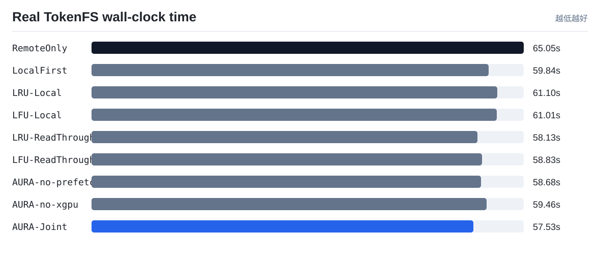
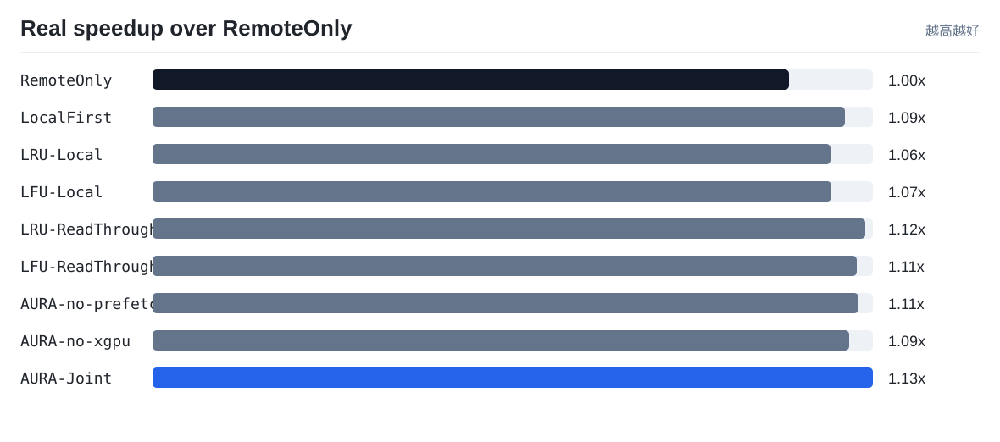
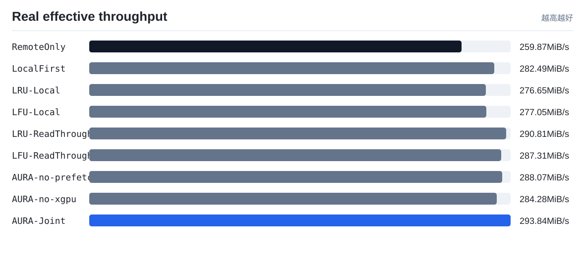
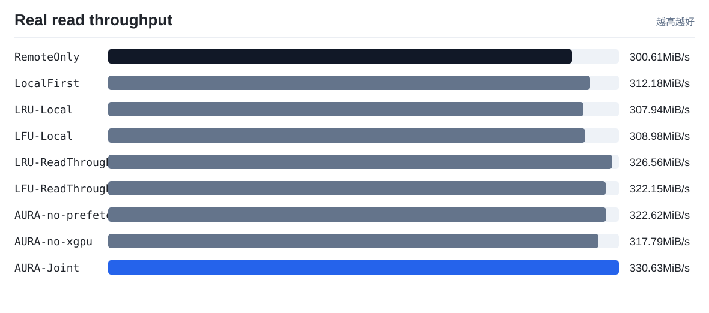
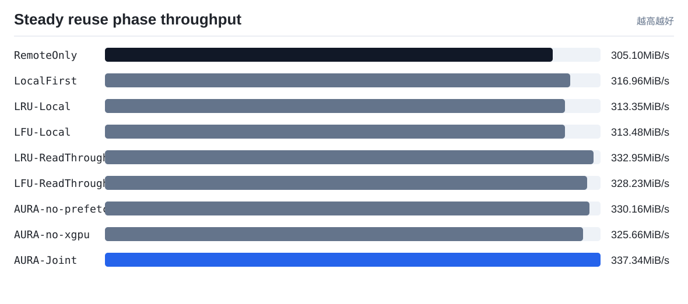

# TokenFS 真实速度实验

实验环境：Repeated real TokenFS workload on verified NVMe-oF, cn14->cn13 real NVMe-oF fair read-through baselines, 64MiB shards, 512MiB quota, 3 runs

本报告只使用真实程序运行产生的 wall-clock 时间、读写吞吐和 TokenFS 指标，不使用成本模型权重。它回答的是：在同一组 token shard workload 下，AURA-Joint 相比 RemoteOnly、LocalFirst、LRU-Local 和 LFU-Local 是否真的更快。

注意：`scripts/real_speed_benchmark.sh` 默认会强制检查远端后端已经通过 NVMe-oF 挂载，并要求 `TOKENFS_NVMEOF_PATH_MODE=direct`。只有 `backends[].type = nvmeof`、`nvme_target_ip` 是真实 Target IP、远端根目录已挂载、挂载源为 `/dev/nvme...` 时，才会生成可用于论文的直连 NVMe-oF 端到端速度结果。若显式设置 `TOKENFS_NVMEOF_PATH_MODE=tunnel`，结果只能作为功能验证，不能写成直连性能。

为避免 Linux 页缓存把远端 NVMe-oF 重复读取伪装成内存命中，真实速度脚本默认在关键阶段以及每次逻辑读取计时前请求清理 OS page cache；清理动作本身只作为 `cache_control` 证据记录，不计入策略读写耗时。这个控制条件不改变 workload 的访问分布，只用于让比较对象回到“本地 SSD 路径 vs 远端 NVMe-oF 路径”。

## 结果表

| 策略 | 总数据 MiB | 总耗时 s | 总吞吐 MiB/s | 总吞吐相对 RemoteOnly | 读吞吐 MiB/s | 读吞吐相对 RemoteOnly | 复用阶段吞吐 MiB/s | 复用阶段相对吞吐 | 平均读 us | 本地读命中率 | 远端打开读取 | 远端打开减少 | 后台动作证据 |
|---|---:|---:|---:|---:|---:|---:|---:|---:|---:|---:|---:|---:|---|
| `RemoteOnly` | 16904.0 | 65.0486 | 259.87 | 1.0x | 300.61 | 1.0x | 305.1 | 1.0x | 46.63 | 0.0% | 260 | 0.0% | promote=0, prefetch=0/0, evict=0, skip_hot=0, xgpu=0/0, spill=0 |
| `LocalFirst` | 16904.0 | 59.8389 | 282.49 | 1.0871x | 312.18 | 1.0385x | 316.96 | 1.0388x | 41.35 | 0.38% | 259 | 0.38% | promote=0, prefetch=0/0, evict=0, skip_hot=0, xgpu=0/0, spill=0 |
| `LRU-Local` | 16904.0 | 61.103 | 276.65 | 1.0646x | 307.94 | 1.0244x | 313.35 | 1.027x | 40.72 | 0.38% | 259 | 0.38% | promote=0, prefetch=0/0, evict=0, skip_hot=0, xgpu=0/0, spill=0 |
| `LFU-Local` | 16904.0 | 61.0139 | 277.05 | 1.0661x | 308.98 | 1.0278x | 313.48 | 1.0275x | 43.17 | 0.38% | 259 | 0.38% | promote=0, prefetch=0/0, evict=0, skip_hot=0, xgpu=0/0, spill=0 |
| `LRU-ReadThrough` | 16904.0 | 58.127 | 290.81 | 1.1191x | 326.56 | 1.0863x | 332.95 | 1.0913x | 41.25 | 73.85% | 68 | 73.85% | promote=2, prefetch=0/0, evict=0, skip_hot=0, xgpu=0/0, spill=0 |
| `LFU-ReadThrough` | 16904.0 | 58.8344 | 287.31 | 1.1056x | 322.15 | 1.0717x | 328.23 | 1.0758x | 42.19 | 73.85% | 68 | 73.85% | promote=2, prefetch=0/0, evict=0, skip_hot=0, xgpu=0/0, spill=0 |
| `AURA-no-prefetch` | 16904.0 | 58.6798 | 288.07 | 1.1085x | 322.62 | 1.0732x | 330.16 | 1.0821x | 43.76 | 91.15% | 23 | 91.15% | promote=2, prefetch=0/0, evict=0, skip_hot=0, xgpu=1/62, spill=0 |
| `AURA-no-xgpu` | 16904.0 | 59.4623 | 284.28 | 1.0939x | 317.79 | 1.0572x | 325.66 | 1.0674x | 42.21 | 71.54% | 74 | 71.54% | promote=1, prefetch=1/1, evict=0, skip_hot=0, xgpu=0/0, spill=0 |
| `AURA-Joint` | 16904.0 | 57.5281 | 293.84 | 1.1307x | 330.63 | 1.0999x | 337.34 | 1.1057x | 42.05 | 95.0% | 13 | 95.0% | promote=1, prefetch=1/1, evict=0, skip_hot=0, xgpu=1/62, spill=0 |

## 可视化

## 解读

- 当前 workload 下总耗时最短的是 `AURA-Joint`，耗时 `57.5281 s`。
- 当前 workload 下有效吞吐最高的是 `AURA-Joint`，约 `293.84 MiB/s`。
- `AURA-Joint` 相比 `RemoteOnly` 的真实端到端速度提升为 `1.1307x`。
- 只看策略生效后的热点/预取/跨 GPU 复用阶段，`AURA-Joint` 相对 `RemoteOnly` 的吞吐为 `1.1057x`。该指标用于观察后台策略完成后，后续读取收益是否出现。

## 论文中怎么使用

- `objective_cost_per_request` 用来解释控制器的决策质量，是策略层指标。
- `wall_time_s`、`effective_mib_s`、`avg_read_us` 用来回答系统实际快不快，是真实运行指标。
- 如果两者方向不一致，必须优先相信真实速度结果，并回头检查实现开销、页缓存控制、后台迁移门槛和成本权重。
