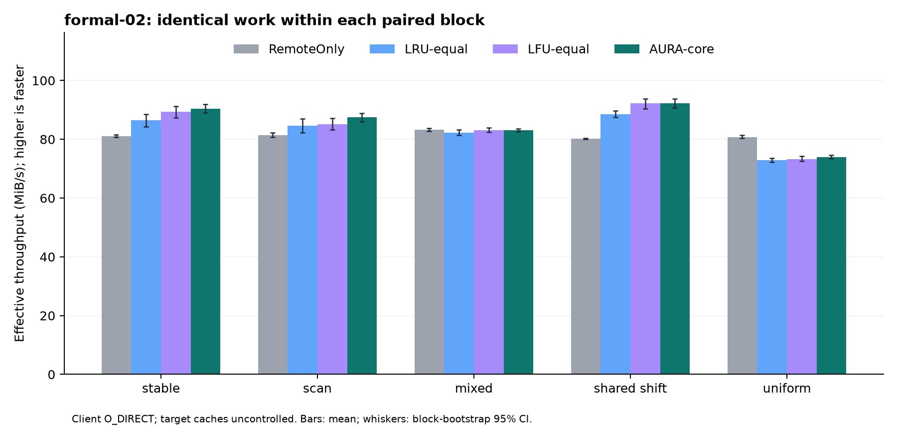
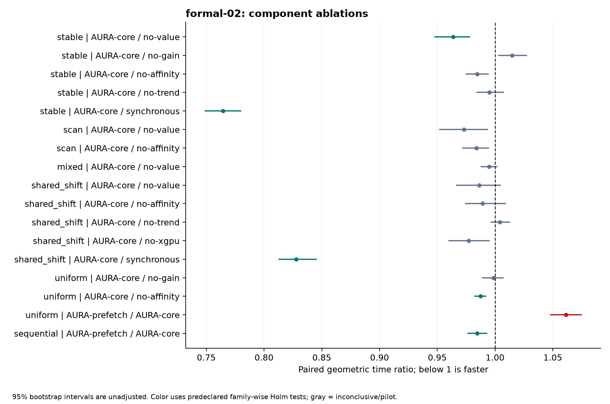

# TokenFS 消融实验实测结果

批次 `formal-02`：400/400 次完整运行通过数据审计。主判据是相同任务的真实完成时间与实际 MiB/s，命中率只用于解释。

在 10 项 AURA-core 对 LRU/LFU 的场景比较中，2 项满足预先固定的提速判据，0 项显示更慢，其余未得到确定结论。该结果不能被改写成“所有策略组件都有效”或“完整论文模型已验证”。

## 可以保留与必须收窄的结论

- **整体优势有场景限制**：稳定热点、热点迁移相对 LRU 的配对耗时分别降低4.48%、3.94%，通过预先固定的家族内 Holm 检验；五场景均未获得相对 LFU 的确定优势。均匀随机比 RemoteOnly 耗时增加9.19%，必须作为反例保留。
- **价值淘汰只得到局部支持**：稳定热点关闭 value victim 规则后变慢，core 耗时降低3.64%；另外三场景证据不确定。它不证明完整 EvictionLoss 或价值函数每个分项有效。
- **亲和与趋势需收窄**：亲和只在均匀随机下获得约1.27%的耗时优势，热点迁移未获确定提速；趋势在所测两场景均无确定收益。逻辑域共享同一磁盘，不代表真实设备亲和。
- **收益准入消融没有识别到筛选收益**：稳定和均匀随机的 core 均未记录 low-reuse/value/benefit 拒绝，且无跨域调用；准入开关虽然存在，本批没有充分触发所要验证的筛选作用。不得将“不显著”解读为等效或机制已验证。
- **异步有净收益**：稳定与迁移场景，相对同步耗时降低23.54%、17.22%；计入后台收尾后方向仍相同。异步改变时序也会影响动作，结果是整套执行方式的净效应，不能全算成纯线程开销差。
- **预取不是默认赢家**：顺序访问耗时降低1.55%，均匀随机增加6.15%；后者复制 payload 从223.2增至483.6 MiB/运行。顺序场景仅比较 core 与 prefetch，不能推出预取优于 RemoteOnly/LRU/LFU。
- **未支持有利协同**：价值×亲和交互项在扫描为0.0179秒，95%区间[-0.0536,0.0849]；迁移为0.0481秒，[0.0105,0.0852]，正方向表示在加性时间标度上次加性收益。此为探索分析，不支持“联合带来额外正收益”。

可用于当前论文的表述：在本轮单客户端、三逻辑缓存域、合成存储访问和 NVMe/TCP 环境下，AURA-core 在稳定与迁移热点相对对等 LRU 获得约4%的任务时间改善；相对对等 LFU 未确立优势，随机访问存在退化。异步执行和部分场景的价值淘汰得到真实速率支持，其余理论贡献仍需独立实现与验证。

## 实际速度

| 场景 | RemoteOnly MiB/s | LRU MiB/s | LFU MiB/s | AURA-core MiB/s | AURA 完成秒 |
|---|---:|---:|---:|---:|---:|
| 稳定热点 | 81.09 | 86.44 | 89.38 | 90.46 | 4.248 |
| 热点与扫描 | 81.32 | 84.57 | 85.14 | 87.45 | 4.394 |
| 变长对象 | 83.23 | 82.28 | 83.12 | 83.11 | 7.364 |
| 热点跨域迁移 | 80.16 | 88.57 | 92.17 | 92.22 | 4.167 |
| 均匀随机 | 80.72 | 72.89 | 73.30 | 73.93 | 5.195 |

以上是运行均值；正式胜负依据配对 log 时间比、按块 bootstrap 区间及预先定义家族内的 Holm 校正，不凭均值差或图形高低下结论。不同场景的字节分布不同，不跨场景直接比较吞吐。

## 各类消融得到什么

| 场景 | 对照 | 耗时变化 | 时间比 95% 区间 | 结论 |
|---|---|---:|---|---|
| 稳定热点 | AURA-core / no-value | -3.64% | [0.947, 0.978] | 支持此场景下真实提速 |
| 稳定热点 | AURA-core / no-gain | +1.48% | [1.003, 1.028] | 速度贡献证据不确定 |
| 稳定热点 | AURA-core / no-affinity | -1.56% | [0.974, 0.995] | 速度贡献证据不确定 |
| 稳定热点 | AURA-core / no-trend | -0.48% | [0.984, 1.008] | 速度贡献证据不确定 |
| 稳定热点 | AURA-core / synchronous | -23.54% | [0.748, 0.780] | 支持此场景下真实提速 |
| 热点与扫描 | AURA-core / no-value | -2.68% | [0.952, 0.994] | 速度贡献证据不确定 |
| 热点与扫描 | AURA-core / no-affinity | -1.60% | [0.972, 0.995] | 速度贡献证据不确定 |
| 变长对象 | AURA-core / no-value | -0.51% | [0.988, 1.002] | 速度贡献证据不确定 |
| 热点跨域迁移 | AURA-core / no-value | -1.38% | [0.966, 1.005] | 速度贡献证据不确定 |
| 热点跨域迁移 | AURA-core / no-affinity | -1.09% | [0.974, 1.009] | 速度贡献证据不确定 |
| 热点跨域迁移 | AURA-core / no-trend | +0.42% | [0.996, 1.013] | 速度贡献证据不确定 |
| 热点跨域迁移 | AURA-core / no-xgpu | -2.28% | [0.960, 0.995] | 速度贡献证据不确定 |
| 热点跨域迁移 | AURA-core / synchronous | -17.22% | [0.813, 0.846] | 支持此场景下真实提速 |
| 均匀随机 | AURA-core / no-gain | -0.15% | [0.988, 1.007] | 速度贡献证据不确定 |
| 均匀随机 | AURA-core / no-affinity | -1.27% | [0.982, 0.992] | 支持此场景下真实提速 |
| 均匀随机 | AURA-prefetch / AURA-core | +6.15% | [1.048, 1.075] | 此场景下更慢 |
| 顺序访问 | AURA-prefetch / AURA-core | -1.55% | [0.976, 0.993] | 支持此场景下真实提速 |

耗时变化为配对几何时间比减1，负数较快。预取行比较 AURA-prefetch/AURA-core；其余行比较 core/指定消融。四格交互、全部主比较、后台收尾、经验尾延迟和搬运量见后附自动报告。

## 验证方式与边界

- cn7 为客户端，cn13 提供独立 NVMe/TCP namespace；三个 GPU 是同一客户端上的逻辑缓存域。
- 统一 Release 二进制、相同 trace/数据/配额、空应用缓存、块内随机策略顺序；主任务使用外层单调时钟。
- 客户端本地和远端前台都使用 O_DIRECT；目标端 loop/backing 缓存与其他任务争用不受控。本地/远端都不是独占裸 NVMe。
- 正式数据每组96次请求、每域8 MiB配额、通常4 MiB对象；mixed 中16 MiB对象不能进入单域缓存，不能据此单独证明大小感知淘汰。
- 逐请求哈希仅用于独立正确性批次；正式运行后校验留存副本，复制路径始终校验。含后台完成时间和复制量单独报告。
- 当前真实程序是 C++ AURA-core；完整 RobustBenefit/需求置信区间、强 SWAP、生产 trace、真实推理 TTFT 和多物理 GPU 仍不能用本批数据证明。
- 固定成本参数、零冷却/驻留、单请求流和短任务限制了价值分项、防抖及长期服务结论。每次96条请求的 nearest-rank p99 实际等于该次最大值，不构成服务级 p99 保证。

## 修复与正确性证据

已修复访问统计快路径、秒级 LRU 并列、跨域副本容量竞争、后台收尾、复制校验、布局字段覆盖、整段计时及模拟在途复制问题。完整矩阵进一步发现 GetAttr/淘汰窗口的 ENOENT 竞态；修复的正向回归通过，单独撤掉锁的负向控制失败。formal-01 因此整体失效并保留，不进入本报告。

Release 版本在 cn7 的72组全变体/全负载内容校验全部通过；cn8 的72组独立目录后端校验也通过。另通过写保护、唯一字节的非对齐范围/EOF读取、96次并发全哈希读取、正常重启和排空后强制退出重启。它们不等于复制中断、断电或严格峰值容量已验证。

Python 参考执行器另补齐声明长度、预期 SHA256、失败依赖收尾、重试等待与最后可靠副本保护；没有临时空间的强 SWAP 明确拒绝，完整实现仍有缺口。

正式批次归档后发现遥测 `score` 的三目表达式把负 int64 淘汰分数转换成 uint64。已补齐各分支显式转 double 和负值回归；排序一直使用独立的 int64 分数，修复仅涉及动作记录。formal-02 的源代码/二进制仍冻结在 `67d219d2372bedf7a32e0ef882dafd555c5f92f2`，不会冒称由最新补丁重新测得；其错误 score 原样保留且不参与速度或模型项推断。

## 仍未完成的工作与可行收口

当前证据已闭合到“可执行 C++ 原型的有限场景性能”，尚未闭合到“论文所有理论主张”。若论文要保留更强主张，按下列依赖推进：

| 优先级 | 缺口 | 可实施方案 | 验收标准 |
|---|---|---|---|
| P0 | 随机访问净退化、准入未触发 | 以实测远端/本地服务时间与复制校验耗时校准成本；加入频率/复用证据门槛与绕过；先在开发集验证拒绝与接受两条路径 | 新保留 trace/种子上比较 RemoteOnly、对等 LRU/LFU；速度改善且复制开销进入计时；不得继续用 formal-02 调参后宣称确认 |
| P0 | 完整 Python 联合模型未接入 C++ | 一个版本化决策接口，固定 snapshot，实际执行带 layout_version 的动作；对照公式与执行结果 | no-uncertainty、independent、joint 开关确实改变相应机制，均走真实 I/O；按完整 wall/MiB/s 判定 |
| P1 | 价值项、大小与防抖缺少独立识别 | 所有对象均可入缓存的变长负载；同频不同实测成本；持续跨多个冷却窗口的稳定/迁移/噪声负载 | 每次只关一项；记录命中的决策分支、搬运与实际速度；未触发的组明确失败，不充当通过 |
| P1 | 强 SWAP、复制中断和峰值占用 | 显式 staging 配额和持久状态机；引入打开文件引用与延迟回收；逐个提交阶段故障注入 | 数据身份/最后副本不丢，重启可恢复；物理峰值含 staging/未回收文件；所有基线总预算相同 |
| P1 | 短合成任务、容量单点、弱外推 | 真实匿名 trace、长稳态、容量比例/后台预算扫描，以及经过合理调参的现代缓存基线 | 先固定最小实际收益和样本量；开发/测试分离，全部场景含反例报告 |
| P2 | 真实 GPU、真实推理和硬件结论 | 真实设备路径与 vLLM/SGLang 集成；记录同模型/同输入/同输出质量的端到端任务 | 实测 tokens/s、TTFT、完成时间；存储 MiB/s 不替代推理指标；设备/目标缓存/争用状态可追溯 |

这些是明确的未完成项，不能通过更换图表或追加同一批种子补成已验证。当前论文若不实施它们，应删除或限定相应贡献表述。

## 可复现信息

- 构建模式：`Release`。
- 二进制 SHA256：`88f857a58e5918ce7bd04f901c9638057f842e01a9bd67c6946cbed938048a41`。
- C++ 源码 SHA256：`44597674679b9e8a7ad46379c10ed57897804861a6bfcad65a0ebe8234039634`。
- 测量入口 SHA256：`14e3665f82d1bd2bb72b105b92e3347ced0a9bd74d9b99202a56bed1a9523558`。
- 全部运行累计逻辑读取：161.133 GiB（不等于远端物理读流量）。

代码与修复记录：[GitHub PR #1](https://github.com/yxtmfz/tokenfs/pull/1)。原始 manifest、trace、配置、逐请求记录、动作和失败记录应与报告一起归档。重算依次运行 evidence_audit.py、evidence_report.py、evidence_mechanisms.py、evidence_figures.py；审计失败时不解释速度比较。

## 机制触发与动作审查

此表只描述记录中实际发生的动作，不能把异步时序造成的序列差异解释为纯算法因果效应。比较忽略 score、reason 和 seq，只保留 action/path/GPU/bytes。formal-02 的负 value score 在日志中发生无符号转换；排序使用独立 int64 分数，动作选择与 wall 不受这一记录格式错误影响。原始 score 不改写、不用于模型项分析。

| 场景 | 比较 | 动作序列相同的配对数 | 复制 MiB（处理/对照） | 解释 |
|---|---|---:|---:|---|
| stable | AURA-core / no-value | 0/10 | 171.6 / 180.4 | 动作差异可能包含异步时序变化，不能单独视为目标算法的因果贡献。 |
| stable | AURA-core / no-gain | 6/10 | 171.6 / 171.6 | 未观察到收益准入拒绝，且无跨域调用；本场景不能识别准入筛选收益。 |
| stable | AURA-core / no-affinity | 2/10 | 171.6 / 180.4 | 动作差异可能包含异步时序变化，不能单独视为目标算法的因果贡献。 |
| stable | AURA-core / no-trend | 4/10 | 171.6 / 171.6 | 动作差异可能包含异步时序变化，不能单独视为目标算法的因果贡献。 |
| stable | AURA-core / synchronous | 3/10 | 171.6 / 168.4 | 动作差异可能包含异步时序变化，不能单独视为目标算法的因果贡献。 |
| scan | AURA-core / no-value | 0/10 | 138.0 / 141.2 | 动作差异可能包含异步时序变化，不能单独视为目标算法的因果贡献。 |
| scan | AURA-core / no-affinity | 0/10 | 138.0 / 162.8 | 动作差异可能包含异步时序变化，不能单独视为目标算法的因果贡献。 |
| mixed | AURA-core / no-value | 0/10 | 188.8 / 186.4 | 动作差异可能包含异步时序变化，不能单独视为目标算法的因果贡献。 |
| shared_shift | AURA-core / no-value | 0/10 | 109.2 / 112.8 | 动作差异可能包含异步时序变化，不能单独视为目标算法的因果贡献。 |
| shared_shift | AURA-core / no-affinity | 0/10 | 109.2 / 232.8 | 动作差异可能包含异步时序变化，不能单独视为目标算法的因果贡献。 |
| shared_shift | AURA-core / no-trend | 3/10 | 109.2 / 109.6 | 动作差异可能包含异步时序变化，不能单独视为目标算法的因果贡献。 |
| shared_shift | AURA-core / no-xgpu | 0/10 | 109.2 / 61.6 | 动作差异可能包含异步时序变化，不能单独视为目标算法的因果贡献。 |
| shared_shift | AURA-core / synchronous | 0/10 | 109.2 / 118.0 | 动作差异可能包含异步时序变化，不能单独视为目标算法的因果贡献。 |
| uniform | AURA-core / no-gain | 1/10 | 223.2 / 224.0 | 未观察到收益准入拒绝，且无跨域调用；本场景不能识别准入筛选收益。 |
| uniform | AURA-core / no-affinity | 0/10 | 223.2 / 251.6 | 动作差异可能包含异步时序变化，不能单独视为目标算法的因果贡献。 |
| uniform | AURA-prefetch / AURA-core | 0/10 | 483.6 / 223.2 | 动作差异可能包含异步时序变化，不能单独视为目标算法的因果贡献。 |
| sequential | AURA-prefetch / AURA-core | 0/10 | 380.0 / 288.0 | 动作差异可能包含异步时序变化，不能单独视为目标算法的因果贡献。 |

## 完整自动报告

# 真实速率与消融证据报告

批次：formal-02。缓存条件：client O_DIRECT, server caches uncontrolled。整批审计：400/400 通过。

主指标为完整任务耗时；实际吞吐为相同任务字节除以外层耗时。时间比=AURA-core/对照，低于 1 较快。

95% 区间按运行块 bootstrap；双侧符号翻转检验假设零假设下配对差对称，主比较 AURA 对 LRU/LFU 跨场景作为一个家族，其他每个组件跨场景各为预先定义的家族，家族内 p 值作 Holm 校正；不声称控制整篇论文的总体错误率。区间本身未经多重比较校正。

| 场景 | 对照/消融 | n | AURA 秒 / MiB/s | 对照 秒 / MiB/s | 时间比 [95% CI] | 判定 |
|---|---|---:|---:|---:|---|---|
| stable | AURA-core / LRU-equal | 10 | 4.248 / 90.46 | 4.449 / 86.44 | 0.955 [0.942, 0.969] | 支持此场景下真实提速 |
| stable | AURA-core / LFU-equal | 10 | 4.248 / 90.46 | 4.302 / 89.38 | 0.988 [0.977, 0.997] | 速度贡献证据不确定 |
| stable | AURA-core / RemoteOnly | 10 | 4.248 / 90.46 | 4.736 / 81.09 | 0.897 [0.881, 0.914] | 支持此场景下真实提速 |
| stable | AURA-core / no-value | 10 | 4.248 / 90.46 | 4.411 / 87.21 | 0.964 [0.947, 0.978] | 支持此场景下真实提速 |
| stable | AURA-core / no-gain | 10 | 4.248 / 90.46 | 4.188 / 91.84 | 1.015 [1.003, 1.028] | 速度贡献证据不确定 |
| stable | AURA-core / no-affinity | 10 | 4.248 / 90.46 | 4.317 / 89.09 | 0.984 [0.974, 0.995] | 速度贡献证据不确定 |
| stable | AURA-core / no-trend | 10 | 4.248 / 90.46 | 4.270 / 90.06 | 0.995 [0.984, 1.008] | 速度贡献证据不确定 |
| stable | AURA-core / synchronous | 10 | 4.248 / 90.46 | 5.562 / 69.24 | 0.765 [0.748, 0.780] | 支持此场景下真实提速 |
| scan | AURA-core / LRU-equal | 10 | 4.394 / 87.45 | 4.550 / 84.57 | 0.966 [0.946, 0.989] | 速度贡献证据不确定 |
| scan | AURA-core / LFU-equal | 10 | 4.394 / 87.45 | 4.516 / 85.14 | 0.973 [0.959, 0.989] | 速度贡献证据不确定 |
| scan | AURA-core / RemoteOnly | 10 | 4.394 / 87.45 | 4.723 / 81.32 | 0.930 [0.912, 0.950] | 支持此场景下真实提速 |
| scan | AURA-core / no-value | 10 | 4.394 / 87.45 | 4.517 / 85.14 | 0.973 [0.952, 0.994] | 速度贡献证据不确定 |
| scan | AURA-core / no-affinity | 10 | 4.394 / 87.45 | 4.465 / 86.05 | 0.984 [0.972, 0.995] | 速度贡献证据不确定 |
| mixed | AURA-core / LRU-equal | 10 | 7.364 / 83.11 | 7.433 / 82.28 | 0.990 [0.980, 0.999] | 速度贡献证据不确定 |
| mixed | AURA-core / LFU-equal | 10 | 7.364 / 83.11 | 7.363 / 83.12 | 1.000 [0.994, 1.006] | 速度贡献证据不确定 |
| mixed | AURA-core / RemoteOnly | 10 | 7.364 / 83.11 | 7.355 / 83.23 | 1.001 [0.994, 1.010] | 速度贡献证据不确定 |
| mixed | AURA-core / no-value | 10 | 7.364 / 83.11 | 7.399 / 82.69 | 0.995 [0.988, 1.002] | 速度贡献证据不确定 |
| shared_shift | AURA-core / LRU-equal | 10 | 4.167 / 92.22 | 4.337 / 88.57 | 0.961 [0.943, 0.976] | 支持此场景下真实提速 |
| shared_shift | AURA-core / LFU-equal | 10 | 4.167 / 92.22 | 4.170 / 92.17 | 0.999 [0.989, 1.011] | 速度贡献证据不确定 |
| shared_shift | AURA-core / RemoteOnly | 10 | 4.167 / 92.22 | 4.791 / 80.16 | 0.870 [0.854, 0.884] | 支持此场景下真实提速 |
| shared_shift | AURA-core / no-value | 10 | 4.167 / 92.22 | 4.225 / 90.94 | 0.986 [0.966, 1.005] | 速度贡献证据不确定 |
| shared_shift | AURA-core / no-affinity | 10 | 4.167 / 92.22 | 4.215 / 91.24 | 0.989 [0.974, 1.009] | 速度贡献证据不确定 |
| shared_shift | AURA-core / no-trend | 10 | 4.167 / 92.22 | 4.150 / 92.60 | 1.004 [0.996, 1.013] | 速度贡献证据不确定 |
| shared_shift | AURA-core / no-xgpu | 10 | 4.167 / 92.22 | 4.264 / 90.10 | 0.977 [0.960, 0.995] | 速度贡献证据不确定 |
| shared_shift | AURA-core / synchronous | 10 | 4.167 / 92.22 | 5.037 / 76.38 | 0.828 [0.813, 0.846] | 支持此场景下真实提速 |
| uniform | AURA-core / LRU-equal | 10 | 5.195 / 73.93 | 5.269 / 72.89 | 0.986 [0.972, 1.000] | 速度贡献证据不确定 |
| uniform | AURA-core / LFU-equal | 10 | 5.195 / 73.93 | 5.241 / 73.30 | 0.991 [0.981, 1.000] | 速度贡献证据不确定 |
| uniform | AURA-core / RemoteOnly | 10 | 5.195 / 73.93 | 4.758 / 80.72 | 1.092 [1.083, 1.101] | 此场景下更慢 |
| uniform | AURA-core / no-gain | 10 | 5.195 / 73.93 | 5.203 / 73.83 | 0.999 [0.988, 1.007] | 速度贡献证据不确定 |
| uniform | AURA-core / no-affinity | 10 | 5.195 / 73.93 | 5.261 / 73.00 | 0.987 [0.982, 0.992] | 支持此场景下真实提速 |
| uniform | AURA-prefetch / AURA-core | 10 | 5.514 / 69.66 | 5.195 / 73.93 | 1.061 [1.048, 1.075] | 此场景下更慢 |
| sequential | AURA-prefetch / AURA-core | 10 | 5.367 / 71.55 | 5.451 / 70.44 | 0.985 [0.976, 0.993] | 支持此场景下真实提速 |

## 后台收尾、尾延迟与搬运

下表均按运行取平均。复制列为逻辑副本 payload，不包括校验读取、元数据和协议开销，不等于网卡/物理盘实测字节。p99 为每次运行有限条请求的经验分位数，不能当作充分采样的服务尾延迟保证。

| 场景 | 策略 | 含后台完成秒 | 后台收尾秒 | 请求 p99 毫秒 | 复制 MiB | 淘汰次数 | 本地读取比例 |
|---|---|---:|---:|---:|---:|---:|---:|
| stable | RemoteOnly | 4.738 | 0.002 | 55.00 | 0.0 | 0.0 | 0.0% |
| stable | LRU-equal | 4.457 | 0.008 | 75.07 | 187.2 | 44.8 | 34.7% |
| stable | LFU-equal | 4.314 | 0.012 | 76.29 | 182.0 | 43.5 | 35.8% |
| stable | AURA-core | 4.254 | 0.006 | 75.00 | 171.6 | 40.9 | 37.5% |
| stable | no-value | 4.414 | 0.004 | 78.35 | 180.4 | 43.1 | 35.0% |
| stable | no-gain | 4.192 | 0.004 | 80.29 | 171.6 | 40.9 | 37.3% |
| stable | no-affinity | 4.323 | 0.006 | 77.45 | 180.4 | 43.1 | 36.0% |
| stable | no-trend | 4.276 | 0.006 | 77.62 | 171.6 | 40.9 | 37.2% |
| stable | synchronous | 5.564 | 0.002 | 143.09 | 168.4 | 40.1 | 38.9% |
| scan | RemoteOnly | 4.725 | 0.002 | 56.83 | 0.0 | 0.0 | 0.0% |
| scan | LRU-equal | 4.760 | 0.210 | 77.81 | 166.0 | 39.5 | 28.6% |
| scan | LFU-equal | 4.705 | 0.189 | 80.65 | 163.6 | 38.9 | 29.6% |
| scan | AURA-core | 4.474 | 0.080 | 75.06 | 138.0 | 32.5 | 30.2% |
| scan | no-value | 4.580 | 0.063 | 77.92 | 141.2 | 33.3 | 29.0% |
| scan | no-affinity | 4.671 | 0.206 | 81.93 | 162.8 | 38.7 | 29.8% |
| scan | E0A0 | 4.799 | 0.193 | 78.67 | 165.2 | 39.3 | 29.4% |
| mixed | RemoteOnly | 7.357 | 0.002 | 189.62 | 0.0 | 0.0 | 0.0% |
| mixed | LRU-equal | 7.435 | 0.002 | 205.45 | 205.6 | 49.4 | 11.1% |
| mixed | LFU-equal | 7.365 | 0.002 | 213.11 | 207.6 | 49.9 | 10.8% |
| mixed | AURA-core | 7.366 | 0.002 | 204.23 | 188.8 | 45.2 | 11.0% |
| mixed | no-value | 7.400 | 0.002 | 204.56 | 186.4 | 44.6 | 11.5% |
| shared_shift | RemoteOnly | 4.792 | 0.002 | 58.74 | 0.0 | 0.0 | 0.0% |
| shared_shift | LRU-equal | 4.343 | 0.006 | 75.91 | 233.2 | 52.3 | 45.2% |
| shared_shift | LFU-equal | 4.174 | 0.004 | 73.55 | 232.0 | 52.0 | 45.4% |
| shared_shift | AURA-core | 4.171 | 0.004 | 84.35 | 109.2 | 21.3 | 40.8% |
| shared_shift | no-value | 4.229 | 0.004 | 83.09 | 112.8 | 22.2 | 40.1% |
| shared_shift | no-affinity | 4.221 | 0.006 | 75.54 | 232.8 | 52.2 | 46.0% |
| shared_shift | no-trend | 4.154 | 0.004 | 75.86 | 109.6 | 21.4 | 40.5% |
| shared_shift | no-xgpu | 4.266 | 0.002 | 73.68 | 61.6 | 13.4 | 30.3% |
| shared_shift | E0A0 | 4.331 | 0.011 | 78.17 | 232.8 | 52.2 | 45.3% |
| shared_shift | synchronous | 5.038 | 0.002 | 137.47 | 118.0 | 23.5 | 42.8% |
| uniform | RemoteOnly | 4.759 | 0.002 | 55.31 | 0.0 | 0.0 | 0.0% |
| uniform | LRU-equal | 5.271 | 0.002 | 84.68 | 253.6 | 61.4 | 6.9% |
| uniform | LFU-equal | 5.243 | 0.002 | 83.61 | 252.8 | 61.2 | 7.0% |
| uniform | AURA-core | 5.201 | 0.006 | 79.56 | 223.2 | 53.8 | 7.6% |
| uniform | no-gain | 5.205 | 0.002 | 85.68 | 224.0 | 54.0 | 7.3% |
| uniform | no-affinity | 5.263 | 0.002 | 81.64 | 251.6 | 60.9 | 7.2% |
| uniform | AURA-prefetch | 5.527 | 0.012 | 86.23 | 483.6 | 118.9 | 5.0% |
| sequential | AURA-core | 5.453 | 0.002 | 86.95 | 288.0 | 70.0 | 0.0% |
| sequential | AURA-prefetch | 5.369 | 0.002 | 86.06 | 380.0 | 93.0 | 17.5% |

含后台完成的配对比与区间见 paired-comparisons.json 的 time_ratio_with_drain / with_drain_ci95；它们是附属分析，主检验仍按预先固定方案。主任务更快但收尾更慢时须同时披露。

## 组件协同

四格交互只检验价值淘汰与亲和放置，不能替代完整 RobustBenefit 与 independent 控制器比较。交互项小于零表示有利的时间交互；此处仅为探索性分析。

| 场景 | n | 交互项均值/秒 | 95% 区间/秒 |
|---|---:|---:|---|
| scan | 10 | 0.0179 | [-0.0536, 0.0849] |
| shared_shift | 10 | 0.0481 | [0.0105, 0.0852] |

失败记录数：0。没有出现的场景/对照不是通过，而是尚无结果。

## 解释边界

输入为合成存储 trace，GPU 为逻辑缓存域；本表不证明真实推理 TTFT、真实 GPU 扩展性或完整 Python 联合模型在 C++ 中的性能。

