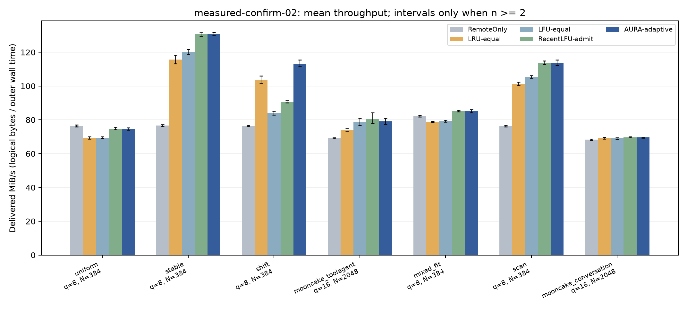
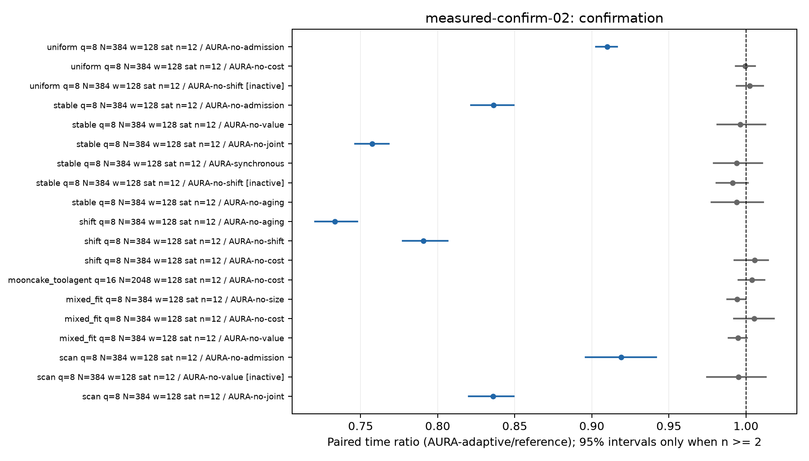

# TokenFS 第二轮策略与消融实验实测结论

本报告仅在冻结的 756 项速度实验全部完成并通过审计后生成。主实验、补充实验、正确性与开发结果分别保留；结果没有按快慢筛选。

主比较 21 项：12 项支持提速，0 项支持退化，9 项未形成明确结论。

达到预先规定的核心收益条件（相对 LRU、LFU、RecentLFU 均有统计支持且前台耗时降幅点估计至少为 5%）的场景：迁移热点。

主表中，对 RecentLFU 近期频率准入参考的已确认优势集中在热点迁移；其他场景不能写成已证明超过这一参考。对 LRU/LFU 的收益与对近期频率参考的收益应分开陈述，公开对话轨迹未确认对三个对等参考的优势。

组件层面的明确证据集中在复用/净收益准入筛选及热点变化下的历史遗忘与快速重置。成本项、大小项、价值 victim 规则和稳定场景异步执行没有获得独立提速的确认；因此“实测成本模型的每一项都有效”不适合作为论文结论。no-joint 胜出只说明同时关闭两项会变慢，协同仍须看四格交互区间。

均匀随机仍比 RemoteOnly 慢约 2.23%（耗时），虽然满足预定“95% 区间上界低于 5% 退化”的描述性标准，也不能写成零开销或随机场景最优。

## 1. 完成了什么

| 类别 | 数量与范围 | 回答的问题 |
|---|---|---|
| 主实验 | 648 次；7 场景，每场景 12 个配对块 | 整体策略是否实际更快，各组件是否贡献速度 |
| 补充实验 | 96 次；每条件 3 个配对块 | 容量、持续时长、历史窗口、原始到达时间下是否稳健 |
| 逻辑域速度补充 | 12 次；3 逻辑调用方，2 场景，各 3 对 | 相同共享副本架构下策略表现；仅描述性 |
| B3 内容校验 | cn7 65 项，cn8 65 项 | 请求与留存副本内容正确，不能当作速度样本 |
| B3 多逻辑域内容校验 | cn8 39 项 | 迁移、交错和循环访问；不证明物理多 GPU 加速 |

旧 formal-02 的 400 次结果以及 B1/B2/B3 开发结果全部保留。B2 在正式请求运行前发现反复清空热度会造成准入饥饿，撤回其冻结；相同确定性反例 B2 失败、B3 通过，新版本重新完成内容校验后才运行确认集。

新旧正式批次的负载、种子和对照矩阵不同；本轮没有把旧 AURA-core 纳入同一确认矩阵，不能用两轮表格的数值差宣称新版相对旧版提速。新版速度结论只针对本轮直接配对的基线与消融。

合成主实验与开发使用相同负载生成形态、不同保留种子，验证的是这些既定形态的重复性，不能据此宣称对未知负载类型泛化。公开轨迹按源请求记录划分前 20% 开发、后 80% 保留，主实验与补充窗口互不重叠；相同前缀块身份可能跨窗口复用，不是按对象身份划分的冷门对象测试。

## 2. 实际速度主结果

前台计时从请求回放开始到最后请求返回；后台补充时间只等待 TokenFS 复制队列排空。初始化、数据生成、事后副本校验、卸载与内核全部写回不在这两个计时边界内。本地缓存不要求 fsync 持久化，各策略规则相同，因此不能声称测量了全部物理 I/O 的持久化完成时间。

环境为 cn7 客户端 → cn13 独立 namespace 的真实 NVMe/TCP 链路。客户端缓存实际位于 /home 的既有 LVM 文件系统（底层 sda），远端导出的是既有文件系统上的 loop backing file；不能标成独占本地/远端裸 NVMe SSD 对测。三个逻辑域共享客户端磁盘。前台双层 O_DIRECT，后台复制 buffered；每次应用缓存重建、后端按同一规则预热。目标页缓存和其他任务争用未控制。远端逻辑/物理扇区、CPU、内存与挂载的最终只读快照保存在 provenance/measured-b3-final-hardware-context.json。

客户端结束时只读快照：CPU Intel(R) Xeon(R) Gold 6230N CPU @ 2.30GHz，80 个逻辑 CPU，总内存 251.4 GiB，Linux 6.8.0-31-generic。远端导出逻辑/物理扇区分别为 512/512 B；这不是文件系统块大小或裸盘物理配置的证明。网卡路由/链路快照如可读取也一并保存，不以其标称速率替代实测吞吐。

结束时只读检查发现 cn7 日历时钟未同步（NTPSynchronized=no），比本机慢约 1935 秒，未调整时钟或改写原记录。前台/后台耗时与请求时间线使用同一主机 CLOCK_MONOTONIC 差值，C++ 成本计时用 steady_clock，不依赖跨主机日历时间相减；日历偏移本身不改变这些速率。不同主机的日志时间不能直接比较，单次检查也不是长期时钟精度证明。见 provenance/clock-offset-check.json。

下表为各完整运行的平均实际 MiB/s。合成对象/公开块的逻辑字节数除以外层 monotonic 时间，没有使用内部评分或命中率换算速度。公开块统一为 1 MiB，不能理解为模型的真实 KV 字节数。

| 场景 | RemoteOnly | LRU | LFU | RecentLFU | AURA-adaptive |
|---|---:|---:|---:|---:|---:|
| 稳定热点 | 76.63 | 115.73 | 120.26 | 130.66 | 130.84 |
| 迁移热点 | 76.41 | 103.64 | 84.05 | 90.68 | 113.25 |
| 热点与扫描 | 76.31 | 101.28 | 105.25 | 113.62 | 113.59 |
| 变长对象 | 82.21 | 78.87 | 79.22 | 85.32 | 85.15 |
| 均匀随机 | 76.35 | 69.21 | 69.47 | 74.85 | 74.69 |
| Mooncake 对话 | 68.27 | 69.21 | 69.01 | 69.65 | 69.61 |
| Mooncake 工具代理 | 69.09 | 74.08 | 78.72 | 80.57 | 79.03 |

吞吐图误差线是各策略完整运行均值的 bootstrap 95% 区间；策略之间的显著性由下面的配对检验判断，不根据柱高或误差线是否重叠判断。

配对耗时比为 AURA / 对照，低于 1 表示更快。耗时下降与吞吐提升不同：下降 10% 耗时对应增加约 11.1% 吞吐。区间为未进行多重比较校正的配对 bootstrap 95% 区间；检验在 21 项主比较内进行 Holm 校正。

| 场景 | 对照 | 耗时比 [95% CI] | 实际吞吐配对变化 | Holm p | 结论 | 含后台收尾耗时比 |
|---|---|---|---:|---:|---|---:|
| 均匀随机 | LRU-equal | 0.9267 [0.9134, 0.9386] | +7.91% | 0.010254 | AURA 更快 | 0.9276 |
| 均匀随机 | LFU-equal | 0.9301 [0.9210, 0.9388] | +7.51% | 0.010254 | AURA 更快 | 0.9309 |
| 均匀随机 | RecentLFU-admit | 1.0021 [0.9901, 1.0143] | -0.21% | 1 | 未确定差异 | 1.0026 |
| 稳定热点 | LRU-equal | 0.8839 [0.8618, 0.9065] | +13.13% | 0.010254 | AURA 更快 | 0.8839 |
| 稳定热点 | LFU-equal | 0.9190 [0.9041, 0.9328] | +8.81% | 0.010254 | AURA 更快 | 0.9190 |
| 稳定热点 | RecentLFU-admit | 0.9985 [0.9877, 1.0084] | +0.15% | 1 | 未确定差异 | 0.9985 |
| 迁移热点 | LRU-equal | 0.9149 [0.8972, 0.9350] | +9.30% | 0.010254 | AURA 更快 | 0.9144 |
| 迁移热点 | LFU-equal | 0.7423 [0.7280, 0.7575] | +34.72% | 0.010254 | AURA 更快 | 0.7422 |
| 迁移热点 | RecentLFU-admit | 0.8010 [0.7859, 0.8167] | +24.85% | 0.010254 | AURA 更快 | 0.8010 |
| Mooncake 工具代理 | LRU-equal | 0.9379 [0.9218, 0.9532] | +6.62% | 0.010254 | AURA 更快 | 0.9379 |
| Mooncake 工具代理 | LFU-equal | 0.9959 [0.9872, 1.0044] | +0.41% | 1 | 未确定差异 | 0.9959 |
| Mooncake 工具代理 | RecentLFU-admit | 1.0180 [1.0033, 1.0402] | -1.77% | 0.19922 | 未确定差异 | 1.0180 |
| 变长对象 | LRU-equal | 0.9264 [0.9155, 0.9361] | +7.94% | 0.010254 | AURA 更快 | 0.9259 |
| 变长对象 | LFU-equal | 0.9305 [0.9211, 0.9388] | +7.47% | 0.010254 | AURA 更快 | 0.9299 |
| 变长对象 | RecentLFU-admit | 1.0022 [0.9870, 1.0148] | -0.22% | 1 | 未确定差异 | 1.0022 |
| 热点与扫描 | LRU-equal | 0.8918 [0.8758, 0.9048] | +12.13% | 0.010254 | AURA 更快 | 0.8910 |
| 热点与扫描 | LFU-equal | 0.9268 [0.9096, 0.9417] | +7.90% | 0.010254 | AURA 更快 | 0.9264 |
| 热点与扫描 | RecentLFU-admit | 1.0004 [0.9827, 1.0172] | -0.04% | 1 | 未确定差异 | 1.0004 |
| Mooncake 对话 | LRU-equal | 0.9942 [0.9851, 1.0019] | +0.58% | 1 | 未确定差异 | 0.9942 |
| Mooncake 对话 | LFU-equal | 0.9913 [0.9844, 0.9968] | +0.87% | 0.070312 | 未确定差异 | 0.9913 |
| Mooncake 对话 | RecentLFU-admit | 1.0007 [0.9960, 1.0056] | -0.07% | 1 | 未确定差异 | 1.0007 |

后台收尾检查：以下前台点估计优势在计入后台时反转：均匀随机 / AURA-no-cost。这些比较不能写成计入后台后的加速。 含后台比值为次级描述，不从前台检验直接继承显著性。

七场景等权汇总仅描述本矩阵，不代表生产流量权重，也不另做显著性结论：

- 相对 LRU-equal：几何平均耗时比 0.9245，对应吞吐变化 +8.16%。
- 相对 LFU-equal：几何平均耗时比 0.9158，对应吞吐变化 +9.20%。
- 相对 RecentLFU-admit：几何平均耗时比 0.9718，对应吞吐变化 +2.90%。

RemoteOnly 仍经过同一 FUSE 原型，只关闭本地缓存，不是绕过文件系统的设备峰值。无缓存架构对照另列如下，七项属于单独的 RemoteOnly 检验家族，不计入上述 21 项对等主比较：

| 场景 | AURA/RemoteOnly 耗时比 [95% CI] | Holm p | 结论 | 含队列收尾比 |
|---|---|---:|---|---:|
| 均匀随机 | 1.0223 [1.0092, 1.0346] | 0.0083008 | AURA 更慢 | 1.0233 |
| 稳定热点 | 0.5857 [0.5804, 0.5908] | 0.003418 | AURA 更快 | 0.5857 |
| 迁移热点 | 0.6750 [0.6609, 0.6877] | 0.003418 | AURA 更快 | 0.6750 |
| Mooncake 工具代理 | 0.8750 [0.8547, 0.8926] | 0.003418 | AURA 更快 | 0.8750 |
| 变长对象 | 0.9656 [0.9546, 0.9761] | 0.003418 | AURA 更快 | 0.9656 |
| 热点与扫描 | 0.6720 [0.6604, 0.6815] | 0.003418 | AURA 更快 | 0.6720 |
| Mooncake 对话 | 0.9808 [0.9753, 0.9851] | 0.003418 | AURA 更快 | 0.9808 |

均匀随机相对 RemoteOnly：耗时比 1.0223，95% 区间 [1.0092, 1.0346]；预定描述性不劣标准（区间上界 < 1.05）满足。没有显著退化本身不代表等效。

## 3. 每类消融证明了什么

当前模型对所有对象共用一个实测每字节服务率差 s，价值为 max(freq−1,0) × s × bytes。默认按价值/字节排序时 bytes 抵消，在 s>0 时与近期频率同序。因此实测成本主要作用于准入和所有 victim 的总损失，不能把 no-value 对照 LRU 的结果解释为逐对象成本预测已被验证。

| 消融 | 所改变的机制 | 可支持的解释 |
|---|---|---|
| no-admission | 关闭净收益/复用准入筛选，保留容量与正确性约束 | 是否值得复制的筛选贡献 |
| no-value | 价值 victim 改为 LRU，保留准入 | 删除谁的规则贡献 |
| no-joint | 同时去掉前两项 | 与前两项组成四格交互；不是完整 RobustBenefit 证明 |
| no-size | 去掉价值密度中的对象大小 | 大小项贡献；本轮变长对象每个都能入缓存 |
| no-cost | 去掉实测服务/复制成本，保留需求估计 | 成本感知的净速度贡献，内部数值单位已不同 |
| no-aging | 禁止历史遗忘和热点重置 | 整体遗忘贡献；不是仅关闭一个自然滑窗 |
| no-shift | 仅关闭热点重置，保留滑动历史 | 额外快速响应机制贡献 |
| synchronous | 相同复制正确性和串行度，前台等待 | 后台执行的贡献；同时查看收尾时间 |

| 场景 | 关闭组件的对照 | AURA/对照耗时比 [95% CI] | Holm p | 结论 | 机制有活动的配对块 | 动作序列不同的配对块 |
|---|---|---|---:|---|---:|---:|
| 均匀随机 | AURA-no-admission | 0.9099 [0.9027, 0.9163] | 0.0014648 | AURA 更快 | 12/12 | 12/12 |
| 均匀随机 | AURA-no-cost | 0.9995 [0.9933, 1.0058] | 1 | 未确定差异 | 12/12 | 12/12 |
| 均匀随机 | AURA-no-shift | 1.0024 [0.9941, 1.0111] | 0.61572 | 机制未观察到；不可归因 | 0/12 | 5/12 |
| 稳定热点 | AURA-no-admission | 0.8361 [0.8217, 0.8492] | 0.0014648 | AURA 更快 | 12/12 | 12/12 |
| 稳定热点 | AURA-no-value | 0.9962 [0.9815, 1.0126] | 1 | 未确定差异 | 2/12 | 1/12 |
| 稳定热点 | AURA-no-joint | 0.7575 [0.7465, 0.7682] | 0.00097656 | AURA 更快 | 12/12 | 12/12 |
| 稳定热点 | AURA-synchronous | 0.9939 [0.9792, 1.0107] | 0.48535 | 未确定差异 | 12/12 | 3/12 |
| 稳定热点 | AURA-no-shift | 0.9915 [0.9809, 1.0013] | 0.31543 | 机制未观察到；不可归因 | 0/12 | 0/12 |
| 稳定热点 | AURA-no-aging | 0.9939 [0.9776, 1.0113] | 0.51074 | 未确定差异 | 12/12 | 0/12 |
| 迁移热点 | AURA-no-aging | 0.7331 [0.7204, 0.7477] | 0.00097656 | AURA 更快 | 12/12 | 12/12 |
| 迁移热点 | AURA-no-shift | 0.7907 [0.7774, 0.8065] | 0.0014648 | AURA 更快 | 12/12 | 12/12 |
| 迁移热点 | AURA-no-cost | 1.0056 [0.9924, 1.0145] | 1 | 未确定差异 | 12/12 | 9/12 |
| Mooncake 工具代理 | AURA-no-cost | 1.0038 [0.9951, 1.0121] | 1 | 未确定差异 | 12/12 | 3/12 |
| 变长对象 | AURA-no-size | 0.9942 [0.9880, 0.9997] | 0.097656 | 未确定差异 | 12/12 | 8/12 |
| 变长对象 | AURA-no-cost | 1.0054 [0.9921, 1.0182] | 1 | 未确定差异 | 12/12 | 12/12 |
| 变长对象 | AURA-no-value | 0.9947 [0.9886, 1.0007] | 0.41162 | 未确定差异 | 12/12 | 10/12 |
| 热点与扫描 | AURA-no-admission | 0.9191 [0.8960, 0.9418] | 0.0014648 | AURA 更快 | 12/12 | 12/12 |
| 热点与扫描 | AURA-no-value | 0.9951 [0.9747, 1.0128] | 1 | 机制未观察到；不可归因 | 0/12 | 1/12 |
| 热点与扫描 | AURA-no-joint | 0.8359 [0.8202, 0.8494] | 0.00097656 | AURA 更快 | 12/12 | 12/12 |

组件图低于 1 表示完整策略更快；蓝色为支持提速，红色为支持退化，灰色为未确定或机制未观察到。线段是未校正的 95% 区间，结论同时要求预定家族内 Holm 检验通过。

组件各有自己的跨场景 Holm 家族，不代表对整篇论文所有陈述完成统一错误率控制。机制有活动或动作不同，只是归因的必要检查，本身不证明提速；策略路径的异步波动也可能使动作序列不同。

no-cost 同时移除实测服务差价与复制成本扣项，将价值换为单位重复访问证据；在变长对象下，这也改变每对象价值的字节权重。它不是“在线实测成本 vs 固定每字节成本”的纯校准对照，不能分别识别在线校准、复制扣项或不同对象的服务成本。no-aging 同时关闭滑窗遗忘和热点重置，只能解释整体遗忘的贡献；no-shift 才单独关闭额外热点重置。

四格交互为 T(full) − T(no-admission) − T(no-value) + T(no-joint)，负值有利；仅作探索性分析：

- 稳定热点：+0.7047 秒，95% 区间 [+0.5483, +0.8290]。
- 热点与扫描：+0.6979 秒，95% 区间 [+0.4835, +0.9289]。

## 4. 补充实验

这些补充数据的主要含义是：热点迁移在窗口 64/256 下相对 RecentLFU 的耗时比分别约为 0.8834/0.7385；4096 请求下约为 0.9499，优势缩小。主迁移实验每 96 次请求切换热点，默认历史窗口 128 次；长序列每 1024 次请求切换，同时基础对象改为 1 MiB、配额改为 4 MiB（保持四对象容量）。因此长序列条件不是只改变运行时长的纯单因素试验，不能把差异完全归因于持续时长。

容量变大时优势并不普遍保留：稳定热点 16 MiB 相对 RecentLFU 的耗时比约为 1.0361，32 MiB 约为 1.0118；公开工具代理按到达时间回放约为 1.0072。下面完整列出这些反例，不用正向结果覆盖它们。

以下条件每项只有 3 个配对块，不能作为确认性胜出或等效结论；它们不合并到主实验，也没有用于回头调参。更长回放为 4096 请求序列，相比主合成实验的 384 请求更长，但不是小时级生产稳态压测。

| 场景/条件 | 对照 | AURA/对照耗时比 [95% CI] | 含后台收尾比 |
|---|---|---|---:|
| 变长对象 / 配额8MiB / 384请求 / 窗口256 | RecentLFU-admit | 1.0020 [0.9849, 1.0160] | 1.0020 |
| 稳定热点 / 配额4MiB / 4096请求 / 窗口128 | LFU-equal | 0.8772 [0.8655, 0.8900] | 0.8772 |
| 稳定热点 / 配额4MiB / 4096请求 / 窗口128 | RecentLFU-admit | 0.9926 [0.9827, 1.0041] | 0.9926 |
| 变长对象 / 配额32MiB / 384请求 / 窗口128 | LFU-equal | 0.9214 [0.9120, 0.9319] | 0.9214 |
| 变长对象 / 配额32MiB / 384请求 / 窗口128 | RecentLFU-admit | 1.0182 [0.9892, 1.0644] | 1.0182 |
| 迁移热点 / 配额8MiB / 384请求 / 窗口64 | RecentLFU-admit | 0.8834 [0.8664, 0.9113] | 0.8834 |
| Mooncake 对话 / 配额16MiB / 1024请求 / 窗口128 / 原始到达时间 | LFU-equal | 0.9901 [0.9858, 0.9946] | 0.9901 |
| Mooncake 对话 / 配额16MiB / 1024请求 / 窗口128 / 原始到达时间 | RecentLFU-admit | 0.9893 [0.9831, 0.9931] | 0.9892 |
| 迁移热点 / 配额8MiB / 384请求 / 窗口256 | RecentLFU-admit | 0.7385 [0.7256, 0.7474] | 0.7385 |
| 变长对象 / 配额16MiB / 384请求 / 窗口128 | LFU-equal | 0.9363 [0.9181, 0.9714] | 0.9363 |
| 变长对象 / 配额16MiB / 384请求 / 窗口128 | RecentLFU-admit | 1.0207 [0.9854, 1.0498] | 1.0207 |
| 迁移热点 / 配额4MiB / 4096请求 / 窗口128 | LFU-equal | 0.6160 [0.5726, 0.6453] | 0.6159 |
| 迁移热点 / 配额4MiB / 4096请求 / 窗口128 | RecentLFU-admit | 0.9499 [0.8988, 0.9772] | 0.9500 |
| Mooncake 工具代理 / 配额16MiB / 1024请求 / 窗口128 / 原始到达时间 | LFU-equal | 1.0167 [0.9978, 1.0381] | 1.0167 |
| Mooncake 工具代理 / 配额16MiB / 1024请求 / 窗口128 / 原始到达时间 | RecentLFU-admit | 1.0072 [1.0059, 1.0083] | 1.0073 |
| 稳定热点 / 配额32MiB / 384请求 / 窗口128 | LFU-equal | 1.0058 [1.0028, 1.0088] | 1.0058 |
| 稳定热点 / 配额32MiB / 384请求 / 窗口128 | RecentLFU-admit | 1.0118 [0.9960, 1.0201] | 1.0118 |
| 稳定热点 / 配额16MiB / 384请求 / 窗口128 | LFU-equal | 1.0087 [0.9975, 1.0222] | 1.0088 |
| 稳定热点 / 配额16MiB / 384请求 / 窗口128 | RecentLFU-admit | 1.0361 [1.0082, 1.0808] | 1.0361 |
| 变长对象 / 配额8MiB / 384请求 / 窗口64 | RecentLFU-admit | 1.0108 [0.9946, 1.0325] | 1.0108 |

原始到达时间回放的 `mechanisms.json` 另含到达至发起、到达至完成的 p99，覆盖单客户端回放器的积压。这些是对象块访问指标，不是 LLM TTFT。

逻辑域补充仅比较共享副本架构一致的 AURA 与 RecentLFU，避免把旧 LRU/LFU 的跨域重复复制行为误算成算法优势：

| 场景 | AURA MiB/s | RecentLFU MiB/s | 配对耗时比 [95% CI] |
|---|---:|---:|---|
| domain_stable | 117.82 | 120.43 | 1.0222 [1.0175, 1.0292] |
| domain_shift | 92.33 | 80.77 | 0.8748 [0.8644, 0.8803] |

多逻辑域中，迁移场景相对 RecentLFU 的配对吞吐点估计约提升 14.31%，稳定场景耗时增加约 2.22%。它们仍是每场景 3 对的描述性结果，不是并行或物理 GPU 的确认性结论。

## 5. 资源代价与正确性

变长对象场景下，AURA 平均复制 59.17 MiB，RecentLFU 为 41.50 MiB，而速度差异未获确认，不能宣称成本策略在所有场景减少搬运。公开对话主实验两者平均只复制 1 MiB，本场景对缓存替换的压力有限，不能据此认定所有替换机制无效。

资源、请求 p50/p99、局部读字节、实际复制 payload、准入拒绝与成本校准状态按每次运行保存。表中 p99 是每次运行经验 p99 的平均，不是所有请求合并后的 p99，也不是充分采样的服务 SLO 保证。CPU 包括后台排空期间的守护进程时间；RSS 为本次守护进程的峰值，不是全系统总占用。复制 payload 不是网卡线上字节或实际物理写放大量。

| 场景 | 策略 | 平均复制 MiB | 平均 CPU 秒 | 平均峰值 RSS KiB | 平均运行内 p99 ms |
|---|---|---:|---:|---:|---:|
| 均匀随机 | LRU-equal | 593.33 | 5.742 | 12449 | 46.010 |
| 均匀随机 | LFU-equal | 594.17 | 5.697 | 12601 | 45.973 |
| 均匀随机 | RecentLFU-admit | 61.17 | 2.724 | 12216 | 36.300 |
| 均匀随机 | AURA-adaptive | 57.83 | 2.696 | 12436 | 36.055 |
| 稳定热点 | LRU-equal | 105.00 | 2.743 | 12415 | 36.232 |
| 稳定热点 | LFU-equal | 78.17 | 2.629 | 12415 | 35.973 |
| 稳定热点 | RecentLFU-admit | 8.33 | 2.105 | 12365 | 32.846 |
| 稳定热点 | AURA-adaptive | 8.50 | 2.044 | 12418 | 32.161 |
| 迁移热点 | LRU-equal | 156.33 | 3.245 | 12384 | 38.148 |
| 迁移热点 | LFU-equal | 368.33 | 4.359 | 12527 | 38.839 |
| 迁移热点 | RecentLFU-admit | 33.17 | 2.458 | 12055 | 34.847 |
| 迁移热点 | AURA-adaptive | 33.00 | 2.403 | 12484 | 36.575 |
| Mooncake 工具代理 | LRU-equal | 203.25 | 8.463 | 13391 | 18.563 |
| Mooncake 工具代理 | LFU-equal | 93.00 | 7.637 | 13063 | 18.241 |
| Mooncake 工具代理 | RecentLFU-admit | 50.25 | 7.298 | 11873 | 18.470 |
| Mooncake 工具代理 | AURA-adaptive | 49.50 | 7.613 | 11364 | 18.642 |
| 变长对象 | LRU-equal | 1512.17 | 11.690 | 12996 | 139.390 |
| 变长对象 | LFU-equal | 1508.50 | 11.560 | 12799 | 139.570 |
| 变长对象 | RecentLFU-admit | 41.50 | 4.263 | 13065 | 99.222 |
| 变长对象 | AURA-adaptive | 59.17 | 4.212 | 12700 | 103.269 |
| 热点与扫描 | LRU-equal | 200.00 | 3.385 | 12467 | 43.219 |
| 热点与扫描 | LFU-equal | 176.00 | 3.288 | 12361 | 44.822 |
| 热点与扫描 | RecentLFU-admit | 8.00 | 2.126 | 12087 | 32.801 |
| 热点与扫描 | AURA-adaptive | 8.00 | 2.062 | 12257 | 32.257 |
| Mooncake 对话 | LRU-equal | 10.67 | 7.002 | 10619 | 17.191 |
| Mooncake 对话 | LFU-equal | 10.42 | 7.088 | 10961 | 17.240 |
| Mooncake 对话 | RecentLFU-admit | 1.00 | 7.327 | 10835 | 15.802 |
| Mooncake 对话 | AURA-adaptive | 1.00 | 7.343 | 10316 | 15.781 |

对等缓存策略与组件消融以相同 trace、逻辑字节、配额、复制校验、复制并发和计时边界配对；RemoteOnly 是明确使用零本地配额的另列架构对照。完整运行是统计单位，请求与时间分段不能充当独立重复。正确性检查确认请求/来源字节、后台提交完成、最终可见配额、错误计数以及独立内容校验。

## 6. 论文能写到什么范围

建议把本轮论文主线收敛为“热点迁移下的缓存准入与历史自适应”，以真实存储回放速度和准入/遗忘/快速重置消融支撑。实测成本、大小密度与额外价值排序可以如实写作实现选择或待检验假设，不应在没有独立收益的情况下列为已经验证的核心创新。性能证据支持研究方向，但不能保证论文的创新性评价或录用。

可以按照本报告的具体对照、场景、效应量和区间写实际存储回放结论。获得支持的组件才适合作为已验证贡献；没有收益或退化的组件应收窄主张、作为失败分析，不能把完整配置默认称为最优。进一步裁剪或调参形成新策略，必须使用新的未看过验证集。

以下不是这 756 次实验能够替代的结论：

- 实际大模型推理 tokens/s、TTFT 或多物理 GPU 加速。本轮是同一客户端磁盘上的逻辑域和不可变整对象读。
- 完整 Python RobustBenefit/不确定性联合优化、共享全局需求聚合。当前是独立 C++ 实测成本启发式。
- 强 SWAP、复制中途断电恢复、含临时文件和打开后删除文件的严格物理峰值空间约束。最终可见配额不是峰值证明。
- 独占裸 NVMe 与两端完全冷缓存。链路是真实 NVMe/TCP，但目标位于共享文件系统/loop 路径，后台复制 buffered，其他负载与目标缓存未控制。
- 超过本轮基线集合的 SOTA 优越性。RecentLFU 是精确近期频率准入参考，不是完整 W-TinyLFU/S3-FIFO 实现。

若论文定位为此原型的存储缓存策略评估，实验章节可以据实成文；若要求保留真实推理、完整联合理论或上述强保证，则仍需相应实现与独立实验。老师汇报应区分“实验已完整跑完”与“所有原始主张都成立”。

## 7. 复现与版本

756 次运行的 CPU、峰值 RSS 和请求分位数均有有限有效数值；服务器与本地重算的 5 份统计 JSON 所有字段完全一致（本次没有浮点舍入差）。52 项本地 Python 回归通过，涵盖证据被篡改或计时异常时的拒绝路径。具体审计记录保存在 validation/。

算法冻结提交 `c3270ece4922818c24f32164804100cea60e050a`，cn7 二进制 SHA256 `c62a05c796bfcb4f0d2cd39ead078493ee4438dc79188bbbda012bbbe6f2d75e`。逻辑域补充运行器在 `502de607435f66e38842c6c87e1a88638ce74913` 冻结，主/补充/逻辑域矩阵与公开窗口均在执行前记录于 `study-configs/measured-b3-freeze.json`。后续离线报告更新不冒充已测程序版本。

完整原始证据、方法、冻结记录和离线重算命令见 [证据索引](EVIDENCE-INDEX.md)。[策略说明](../../../../docs/measured-admission-study.md) 与 [预定确认方案](../../../../docs/measured-confirmation-plan.md) 保留开发修订与验收标准。
