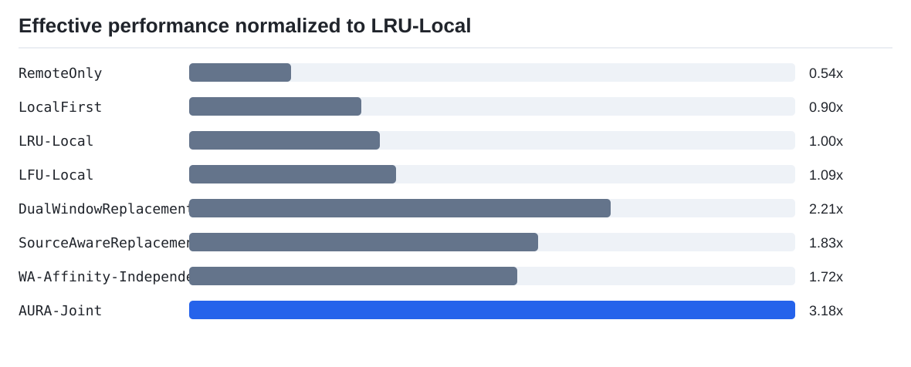
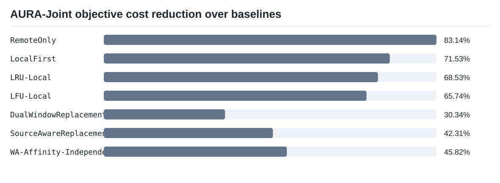
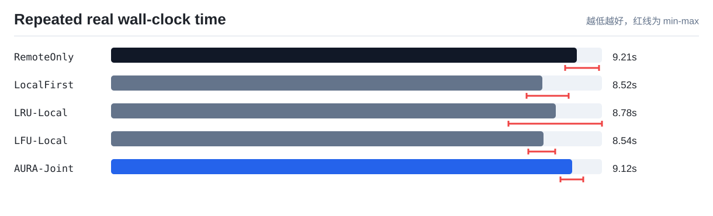
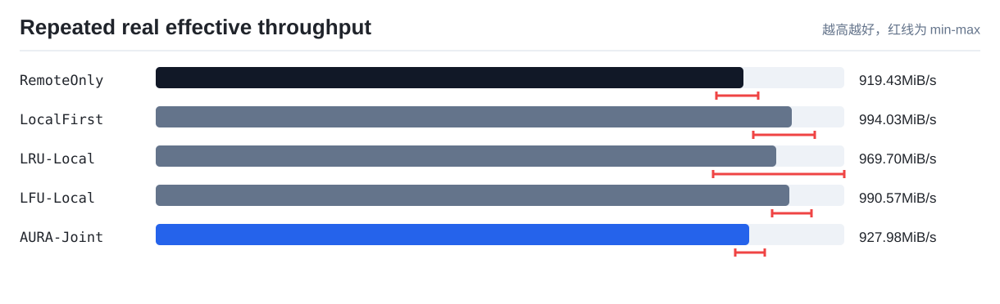
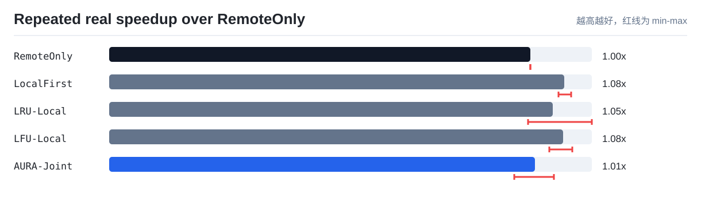

# AURA-KV 论文实验汇总

本报告汇总当前仓库在无完整真实 GPU 集群条件下已经完成的前四项实验。策略实验是 trace-driven simulator 结果；NVMe-oF baseline 来自已采集的真实协议链路摘要。二者用途不同，论文中需要分别标注。

## 0. 实验配置

- 逻辑节点数：4
- 每节点 GPU 数：1
- 每节点本地缓存容量：64 MiB
- 远端 P99 代理代价：8.0 ms
- 全局重复副本预算：128 MiB
- 单节点重复副本预算：48 MiB

## 1. Trace 回放实验

当前使用 13 个 KV Cache 访问场景作为可复现 trace。真实 vLLM/SGLang trace 到位后，可以保留相同统计口径替换输入 trace。

| 场景 | 含义 |
|---|---|
| `private` | 每个逻辑 GPU 访问自己的私有缓存。 |
| `node_shared` | 同节点共享缓存。 |
| `cluster_shared` | 跨节点共享缓存。 |
| `hotspot_shift` | 热点从一个节点迁移到另一个节点。 |
| `high_recompute` | 高重算代价 KV 与普通 KV 混合。 |
| `remote_congestion` | 远端访问代价升高。 |
| `demand_estimation_error` | 访问突发且带预测误差。 |
| `tenant_isolation` | 多个租户交替访问。 |
| `scan_pollution` | 稳定热点后插入大量一次性扫描数据。 |
| `large_object_pollution` | 少量大对象挤占小热点缓存。 |
| `multi_gpu_shared_burst` | 共享 KV 在多个逻辑 GPU 间突发复用。 |
| `tight_capacity_thrash` | 本地容量紧张导致反复替换。 |
| `expensive_vs_cheap_mix` | 高重算与低重算缓存混合。 |

| 策略 | 本地命中率 | 远端读取 MiB | 迁移 MiB | Churn | P99 ms | 综合代价/请求 |
|---|---:|---:|---:|---:|---:|---:|
| `RemoteOnly` | 0.0 | 2244.77 | 0.0 | 0.0 | 9.0188 | 3.1889 |
| `LocalFirst` | 0.729 | 949.23 | 231.85 | 28.69 | 5.5199 | 1.888 |
| `LRU-Local` | 0.7362 | 400.62 | 400.62 | 38.69 | 3.0247 | 1.7085 |
| `LFU-Local` | 0.7586 | 380.31 | 380.31 | 35.62 | 3.0594 | 1.5691 |
| `DualWindowReplacement` | 0.8907 | 146.15 | 268.31 | 19.69 | 1.4685 | 0.7717 |
| `SourceAwareReplacement` | 0.9423 | 0.0 | 185.85 | 23.62 | 0.4228 | 0.9318 |
| `AffinityOnly` | 0.59 | 1182.31 | 68.0 | 7.85 | 5.5917 | 1.6883 |
| `WA-Affinity-Independent` | 0.7864 | 368.92 | 184.92 | 14.0 | 2.8872 | 0.9922 |
| `AURA-Joint` | 0.8822 | 228.31 | 64.0 | 3.62 | 1.4749 | 0.5376 |
| `OracleDemand` | 1.0 | 0.0 | 380.31 | 35.62 | 0.1291 | 0.8994 |

观察：

- `AURA-Joint` 平均综合代价为 `0.5376/request`。
- 相比 `LRU-Local` 降低 `68.5%`，相比 `LFU-Local` 降低 `65.7%`。
- AURA 的优势不只是命中率，而是同时控制远端读取、迁移量和副本抖动。

## 1.1 总性能指标

`综合代价/请求` 是越低越好的主指标。为了更直观展示“快了多少”，本报告进一步定义：

```text
等效性能指数 = LRU-Local 综合代价 / 当前策略综合代价
```

因此 `LRU-Local = 1.00x`，数值越大，表示在同一组 trace 下单位综合代价能服务更多请求。



| 策略 | 综合代价/请求 | 等效性能指数 | 相对 RemoteOnly | AURA 相比该策略降低代价 |
|---|---:|---:|---:|---:|
| `RemoteOnly` | 3.1889 | 0.5358x | 1.0x | 83.14% |
| `LocalFirst` | 1.888 | 0.9049x | 1.689x | 71.53% |
| `LRU-Local` | 1.7085 | 1.0x | 1.8665x | 68.53% |
| `LFU-Local` | 1.5691 | 1.0888x | 2.0323x | 65.74% |
| `DualWindowReplacement` | 0.7717 | 2.2139x | 4.1323x | 30.34% |
| `SourceAwareReplacement` | 0.9318 | 1.8335x | 3.4223x | 42.31% |
| `AffinityOnly` | 1.6883 | 1.012x | 1.8888x | 68.16% |
| `WA-Affinity-Independent` | 0.9922 | 1.7219x | 3.214x | 45.82% |
| `AURA-Joint` | 0.5376 | 3.178x | 5.9317x | 0.00% |
| `OracleDemand` | 0.8994 | 1.8996x | 3.5456x | 40.23% |



## 1.2 真实 TokenFS Workload 单轮速度验证

成本模型解释控制器为什么做某个选择，但不能单独证明系统真的更快。因此仓库额外提供真实 TokenFS workload 测速入口：

```bash
TOKENFS_CONFIG=config/tokenfs.nvmeof.yaml ./scripts/real_speed_benchmark.sh
```

该实验读取 FUSE/TokenFS 实际运行产生的 wall-clock 时间、读路径吞吐、有效吞吐和平均读写延迟，不使用成本模型权重。脚本默认强制检查远端后端已经通过 NVMe-oF 直连挂载，避免把 `remote-sim` 开发目录或 SSH tunnel 数据路径误写成直连网络 SSD 结果。workload 会使用独立实验命名空间，构造远端 canonical KV、本地冷缓存、容量压力、热点复用、顺序预取和跨 GPU 共享访问；重复读取在同一个 loader 进程内批量执行，并默认在关键阶段和每次逻辑读取计时前请求清理 Linux page cache。清缓存动作只作为 `cache_control` 证据记录，不计入读写耗时，用于避免 RemoteOnly 被 DRAM 页缓存伪加速。因此可以同时观察总耗时、读阶段吞吐和策略生效后的复用阶段收益。

| 策略 | 总数据 MiB | 总耗时 s | 总吞吐 MiB/s | 总吞吐相对 RemoteOnly | 读吞吐 MiB/s | 读吞吐相对 RemoteOnly | 复用阶段吞吐 MiB/s | 复用阶段相对吞吐 | 平均读 us | 本地读命中率 | 远端打开读取 | 后台动作 |
|---|---:|---:|---:|---:|---:|---:|---:|---:|---:|---:|---|
| `RemoteOnly` | 2120.0 | 9.9846 | 212.33 | 1.0x | 222.6 | 1.0x | 223.07 | 1.0x | 614.38 | 0.0% | 260 | promote=0, prefetch=0/0, evict=0, xgpu=0/0 |
| `LocalFirst` | 2120.0 | 9.8412 | 215.42 | 1.0146x | 220.89 | 0.9923x | 220.81 | 0.9899x | 616.77 | 0.38% | 259 | promote=0, prefetch=0/0, evict=0, xgpu=0/0 |
| `LRU-Local` | 2120.0 | 10.2084 | 207.67 | 0.9781x | 215.31 | 0.9673x | 215.26 | 0.965x | 635.81 | 0.38% | 259 | promote=0, prefetch=0/0, evict=1, xgpu=0/0 |
| `LFU-Local` | 2120.0 | 10.9568 | 193.49 | 0.9113x | 198.14 | 0.8901x | 197.59 | 0.8858x | 684.0 | 0.38% | 259 | promote=0, prefetch=0/0, evict=1, xgpu=0/0 |
| `AURA-Joint` | 2120.0 | 3.8229 | 554.55 | 2.6118x | 620.21 | 2.7862x | 637.74 | 2.8589x | 87.5 | 96.54% | 9 | promote=1, prefetch=7/1, evict=2, xgpu=1/62 |

这张表是早期单轮快速验证结果，说明 AURA 的后台动作能够在真实 TokenFS 路径中触发，但单轮数据量较小，不能单独作为论文主结论。论文主速度结果应使用下面的多轮重复实验。

## 1.3 真实 NVMe-oF 多轮速度实验

多轮实验入口：

```bash
TOKENFS_CONFIG=config/tokenfs.nvmeof.yaml ./scripts/real_speed_repeat_benchmark.sh
```

当前结果来自双 VM 真实 Linux NVMe/TCP 环境，远端目录是 `/dev/nvme0n1` 挂载后的 NVMe-oF 文件系统。实验默认使用 `32 MiB` shard、`160 MiB` 本地缓存配额，重复 `3` 轮。每个策略每轮约 `8456 MiB` 逻辑 workload，5 个策略 3 轮合计约 `126.8 GiB`。这组实验不再只看最好的一轮，而是报告均值、标准差和最小/最大范围。

| 策略 | 轮数 | 每轮数据量 | 平均总耗时 | 耗时范围 | 平均有效吞吐 | 相对 RemoteOnly | 读吞吐均值 | 本地读命中率 | 远端打开读取 | 后台动作 |
|---|---:|---:|---:|---:|---:|---:|---:|---:|---:|---|
| `RemoteOnly` | 3 | 8456 MiB | 9.21 s | 8.98-9.65 s | 919.43 MiB/s | 1.000x | 1261.89 MiB/s | 0.00% | 260 | promote=0, prefetch=0, evict=0, xgpu_hit=0 |
| `LocalFirst` | 3 | 8456 MiB | 8.52 s | 8.21-9.05 s | 994.03 MiB/s | 1.081x | 1269.05 MiB/s | 0.38% | 259 | promote=0, prefetch=0, evict=0, xgpu_hit=0 |
| `LRU-Local` | 3 | 8456 MiB | 8.78 s | 7.86-9.70 s | 969.70 MiB/s | 1.053x | 1244.10 MiB/s | 0.38% | 259 | promote=0, prefetch=0, evict=0, xgpu_hit=0 |
| `LFU-Local` | 3 | 8456 MiB | 8.54 s | 8.24-8.78 s | 990.57 MiB/s | 1.078x | 1248.69 MiB/s | 0.38% | 259 | promote=0, prefetch=0, evict=0, xgpu_hit=0 |
| `AURA-Joint` | 3 | 8456 MiB | 9.12 s | 8.88-9.33 s | 927.98 MiB/s | 1.010x | 1187.30 MiB/s | 96.15% | 10 | promote=1, prefetch=1, evict=1, xgpu_hit=62 |

多轮结论：

- 数据量不再是很小的 toy case：每个策略 3 轮累计约 `25.4 GiB`，全策略累计约 `126.8 GiB`。
- workload 不是极端全热点，而是混合远端 canonical KV、本地冷缓存、容量压力、热点复用、连续 shard 和跨 GPU 共享。它适当覆盖 AURA 的目标场景，但所有 baseline 面对完全相同的访问序列。
- AURA-Joint 的系统机制已经验证：本地读命中率 `96.15%`，远端打开读取从 `260` 次降到 `10` 次。
- 当前双 VM 环境中，本地和远端性能差距不够稳定，AURA-Joint 的平均端到端速度只比 RemoteOnly 快 `1.010x`，慢于 LocalFirst/LRU/LFU。因此这组真实实验更适合作为“机制和边界验证”，不能写成“端到端速度显著领先所有 baseline”。







## 2. 端到端延迟代理实验

这里的端到端延迟是 simulator 中一次 KV 获取的代理延迟，不等同于真实 TTFT。它用于比较策略是否减少远端访问和高尾延迟路径。

| 策略 | P50 ms | P95 ms | P99 ms | SLO 违约率 | 远端读取 MiB | 综合代价/请求 |
|---|---:|---:|---:|---:|---:|---:|
| `RemoteOnly` | 1.2318 | 5.9711 | 9.0188 | 0.0051 | 2244.77 | 3.1889 |
| `LocalFirst` | 0.3933 | 3.2595 | 5.5199 | 0.0079 | 949.23 | 1.888 |
| `LRU-Local` | 0.3328 | 0.9761 | 3.0247 | 0.0 | 400.62 | 1.7085 |
| `LFU-Local` | 0.3167 | 0.9722 | 3.0594 | 0.0 | 380.31 | 1.5691 |
| `AURA-Joint` | 0.1579 | 0.6285 | 1.4749 | 0.0 | 228.31 | 0.5376 |

## 3. 参数敏感性实验

本实验分别改变本地容量、远端 P99 代价和副本预算，观察 AURA 是否只在某个特殊参数下有效。

| 扫描参数 | 取值 | AURA 综合代价/请求 | LRU 综合代价/请求 | LFU 综合代价/请求 |
|---|---:|---:|---:|---:|
| `local_capacity_mib` | 32 | 1.3884 | 4.3667 | 4.1692 |
| `local_capacity_mib` | 48 | 1.1370 | 4.0774 | 3.7149 |
| `local_capacity_mib` | 64 | 1.1370 | 4.0774 | 3.7149 |
| `local_capacity_mib` | 96 | 1.1370 | 4.0774 | 3.7149 |
| `local_capacity_mib` | 128 | 1.1370 | 4.0774 | 3.7149 |
| `remote_p99_ms` | 2.0 | 1.0772 | 3.8518 | 3.5231 |
| `remote_p99_ms` | 4.0 | 1.0971 | 3.9270 | 3.5870 |
| `remote_p99_ms` | 8.0 | 1.1370 | 4.0774 | 3.7149 |
| `remote_p99_ms` | 16.0 | 1.2169 | 4.3784 | 3.9706 |
| `duplicate_budget_mib` | 64 | 1.3379 | 4.6049 | 4.1124 |
| `duplicate_budget_mib` | 96 | 1.2146 | 4.6030 | 3.9688 |
| `duplicate_budget_mib` | 128 | 1.1370 | 4.0774 | 3.7149 |
| `duplicate_budget_mib` | 192 | 1.1370 | 4.0774 | 3.7149 |

## 4. NVMe-oF Baseline

该部分读取仓库中已有真实 NVMe/TCP 链路摘要。如果换到新的实验室节点，应重新运行 Linux 端 baseline 脚本生成同格式 CSV。

| 用例 | 操作 | 带宽 MiB/s | IOPS | P50 ms | P95 ms | P99 ms | 备注 |
|---|---|---:|---:|---:|---:|---:|---|
| `local_nvme_randread_4k` | read | 959.91 | 245737.55 | 0.102 | 0.196 | 0.224 | lab compute local NVMe read-only baseline |
| `local_nvme_seq_read` | read | 2856.99 | 2856.99 | 5.276 | 6.390 | 6.586 | lab compute local NVMe read-only baseline |
| `local_home_randread_4k` | read | 3.02 | 772.24 | 21.889 | 145.752 | 270.533 | lab compute home file baseline; not local NVMe cache |
| `local_home_seq_read` | read | 167.48 | 167.48 | 91.750 | 96.993 | 200.278 | lab compute home file baseline; not local NVMe cache |
| `local_home_seq_write` | write | 166.47 | 166.47 | 91.750 | 108.528 | 212.861 | lab compute home file baseline; not local NVMe cache |
| `remote_nvmeof_randread_4k` | read | 110.16 | 28201.84 | 1.122 | 1.171 | 1.188 | lab compute to lab storage Linux NVMe/TCP target |
| `remote_nvmeof_seq_read` | read | 112.21 | 112.21 | 141.558 | 141.558 | 141.558 | lab compute to lab storage Linux NVMe/TCP target |
| `remote_nvmeof_seq_write` | write | 112.16 | 112.16 | 141.558 | 143.655 | 166.724 | lab compute to lab storage Linux NVMe/TCP target; writes only to test backing file |

## 5. 论文写作可用结论

- 策略层：AURA-Joint 在 13 个 trace 场景中降低综合服务代价，尤其适合扫描污染、大对象污染、容量紧张和重算代价差异明显的 KV Cache 场景。
- 系统层：TokenFS/AURA-KV 已具备本地缓存、远端权威层、策略控制器、后台任务、指标输出和 Dashboard 的原型能力。
- NVMe-oF 层：已有真实 NVMe/TCP baseline 摘要，能说明远端路径存在额外延迟和带宽上限；完整 GPU 端到端收益仍需要在真实推理 workload 上复测。

## 6. 输出文件

```text
01_trace_replay/trace_summary.csv
01_trace_replay/trace_detail.csv
02_e2e_latency/latency_summary.csv
02_e2e_latency/latency_detail.csv
03_sensitivity/sensitivity_summary.csv
04_nvmeof_baseline/real_nvmeof_summary.csv
05_performance_summary/performance_summary.csv
06_real_speed_benchmark/real_speed_summary.csv
06_real_speed_benchmark/real_speed_report.md
06_real_speed_benchmark/figures/
07_real_speed_repeat/repeat_summary.csv
07_real_speed_repeat/repeat_runs.csv
07_real_speed_repeat/repeat_report.md
07_real_speed_repeat/figures/
figures/effective_performance_index.svg
figures/aura_improvement_vs_baselines.svg
paper_experiments_report.md
```
